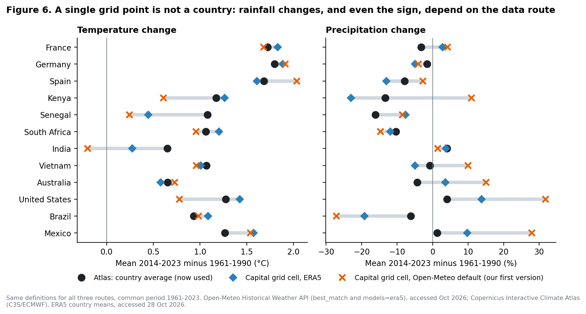
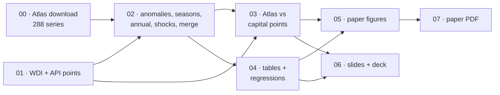
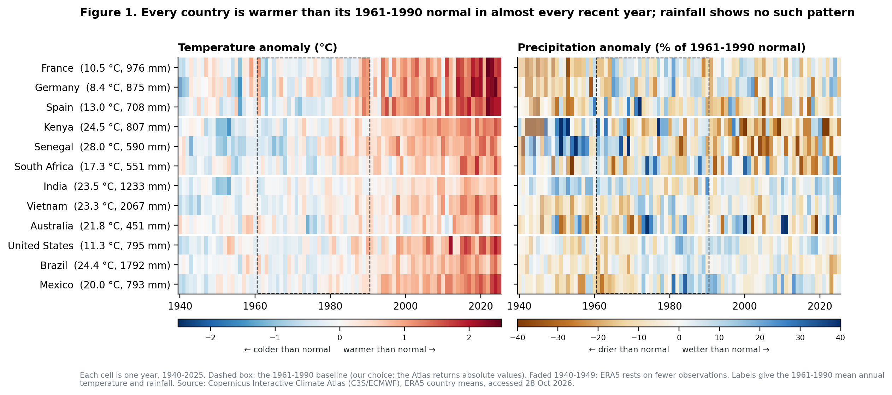
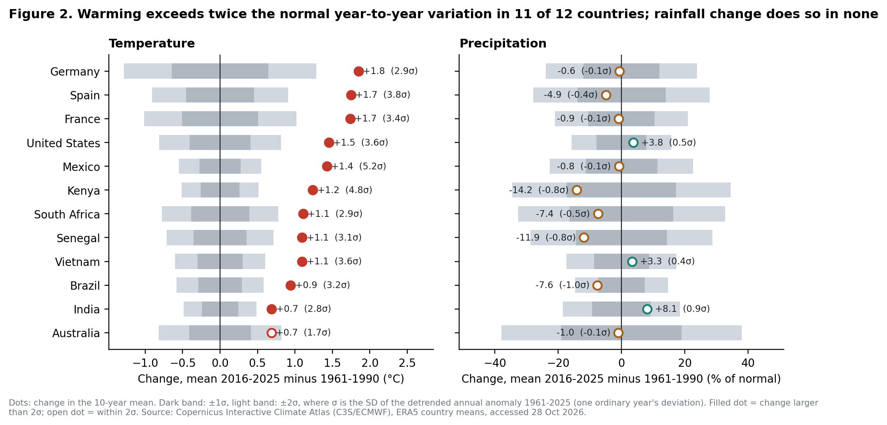
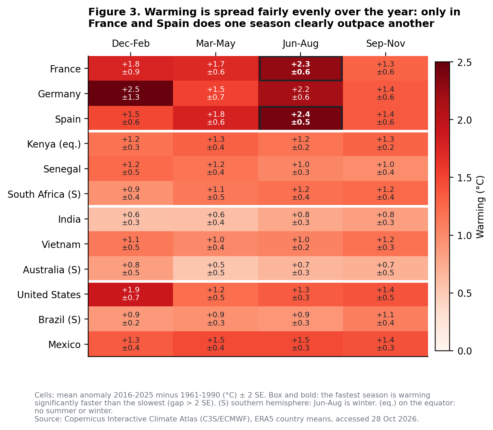
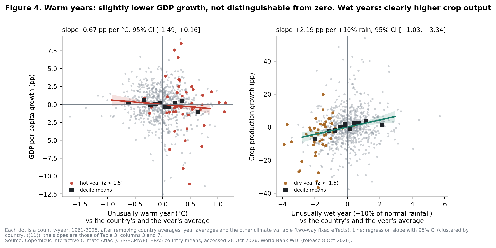
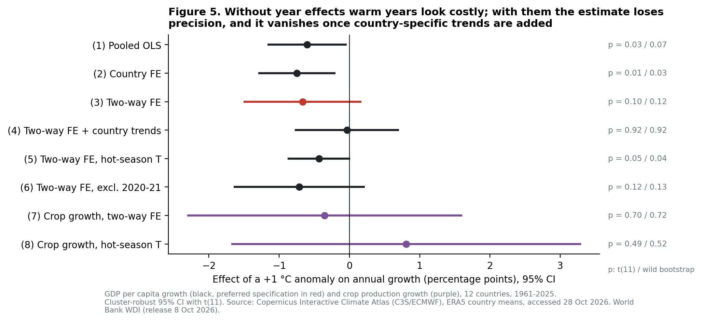

# Warming, rainfall and growth in 12 countries, 1940–2025

**Environmental Economics · ESSEC BSc AIDAMS · T1 2026–2027 · Track 1: temperature and precipitation records**
**Group:** Eliott Beghin · Pollux Gronier · Saty Viard Laroque · Augustin Vlandas
**Course:** Caterina Seghini, ESSEC Department of Economics

<p align="center"></p>

> **The project in one sentence.** We took 85 years of temperature and rainfall records for 12 countries, measured how much the climate has changed compared with what a normal year looks like, and checked whether the unusual climate years also show up in the economy (GDP growth and harvests).

This README is written for someone who has **never heard of the project**. Read it top to bottom once and you will know what we did, why, how, where every file is, and how to explain it.

---

## Contents

**Part A: Understand the project**
1. [Where this comes from: the course and the assignment](#1-where-this-comes-from-the-course-and-the-assignment)
2. [The question, in plain words](#2-the-question-in-plain-words)
3. [The answer in six numbers](#3-the-answer-in-six-numbers)
4. [Key ideas you need (no prior knowledge assumed)](#4-key-ideas-you-need-no-prior-knowledge-assumed)
5. [How the project evolved: from version 1 to the final version](#5-how-the-project-evolved-from-version-1-to-the-final-version)

**Part B: The data and the method**

6. [How we got every dataset](#6-how-we-got-every-dataset)
7. [Every choice we made, and why](#7-every-choice-we-made-and-why)
8. [The pipeline: what each script does](#8-the-pipeline-what-each-script-does)

**Part C: Results**

9. [The results, figure by figure, and how to read them](#9-the-results-figure-by-figure-and-how-to-read-them)
10. [What we can and cannot conclude](#10-what-we-can-and-cannot-conclude)

**Part D: Using the repository**

11. [The repository, file by file](#11-the-repository-file-by-file)
12. [How to run everything, from zero](#12-how-to-run-everything-from-zero)
13. [The presentation (9 November)](#13-the-presentation-9-november)
14. [Glossary](#14-glossary)
15. [FAQ: questions the professor may ask](#15-faq-questions-the-professor-may-ask)
16. [Use of AI, good practice, references](#16-use-of-ai-good-practice-references)

---

# Part A: Understand the project

## 1. Where this comes from: the course and the assignment

- **Course:** *Environmental Economics*, BSc AIDAMS (ESSEC × CentraleSupélec), term 1 2026–2027.
- **Assignment** (`docs/assignment_brief.pdf`): ten groups, one "track" each. Each group must take a real public dataset, understand what it measures, and use it to answer a precise question.
- **Our track: Track 1, temperature and precipitation records.** The brief asks four things:
  1. Plot temperature and precipitation over the full available record for countries in different regions.
  2. Compute **monthly anomalies** against a baseline we choose and state.
  3. Describe each series: how much has it changed, how large is year-to-year variation compared with that change, and where has the change been largest? Does rainfall move where temperature moves?
  4. Either check whether unusually warm or dry years were also unusual for the **economy** (World Bank data), or check whether some **seasons** warm faster than others. **We did both.**
- **Deliverables:**
  - a paper of at most 10 pages, due **2 November 2026** (`paper/PAPER.pdf`);
  - the code that reproduces every result from the raw data (`scripts/`);
  - a 10-minute talk plus 3 minutes of questions on **9 November 2026** (`presentation/`).
- **How it is graded:**
  - honesty about what the data measure;
  - figures that can be read on their own;
  - economic reasoning;
  - claims that match the design (correlation is not causation);
  - a clear position;
  - clarity.

The brief insists on one thing above all: *"A clear, honest analysis of a simple question is worth more than an ambitious claim the analysis cannot support."* Everything in this repository follows that line.

## 2. The question, in plain words

Every plan people make, a harvest, a dam, a heating system, an insurance price, assumes that **a normal year looks like the normal years we remember**. So we ask:

1. **How much** have temperature and rainfall changed since 1961–1990, in 12 very different countries?
2. **Is that change big compared with normal ups and downs?** One hot summer means nothing on its own. A whole decade that is hotter than almost any year of the past does.
3. **Where and when?** Which countries changed most? Does rainfall change in the same places? Does every season warm equally?
4. **Does the economy notice?** In the years that were unusually hot or dry, did GDP growth or harvests do worse than usual?

**Why these 12 countries?** Three per continent, chosen to cover very different climates and economies:

| Europe | Africa | Asia-Pacific | Americas |
|---|---|---|---|
| France, Germany, Spain | Kenya, Senegal, South Africa | India, Vietnam, Australia | United States, Brazil, Mexico |
| temperate, continental, Mediterranean | highland tropics, Sahel, subtropical | monsoon, tropical, dry | temperate, tropical, highland |

Agriculture is about 1 % of GDP in Germany and the USA, but 15–23 % in Kenya, Senegal and India. That contrast matters for question 4.

## 3. The answer in six numbers

| | Finding | What kind of claim |
|---|---|---|
| 🌡️ **+0.7 to +1.85 °C** | Warming of 2016–2025 compared with 1961–1990, from India and Australia (+0.7) to Germany (+1.85). **All 120** country-years since 2016 were warmer than their 1961–1990 normal. | description |
| 📏 **11 / 12** | Countries where that warming is more than **twice the normal year-to-year variation**. Mexico: 5.2 times. Australia is the exception (1.7), because its climate swings a lot. | description |
| 🌧️ **0 / 12** | Countries where the **rainfall** change exceeds twice the normal variation. And rainfall does not change where warming is largest. | description |
| 🗓️ **2 / 12** | Countries where one season clearly warms faster: **France and Spain**, where summer leads by about 1 °C. | description |
| 🌾 **+2.2 points** | Crop growth in a year with 10 % more rain than normal. Dry years: crops −7.6 points. In 9 of the 12 hottest summers on record, crops fell by more than 5 points (France 2003: −21). | correlation |
| 📉 **−0.67 points per °C** | GDP-per-capita growth in a warmer-than-usual year. But the uncertainty range (−1.49 to +0.16) includes zero, and the effect vanishes in a stricter model. | correlation, **not** causal |

**In one sentence:** the warming is unmistakable and far outside normal variability; rainfall change is local and noisy; climate shocks show up in harvests long before they show up in GDP.

## 4. Key ideas you need (no prior knowledge assumed)

### Climate side

- **Weather vs climate.** Weather is what happens on a given day or year. Climate is the *usual* weather, averaged over decades. A single hot year is weather; a decade of hot years is a climate shift.
- **ERA5 (a "reanalysis").** There is no thermometer in every square kilometre. ERA5, produced by the European weather centre ECMWF, takes millions of real observations (weather stations, balloons, ships, satellites) and feeds them into a weather model, which fills the gaps consistently. The result is a complete map of the weather every hour since 1940, on a grid of ~28 km squares. It is the standard dataset climate scientists use.
- **Copernicus Interactive Climate Atlas.** A website from the EU's Copernicus climate service. It takes ERA5 and **averages it over a region**, for example a country, then lets you download the time series. This is the source the brief recommends, and the one we use.
- **Anomaly.** The difference from normal. If Paris is usually 19.0 °C in July (1961–1990 average) and July 2022 was 21.5 °C, the July 2022 anomaly is **+2.5 °C**. Anomalies remove the seasons, so a January can be compared with a July (in France, the seasons are 92 % of the month-to-month variation).
- **Baseline.** The "normal" period used for anomalies. We chose **1961–1990**: it is the official World Meteorological Organization reference period, it comes before most of the warming, and our economic data also start in 1961. The Atlas gives raw values, not anomalies, so this choice was ours to make and to state.
- **Noise (σ, "sigma").** How much a normal year differs from the long-run trend. If σ = 0.5 °C, an ordinary year is typically within ±0.5 °C of the trend.
- **Signal-to-noise (Δ/σ).** The change (Δ, last 10 years against the baseline) divided by the noise. Above 2, the recent climate is outside what normal variation produces: people cannot mistake it for a "normal year".
- **Hot season.** Each country's three warmest months (Jun–Aug in France, Dec–Feb in South Africa). We use it because a summer heatwave barely moves the annual average: France 2003 is an ordinary-looking year (1.2σ) but an extreme summer (3.4σ).

### Economics side

- **GDP per capita growth.** How much the average income grew that year (%). We use growth, not the level, because weather shocks affect one year's output.
- **Crop production index.** A World Bank index of the volume of crops produced. Its yearly change is our measure of harvests.
- **Panel regression.** One regression on all 12 countries × 65 years at once (756 country-years).
- **Fixed effects.**
  - **Country effects** compare each country only with itself. Vietnam always grows faster than Senegal, and that has nothing to do with the weather.
  - **Year effects** compare countries *within the same year*. They remove what hit everyone at once: oil shocks, the 2009 crisis, COVID, and the global warming trend itself.
  - With both ("two-way fixed effects"), what is left is "this country was warmer than usual compared with the others that year". That is close to random, which is what makes it informative.
- **Standard error, confidence interval, p-value.** How precise an estimate is. A 95 % confidence interval that includes zero means we cannot rule out "no effect".
- **Clustering and the wild bootstrap.** Years of the same country are not independent, so we "cluster" by country. With only 12 countries, standard formulas are too optimistic. The **wild cluster bootstrap** is a simulation method that gives honest p-values with few clusters.
- **Correlation vs causation.** Two things moving together does not prove one causes the other. Our economic results are *correlations*. We explain in §10 what it would take to make them causal.

## 5. How the project evolved: from version 1 to the final version

1. **Version 1 (October).** We downloaded daily weather from a free API (Open-Meteo) at **one point per capital city**, from 1960 to 2023, and ran the analysis.
2. **Audit (27 October).** We checked version 1 against the brief and found several real problems:
   - **Wrong source.** The brief recommends the Copernicus Atlas, and we had used an API.
   - **Wrong product.** We had not specified the model, so the API returned a different product (ERA5-Land) from the one we described (ERA5).
   - **A city is not a country.** One grid point at a capital stood in for a whole country.
   - **Unsupported claims.** Some statements contradicted our own numbers (e.g. "Europe's summers warm fastest", false for Germany), and some figures had no source.
   - The full list is in [`docs/AUDIT_first_version.md`](docs/AUDIT_first_version.md).
3. **Final version (28 October to 2 November).**
   - **Data:** re-downloaded everything from the **Copernicus Atlas** as **country averages**, 1940–2025, and kept the API data only as a **comparison**. That comparison became a finding in itself: for rainfall, the data route changes the answer (§6.3).
   - **Analysis:** rewrote it with honest uncertainty: noise σ, standard errors, wild bootstrap, and all model variants reported.
   - **Write-up:** rewrote the paper, the figures and the presentation.
   - **Final check:** [`docs/AUDIT_final.md`](docs/AUDIT_final.md).

---

# Part B: The data and the method

## 6. How we got every dataset

We use three sources: one primary climate source, one economic source, and one climate source kept only to show why we did *not* use it.

### 6.1 Climate: Copernicus Interactive Climate Atlas, ERA5 (primary)

| | |
|---|---|
| **Producer** | Copernicus Climate Change Service (C3S), implemented by ECMWF |
| **Product** | [Copernicus Interactive Climate Atlas](https://atlas.climate.copernicus.eu/atlas), dataset **ERA5** (global reanalysis, 0.25° grid, Hersbach et al. 2020) |
| **Variables** | `t`: mean of daily mean 2 m air temperature (°C); `pr`: mean of daily accumulated precipitation (mm/day) |
| **What we downloaded** | 12 countries × 2 variables × 12 calendar months = **288 series**, each 1940–2025 → 24,768 country-month values |
| **Spatial unit** | the **area average over each country** |
| **Accessed** | 28 October 2026 (`data/raw/atlas/DOWNLOAD_LOG.json`) |
| **Files** | `data/raw/atlas/json/*.json` (raw server responses, untouched) → `data/raw/atlas/atlas_era5_monthly.csv` (tidy) |

**How the download works.** On the Atlas website you choose the dataset (ERA5), a variable, a month and a region, then click *Regional information → Download data → CSV*. By watching the browser's network traffic we saw that this CSV is built from a JSON time series sent by the Atlas server. `scripts/00_download_atlas.py` sends exactly those requests, so its numbers are the CSV-button numbers, without 288 manual downloads. The manual click-path is in [`data/README.md`](data/README.md), so anyone can check a series by hand.

**How a "country" is defined in the Atlas.** This was the main data problem.
- **France, Germany, Spain.** The Atlas has a *European countries* region set, so we use its own country masks.
- **The other 9 countries.** Outside Europe the Atlas only offers large IPCC regions such as "Western Africa", which cross borders. Its **user-defined region** tool accepts any shape. We upload each country's real border (Natural Earth, 1:50 m), and the Atlas computes the country average as a server-side job.
- **United States.** The 48 contiguous states, so that Alaska does not dominate a "US climate" the US economy barely lives in.
- **Validation.** We ran France through the user-defined route too. It matches the Atlas's own France mask to **0.004 °C** (`data/raw/atlas/validation_france_user_defined_vs_mask.json`). All 12 countries are measured the same way.

**Units we derive.**
- Monthly rain (mm) = `pr` (mm/day) × days in the month.
- Annual temperature = day-weighted mean of the 12 months.
- Annual rain = sum of the 12 months.

### 6.2 Economy: World Bank World Development Indicators (WDI)

| | |
|---|---|
| **Producer / dataset** | World Bank, World Development Indicators, **release of 8 October 2026** |
| **Access** | WDI API v2, no key needed, accessed 28 October 2026 |
| **Indicators used** | `NY.GDP.PCAP.KD.ZG` real GDP per capita growth (%) · `AG.PRD.CROP.XD` crop production index (2014–16 = 100) · `NV.AGR.TOTL.ZS` agriculture value added (% of GDP) |
| **Downloaded, not used** | `NY.GDP.MKTP.KD.ZG` real GDP growth (robustness) |
| **File** | `data/raw/worldbank_wdi.csv` (+ `worldbank_wdi_metadata.json` with release and access dates) |

**Merge.** Climate and economy are matched on (country code, year) for 1961–2025, giving 780 country-years. Every climate year finds a WDI row; the gaps are on the WDI side:

| Gap | Effect |
|---|---|
| Vietnam's GDP growth starts in 1985 | **756** growth observations instead of 780 |
| The crop index ends in 2023 | 756 crop-growth observations |
| The agriculture share starts late (Germany 1991, Spain 1995, USA 1997, Australia 1990) | used for description only |
| Germany before 1991 | the World Bank's reconstruction of unified Germany |

### 6.3 Comparison only: the API at the capital (our version 1)

We kept version 1's files (`data/raw/openmeteo/best_match/`) and downloaded the same points with the correct model (`data/raw/openmeteo/era5/`). `scripts/03_compare_sources.py` puts all three routes through identical definitions:

| Over 1961–2023 | Temperature | Rainfall |
|---|---|---|
| Correlation, ERA5 capital point vs country (median) | 0.91 | 0.73 (only 0.39 in the USA) |
| Gap in the measured change, version 1 vs country (median) | 0.19 °C | 9.2 percentage points |
| Worst case | India: −0.20 °C at the point vs **+0.65 °C** for the country | USA: +32 % vs **+4 %**; Kenya: +11 % vs **−13 %** (sign flips) |

**Why rain is so sensitive.** A warm year is warm over hundreds of kilometres. Rain depends on storm tracks, mountains and coasts, and a capital is not a random point: Dakar is on the ocean, Mexico City in a high valley. **This is the project's first lesson: check what the data measure before using them.**

<p align="center"></p>

## 7. Every choice we made, and why

Each choice is one a reader could challenge. For each we give the alternative we rejected.

### Sample

| Choice | Why | Alternative rejected |
|---|---|---|
| **12 countries, 3 per continent** | Covers very different climates and agriculture shares from 1 % to 23 % of GDP. 12 is also about the minimum for clustered statistics. | One region only: no contrast. |
| **Country averages** | The question is about countries, and GDP is national. | One point at the capital: fails for rain (§6.3). IPCC regions: cross borders. |
| **USA = 48 contiguous states** | Where the US economy and its farms are. | Alaska would be about 18 % of the area. |
| **ERA5** | Global, gap-free, consistent over time; the Atlas's longest record (from 1940). | E-OBS is Europe only; station data have gaps. |
| **Change measured from 1961; 1940–1960 shown only** | ERA5 rests on fewer observations before ~1950, and for African rainfall before satellites (1979). 1961 is also the start of the WDI data. | Using 1940 would lean on the weakest data. |

### Climate definitions

| Choice | Why | Alternative rejected |
|---|---|---|
| **Monthly anomalies** | Required by the brief; they remove the seasons. | Annual values only: no seasons. |
| **Baseline 1961–1990** | WMO reference, mostly before the warming, start of the economic data. | 1991–2020 already contains much of the warming. |
| **Change = mean 2016–2025 minus baseline** | A 10-year mean smooths odd years. | First vs last year: pure noise. |
| **Trend = slope per decade, Newey–West errors** | A second measure that uses every year; the errors allow neighbouring years to be correlated. | — |
| **Noise σ = SD around the trend** | How far an ordinary year strays; removing the trend stops the warming being counted as noise. | Raw SD: inflated by the trend. |
| **Threshold 2σ** | Outside the range of ~95 % of ordinary years. A reading rule, not a test. | — |
| **Rain in % of normal** | Makes dry Senegal (590 mm) and wet Vietnam (2,067 mm) comparable. | mm: scale-dependent. |
| **Seasons labelled by calendar (DJF, MAM, JJA, SON)** | JJA is summer in the north, winter in the south. | "Summer/winter" labels: wrong in the south. |
| **Hot season = 3 warmest months** | Catches heatwaves that annual means hide. | Annual temperature only: misses 2003. |
| **Shock year = more than 1.5σ from the trend** | The most extreme ~7 % of years in each country; "hot" does not just mean "recent". | Raw anomalies: every recent year would be a shock. |

### Economic definitions and statistics

| Choice | Why | Alternative rejected |
|---|---|---|
| **GDP per capita growth** | Weather hits one year's output (Dell, Jones & Olken 2012). | GDP levels: trending, spurious correlations. |
| **Crop production growth** | The most directly exposed output. | Agriculture share in levels: driven by structural change. |
| **Two-way fixed effects** | Removes country differences and common shocks; what is left is close to random weather. | Country effects only: gives a misleading "significant" −0.75 (§9). |
| **Cluster by country + wild bootstrap** | Honest uncertainty with only 12 countries. | Plain OLS errors: far too small. |
| **8 model variants, all reported** | No cherry-picking of the one that "works". | Showing only the best-looking model. |
| **Effects in points per °C and per typical warm year** | The brief asks for effects "in the units of the problem". | Signs and stars only. |

## 8. The pipeline: what each script does

The scripts are numbered. Run them in order; each reads what the previous ones wrote.



| Script | In plain words | Reads | Writes |
|---|---|---|---|
| **`00_download_atlas.py`** | Downloads the 288 climate series from the Copernicus Atlas (country masks for FRA/DEU/ESP, uploaded borders for the 9 others). Keeps a copy of every server answer; retries when the server hiccups; runs 6 requests at a time. | Atlas website, Natural Earth borders | `data/raw/atlas/…` (288 JSON files, tidy CSV, borders, download log) |
| **`01_download_data.py`** | Downloads the World Bank indicators (and the release date), and the API capital points used only for the comparison. | World Bank API, Open-Meteo API | `data/raw/worldbank_wdi.csv`, `data/raw/openmeteo/…` |
| **`02_process_data.py`** | Turns raw values into the brief's quantities: monthly totals, 1961–1990 normals, monthly anomalies, seasons, hot season, annual series, shock years; then merges with the economy. | Atlas CSV, WDI CSV | `data/processed/climate_monthly.csv`, `climate_seasonal.csv`, `climate_annual.csv`, `panel.csv` |
| **`03_compare_sources.py`** | Applies identical definitions to the country average and to the two capital-point versions, to measure how much the data route matters. | processed + API files | `paper/tables/table_A1_source_comparison.*` |
| **`04_run_econometrics.py`** | Produces every table: change, noise and trends (1), economy summary (1b), seasons (2), regressions with bootstrap (3), shock vs normal years (4), most extreme year per country (5). About 1 minute. | processed files | `paper/tables/*.csv` and `*.md`, `data/processed/regression_results_raw.csv` |
| **`05_generate_figures.py`** | Draws the paper's figures. Each has its units, period and source, and its conclusion as its title. | processed files, tables | `figures/fig1…fig6, figA1` |
| **`06_presentation.py`** | Draws the slide charts, builds a PowerPoint with speaker notes, and writes the spoken script. All numbers are read from the tables, so slides and paper always agree. | processed files, tables | `presentation/figures/`, `Track1_presentation.pptx`, `SCRIPT.md` |
| **`07_build_paper_pdf.py`** | Turns `paper/PAPER.md` into an A4 PDF (via Chrome or Edge) to check the 10-page limit. | `PAPER.md`, figures | `paper/PAPER.pdf` |

The notebook `notebooks/track1_climate_economics.ipynb` runs the same scripts and shows each table and figure inline, if you prefer Jupyter.

---

# Part C: Results

## 9. The results, figure by figure, and how to read them

**Figure 1: the full record (brief step 1).** Each row is a country, each small vertical stripe one year since 1940.
- **Left, temperature:** blue = colder than the 1961–1990 normal, red = warmer.
- **Right, rainfall:** brown = drier, green = wetter.
- **Read:** temperature turns red everywhere after the 1980s; rainfall flickers with no direction.



**Figure 2: signal vs noise (brief step 3).**
- **Dots:** the change, last decade against 1961–1990.
- **Grey bands:** ±1σ and ±2σ of normal variation.
- **Filled dot:** a change larger than 2σ.
- **Read:** temperature is beyond 2σ in 11 of 12 countries; rainfall is never beyond 2σ.



**Figure 3: seasons (brief step 4b).**
- **Each cell:** warming in one season, with its margin of error.
- **Boxed cells:** a season that warms clearly faster than the slowest one.
- **Read:** only France and Spain have one (summer). Germany's winter warmed a lot (+2.5 °C), but winters there vary too much to call it faster.



**Figure 4: climate and the economy (brief step 4a).** Each dot is a country-year after removing the country's and the year's averages.
- **Left, heat vs GDP:** a slight downward slope, but the band includes flat.
- **Right, rain vs crops:** a clear upward slope.
- **Read:** shocks reach harvests, not national GDP.



**Figure 5: why the GDP answer depends on the model.**
- **Without year effects:** the effect looks significant (−0.75, p = 0.01). That is partly because the world warmed while growth slowed after the 1960s.
- **With year effects (preferred, red):** −0.67, but the interval crosses zero (bootstrap p = 0.12).
- **With country trends:** about 0.



**Figure 6: the data route** (§6.3). Country average vs one grid point at the capital: close for temperature, very different for rain.

**Extreme years** (`paper/tables/table5_landmark_years.md`):
- **France, summer 2003:** crops −21 points against normal, GDP −1.5.
- **Germany 2003:** crops −18.
- **USA 1988:** crops −14.
- **Senegal 1983 (driest year):** crops −35.
- **Counter-examples:** India 2010 and Mexico 1980.

All tables are in [`paper/tables/`](paper/tables/), each as `.csv` (for computing) and `.md` (for reading).

## 10. What we can and cannot conclude

- **Descriptions (solid):**
  - every country has warmed, beyond normal variability in 11 of 12;
  - rainfall change is within the noise;
  - southern Europe's warming is summer-heavy.
- **Correlations (clear for crops, weak for GDP):**
  - wet years go with higher harvests and dry years with lower ones;
  - warm years go with slightly lower GDP growth, but 12 countries cannot distinguish that from zero.
- **Not claimed:**
  - **No causal effect on GDP.** The estimate is too imprecise and changes with the model.
  - **No effect of *climate change* itself.** One unusual year allows no adaptation (irrigation, new crops) and no build-up of damage.
  - **Why national figures understate local losses:** national averages hide regional ones.
- **To make it causal we would need:**
  - many more units (all countries, or regions);
  - weather weighted by where crops and people are;
  - a mechanism chosen before looking at the results.
- **Limits:**
  - 12 countries;
  - ERA5 rain is modelled, not measured by gauges;
  - country averages weight deserts and cities alike;
  - the agriculture share starts late for some countries.

---

# Part D: Using the repository

## 11. The repository, file by file

```
Environemental-economics-/
│
├── README.md                       ← this file
├── requirements.txt                ← Python packages to install
│
├── paper/                          ← WHAT WE HAND IN
│   ├── PAPER.md                    ← the paper (source text)
│   ├── PAPER.pdf                   ← the paper as submitted (9 pages incl. references)
│   ├── PAPER.html, assets/         ← intermediate files used to build the PDF
│   └── tables/                     ← every table of the paper, .csv + .md
│       ├── table1_climate_summary        change, noise, trends by country
│       ├── table1b_economy_summary       growth, crops, agriculture share
│       ├── table2_seasonal_change        warming by season, with errors
│       ├── table3_regressions            the 8 regression models
│       ├── table4_shock_years            growth in shock vs normal years
│       ├── table5_landmark_years         each country's most extreme year
│       └── table_A1_source_comparison    country average vs capital point
│
├── scripts/                        ← THE CODE, run 00 → 07 in order (see §8)
│
├── data/
│   ├── README.md                   ← data sheet: sources, dates, manual Atlas steps
│   ├── raw/                        ← downloads, never modified
│   │   ├── atlas/                  ← 288 Atlas series (json/), tidy CSV, borders, log, validation
│   │   ├── openmeteo/              ← API capital points: best_match (version 1), era5
│   │   ├── worldbank_wdi.csv       ← economic data (+ metadata with release date)
│   │   └── maps/                   ← world borders for the map
│   └── processed/                  ← outputs of 02–04 (anomalies, panel, regression results)
│
├── figures/                        ← the paper's figures (fig1–fig6, figA1)
│
├── presentation/                   ← THE TALK (9 November)
│   ├── deck_source/                ← the designed 15-slide deck (one HTML file per slide)
│   ├── Track1_presentation.pptx    ← an automatically generated PowerPoint version
│   ├── SCRIPT.md                   ← the word-for-word talk, with timings and speakers
│   ├── DEFENSE_NOTES.md            ← 18 likely questions with short, sourced answers
│   └── figures/                    ← slide charts (deck/ = versions used in the designed deck)
│
├── docs/
│   ├── assignment_brief.pdf        ← the course brief
│   ├── REPORT.md                   ← long version of the project, with a glossary
│   ├── AUDIT_first_version.md      ← what was wrong in version 1
│   └── AUDIT_final.md              ← final checks before hand-in
│
└── notebooks/
    └── track1_climate_economics.ipynb  ← the same pipeline in Jupyter
```

## 12. How to run everything, from zero

You do **not** need to re-download anything: all raw data are in the repository.

1. **Install Python 3.10 or newer** from [python.org](https://www.python.org/downloads/) (tick "Add Python to PATH" on Windows).
2. **Get the project.** Either download the ZIP from GitHub (*Code → Download ZIP*) and unzip it, or:

```bash
git clone https://github.com/Polluxgnr/Environemental-economics-.git
```

3. **Open a terminal in the project folder and install the packages:**

```bash
pip install -r requirements.txt
```

4. **Run the scripts in order.** Each one prints what it did:

```bash
python scripts/00_download_atlas.py
```

Then the same way: `01_download_data.py`, `02_process_data.py`, `03_compare_sources.py`, `04_run_econometrics.py` (about one minute), `05_generate_figures.py`, `06_presentation.py`, `07_build_paper_pdf.py` (needs Chrome or Edge installed).

**What to expect:**
- **Steps 00 and 01** find the cached files and download nothing.
- **Steps 02–07** take about 3 minutes in total.
- **Results are identical every time**, byte for byte: the bootstrap uses a fixed random seed.

**If something fails:**
- **Re-download from scratch:** delete a file in `data/raw/` and its script fetches it again. A full Atlas download takes 1–2 hours, because the Atlas computes user-defined regions one at a time and sometimes returns server errors; the script retries automatically.
- **`ModuleNotFoundError`:** re-run `pip install -r requirements.txt`.
- **Script 07 cannot find a browser:** open `paper/PAPER.html` and print it to PDF.

## 13. The presentation (9 November)

- **Format:** 10 minutes + 3 minutes of questions. Two people speak, and everyone must be able to answer any question.
- **Slides:** the designed deck (`presentation/deck_source/`, 15 slides). The spoken text is in the speaker notes and in [`presentation/SCRIPT.md`](presentation/SCRIPT.md).
- **Storyline:** each slide answers the question the previous one raises.

| Slides | Speaker | Content |
|---|---|---|
| 1–2 | Speaker 1 | The question; the 12 countries; every one is warmer |
| 3 | Speaker 1 | What "a country's climate" means: country average vs capital point |
| 4 | Speaker 1 | Method on France: remove the seasons, compare change with noise |
| 5–7 | Speaker 1 | Full record, signal vs noise, seasons |
| 8–11 | Speaker 2 | The economy: hottest summers, regressions, rain and harvests |
| 12–13 | Speaker 2 | What we can and cannot conclude; three takeaways |
| 14–15 | everyone | Questions; backup slide with data definitions |

- **Preparing:** rehearse `SCRIPT.md` with a timer (about 8 minutes spoken), and go through [`DEFENSE_NOTES.md`](presentation/DEFENSE_NOTES.md) together.

## 14. Glossary

| Term | Meaning |
|---|---|
| **Anomaly** | Value minus its normal (here: the same calendar month's 1961–1990 average) |
| **Baseline** | The "normal" period: 1961–1990 |
| **ERA5** | ECMWF's reanalysis: a weather model corrected by observations, complete since 1940 |
| **Reanalysis** | Gap-free weather record built by combining observations with a model |
| **Copernicus Atlas** | EU website that averages ERA5 over regions and lets you download the series |
| **σ (sigma), noise** | How far an ordinary year strays from the trend |
| **Signal-to-noise (Δ/σ)** | Change divided by noise; above 2 = clearly outside normal variation |
| **Hot season** | The three warmest calendar months of a country |
| **Shock year** | A year more than 1.5σ hotter (or drier) than the trend |
| **pp** | Percentage points (e.g. growth 2 % → 1 % is −1 pp) |
| **Fixed effects** | Controls that compare a country with itself (country) and with others in the same year (year) |
| **Clustered standard errors** | Errors that allow a country's years to be related |
| **Wild cluster bootstrap** | Simulation-based p-values that stay honest with few countries |
| **Confidence interval** | Range of values compatible with the data; includes 0 → effect not distinguishable from zero |
| **Correlation vs causation** | Moving together vs one causing the other |
| **WDI** | World Bank's World Development Indicators |

## 15. FAQ: questions the professor may ask

**Why not the API you started with?** One grid point is not a country. For rain the answer changes completely (Kenya −13 % vs +11 %). The Atlas gives country averages and is the source the brief recommends.

**Are the Atlas series anomalies?** No, absolute values. So we chose the 1961–1990 baseline ourselves.

**Why start the analysis in 1961 if the data start in 1940?** ERA5 has fewer observations before 1950, and the economic data start in 1961.

**Does rainfall really not change?** Some countries have significant drying trends (Kenya, Senegal, Spain), but in every country the last decade is still within the normal range. The evidence for rainfall change is weak and depends on the years compared.

**Why does the simple model find a big GDP effect?** Because both temperature and growth trend over time. Year effects remove that coincidence.

**So heat does not hurt the economy?** We cannot say that. The uncertainty range includes zero *and* a loss of 1.5 points per °C. Twelve countries are too few to tell them apart.

**Is any of this causal?** No. The climate results are descriptions; the economic results are correlations. See §10.

More, with exact numbers: [`presentation/DEFENSE_NOTES.md`](presentation/DEFENSE_NOTES.md).

## 16. Use of AI, good practice, references

**Use of AI.** AI assistants were used as tools, for coding and debugging, reviewing a first version against the brief, and help with editing and slides. The paper's closing statement says which tools and for what. Good practice we followed:
- Every number comes from the scripts run on the raw data in this repository, never from an AI answer.
- The full pipeline was re-run and the paper's tables were checked against the generated output (`docs/AUDIT_final.md`).
- Every data source is documented with its producer, version and access date.
- Every methodological choice is ours and justified in §7.

**Main references** (full list in the paper):
- Dell, Jones & Olken (2012, 2014): weather shocks and growth.
- Burke, Hsiang & Miguel (2015): temperature and economic production.
- Kahn et al. (2021): long-run effects of climate deviations.
- Hersbach et al. (2020): ERA5.
- Ciais et al. (2005): the 2003 European heatwave.
- Cameron, Gelbach & Miller (2008); Webb (2023): inference with few clusters.
- IPCC AR5 WGII (2014) and AR6 WGI (2021).
