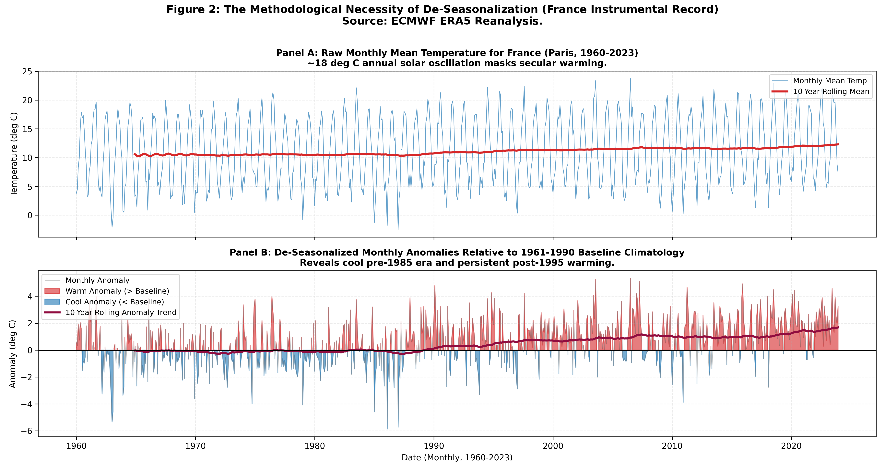

# Climate records and the economy, 1960–2023

Group project for the *Environmental Economics* course (ESSEC / CentraleSupélec AIDAMS, fall 2026). We pulled 64 years of daily temperature and precipitation for 12 countries, built monthly anomalies, measured how much the climate has shifted compared with normal year-to-year noise, and tested whether hot or dry years show up in economic growth.

## Findings

- **Warming is clear above the noise in most countries.** Between the 1960s and 2014–2023, Germany warmed by 2.2 °C, Spain by 2.1 °C and France by 1.8 °C. In seven of the twelve countries the change is more than twice the usual year-to-year variation.
- **Precipitation moves elsewhere.** The largest rainfall changes are in Mexico (+46%), the US (+38%), Vietnam and Australia, not in the countries that warmed most.
- **Seasons warm unevenly.** Summers warmed fastest in Spain and France; winters led in Germany and the US.
- **The economy: yes in shock years, not on average.** Known droughts and heatwaves (1976, 2003 in Europe, 1984 in the Sahel) match visible drops in farm output. But in a two-way fixed-effects panel, a warmer year has no statistically robust effect on GDP per capita growth (−0.65 pp per °C, p = 0.051). A simpler country fixed-effects model suggests a large, significant penalty, but that comes from warming and slowing post-war growth trending together, not from weather.



## Data and method

- **Climate:** ERA5 reanalysis through the Open-Meteo API, daily values at each capital (3 countries in each of Europe, Africa, Asia-Pacific and the Americas), aggregated to months.
- **Economy:** World Bank WDI (GDP per capita growth, agriculture share of GDP) and the FAO crop production index.
- **Anomalies** against the WMO 1961–1990 baseline. Trends with Newey-West standard errors, signal-to-noise as change over detrended standard deviation.
- **Panel regressions** with country and year fixed effects, clustered by country with small-sample corrections (12 clusters).

The full write-up, with every formula, sample-size accounting and the limits of single-point sampling (New Delhi is an outlier for that reason), is in [docs/full_report.md](docs/full_report.md). The paper is in [paper/PAPER.md](paper/PAPER.md).

## Run it

```bash
pip install -r requirements.txt
python scripts/01_download_data.py        # Open-Meteo and World Bank APIs
python scripts/02_process_data.py         # monthly anomalies and merged panel
python scripts/03_run_econometrics.py     # regressions
python scripts/04_generate_visualizations.py
```

The notebook `notebooks/track1_climate_economics.ipynb` walks through the same steps.

## Stack

Python, pandas, statsmodels, SciPy, Matplotlib, seaborn, requests.
