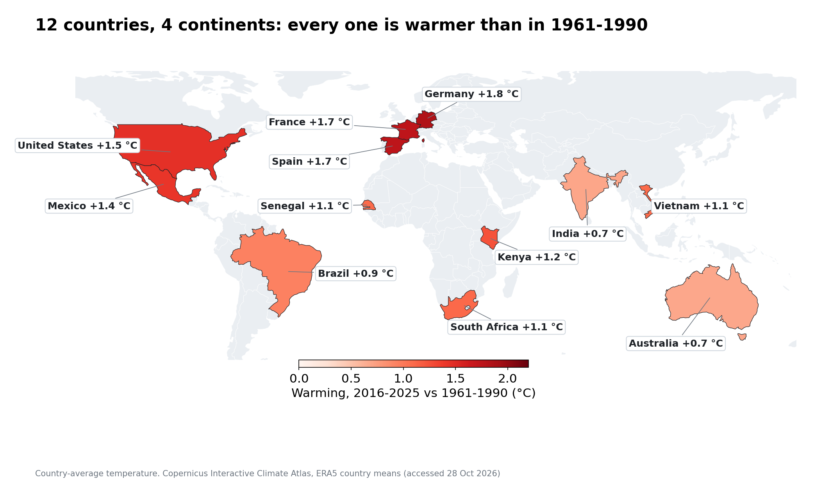
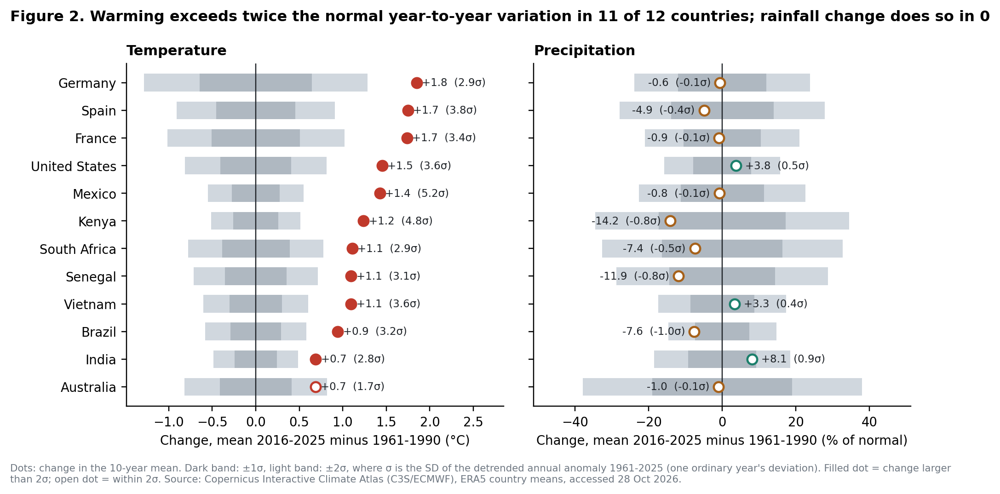
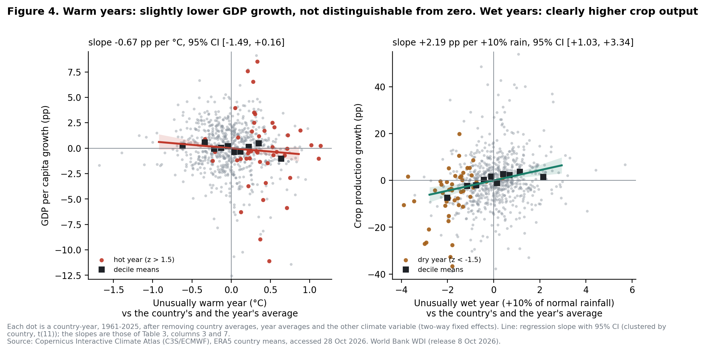
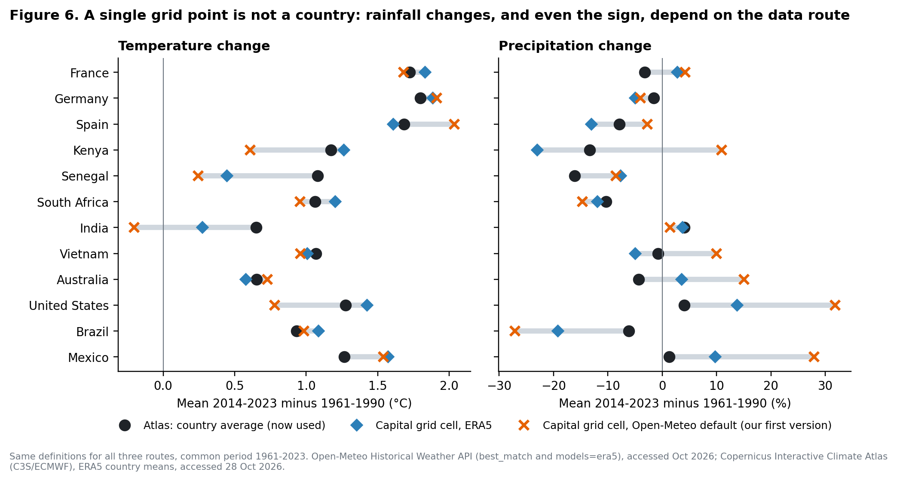
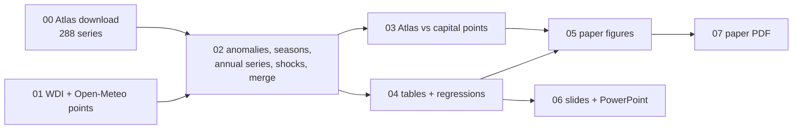

# Warming, rainfall and growth in 12 countries, 1940–2025

**Environmental Economics · ESSEC BSc AIDAMS · T1 2026–2027 · Track 1: temperature and precipitation records**

> How much have temperature and rainfall changed in 12 countries, is that change larger than normal year-to-year variation, and do the years that stand out in the climate also stand out in the economy?

We answer with **country-average ERA5 data from the Copernicus Interactive Climate Atlas** (1940–2025) and **World Bank WDI** data (1961–2025). Each script below rebuilds every number, table and figure from the raw downloads, in order.

<p align="center"></p>

---

## The answer in five numbers

| | Result | Type of claim |
|---|---|---|
| 🌡️ **+0.7 to +1.85 °C** | Warming of 2016–2025 vs 1961–1990, from India/Australia to Germany. All 120 recent country-years were above normal. | description |
| 📏 **11 / 12** | Countries where that warming exceeds twice the normal year-to-year variation (Mexico: 5.2σ). | description |
| 🌧️ **0 / 12** | Countries where the rainfall change does. Rainfall also does not move where warming is largest (rank correlation 0.04). | description |
| 🌾 **+2.2 pp** | Crop growth per +10 % of normal rainfall (p = 0.002). France and Germany lost ~20 pp of crop growth in the 2003 summer. | correlation |
| 📉 **−0.67 pp / °C** | GDP-per-capita growth in a warmer-than-usual year. 95 % CI [−1.49, +0.16]: compatible with zero, and it disappears with country trends. | correlation, not causal |

**In one sentence:** the warming is unmistakable and far outside normal variability. Rainfall is local and noisy. Climate shocks show up in harvests long before they show up in GDP.

---

## What the brief asked, and where we answer it

| Brief, Track 1 | Our answer | Where |
|---|---|---|
| (1) Plot temperature and precipitation over the full record for countries in different regions | 12 countries, 3 per continent, 1940–2025, as climate stripes and as levels | Fig. 1, Fig. A1 |
| (2) Monthly anomaly vs a baseline you choose and state | 1961–1990 per calendar month. The Atlas gives absolute values, so the baseline is ours. | §2 of the paper, `02_process_data.py` |
| (3) Change start→end vs year-to-year variation; where is it largest; does rain move in the same places? | Change 2016–25 vs 1961–90, noise σ, signal-to-noise, Newey–West trends | Table 1, Fig. 2 |
| (4a) Were unusual climate years unusual for the economy? | Shock-year comparisons, the most extreme year per country, two-way FE regressions with a wild cluster bootstrap | Tables 3–5, Fig. 4–5 |
| (4b) Is the change even across the year? | Country × season warming with standard errors | Table 2, Fig. 3 |
| What we can and cannot conclude | Description vs correlation; what causality would require | §6 of the paper |

<table>
<tr>
<td width="50%"><br><sub><b>Fig. 2</b>: grey bands are ±1σ / ±2σ of an ordinary year. Warming is outside them almost everywhere; rainfall change never is.</sub></td>
<td width="50%"><br><sub><b>Fig. 4</b>: after removing country and year averages, warm years barely move GDP; wet years clearly lift crop output.</sub></td>
</tr>
</table>

---

## Data

| Source | What | Unit / coverage | Access |
|---|---|---|---|
| **Copernicus Interactive Climate Atlas** (C3S/ECMWF), dataset ERA5 | `t` mean daily temperature, `pr` mean daily precipitation | °C, mm/day → mm/month · monthly 1940–2025 · **country area means** | 28 Oct 2026 |
| **World Bank WDI**, release 8 Oct 2026 | GDP per capita growth, crop production index, agriculture share of GDP | %, index (2014–16 = 100), % of GDP · 1961–2025 | 28 Oct 2026 |
| Open-Meteo Historical API (*comparison only*) | the same variables at one grid cell per capital | daily 1960–2023 | Oct 2026 |

**How we got the Atlas data.**
- **France, Germany, Spain:** the Atlas's *European countries* masks.
- **The other nine countries:** the Atlas has no country masks outside Europe, so we used its **user-defined region** tool with Natural Earth borders.
- **Check on the user-defined route:** it reproduces the Atlas's own France mask to 0.004 °C.
- **Download:** `scripts/00_download_atlas.py` sends exactly the requests behind the Atlas's *Download → CSV* button.
- **By hand:** [`data/README.md`](data/README.md) gives the manual click-path, every access date and what each merge loses.

### Why not the API we used first?

Our first version took one grid point per capital from an API. It also didn't name the model, so it silently received ERA5-Land rather than ERA5. Putting both routes through identical definitions:
- **Temperature** roughly survives: median correlation 0.91, median gap 0.19 °C.
- **Rainfall** does not: the median gap is 9 pp, and the sign flips for Kenya (country −13 %, Nairobi cell +11 %).

<p align="center"></p>

---

## Method in brief

- **Anomalies.** Each calendar month minus its 1961–1990 mean. This removes the seasonal cycle, which is 92 % of monthly temperature variance in France.
- **Change and noise.** Δ = mean anomaly 2016–2025. σ = SD of the detrended annual anomaly, i.e. how far an ordinary year strays. Signal-to-noise = Δ/σ.
- **Seasons and heat.** DJF/MAM/JJA/SON warming with standard errors. A **hot-season** anomaly (each country's three warmest months) catches heatwaves that an annual mean dilutes: France 2003 is 1.2σ as a year, 3.5σ as a summer.
- **Economy.** Two-way fixed effects: country effects (each country vs itself) and year effects (oil shocks, 2009, COVID and the global trend removed):

  $$g_{it} = \alpha_i + \gamma_t + \beta\,T_{it} + \delta\,P_{it} + \varepsilon_{it}$$

  Standard errors are clustered by country, with t(11) critical values and a **wild cluster bootstrap** (Webb weights, 9,999 draws) because there are only 12 clusters.



---

## Repository

```
├── paper/
│   ├── PAPER.md · PAPER.pdf      ← the paper (≤ 10 pages)
│   └── tables/                   ← every table, csv + md
├── docs/
│   ├── REPORT.md                 ← long version: data, process, explanations, insights, glossary
│   └── AUDIT_first_version.md    ← what was wrong in v1 and how it was fixed
├── presentation/
│   ├── Track1_presentation.pptx  ← 10-min deck with speaker notes
│   ├── SLIDES.md                 ← timing, speaker roles, one message per slide
│   ├── DEFENSE_NOTES.md          ← 18 likely Q&A questions with sourced answers
│   └── figures/                  ← 16:9 slide visuals
├── figures/                      ← paper figures (fig1–fig6, figA1)
├── data/
│   ├── README.md                 ← sources, access dates, manual Atlas steps, merge losses
│   ├── raw/atlas/                ← 288 raw Atlas responses + tidy csv + download log + validation
│   ├── raw/openmeteo/            ← capital-point comparison (best_match = v1, era5)
│   ├── raw/worldbank_wdi.csv
│   └── processed/                ← monthly, seasonal, annual, panel, regression output
├── scripts/                      ← 00 → 07, run in order
└── notebooks/                    ← the same pipeline, step by step, with outputs
```

## Reproduce

```bash
pip install -r requirements.txt
```

```bash
python scripts/00_download_atlas.py
```

Then run `01_download_data.py` to `07_build_paper_pdf.py` in order. Each takes seconds, except the bootstrap in `04` (about a minute).

All downloads are cached in `data/raw/`, so nothing is re-downloaded unless a file is missing. A fresh Atlas download of the 288 series takes 1–2 hours, because the Atlas computes user-defined regions as server-side jobs. `07` needs Chrome or Edge to print the PDF.

## Limits

- **Few countries.** 12 countries = 12 clusters, so the GDP estimate is imprecise. A non-significant result is not evidence of no effect.
- **National averages** hide regional contrasts and weight deserts and cities alike.
- **ERA5 itself.** It is less constrained before ~1950 (and for African rainfall before satellites); rainfall is modelled, not gauged.
- **Weather is not climate change.** One unusual year allows neither adaptation nor the build-up of damage.

## Use of AI

AI assistants were used for code, data retrieval and drafting. The paper's closing section states which tools and for what; the group completes it. Every number comes from the scripts in this repository, run on the raw data included here.

---

*Main references:*
- Dell, Jones & Olken (2012, 2014)
- Burke, Hsiang & Miguel (2015)
- Kahn et al. (2021)
- Hersbach et al. (2020), ERA5
- Cameron, Gelbach & Miller (2008)
- Webb (2023)
- IPCC AR5 WGII (2014), AR6 WGI (2021)

Full list in the paper.
