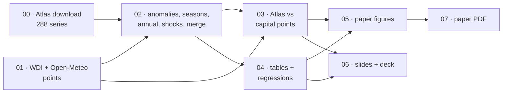

# Warming, rainfall and growth in 12 countries, 1940–2025

**Environmental Economics · ESSEC BSc AIDAMS · T1 2026–2027 · Track 1: temperature and precipitation records**

> **Question.** How much have temperature and rainfall changed in 12 countries, is that change larger than the ordinary year-to-year variation, where and in which season is it largest, and were the years that stand out in the climate also unusual for the economy?

We answer with **country-average ERA5 data from the Copernicus Interactive Climate Atlas** (monthly, 1940–2025) and **World Bank WDI** data (1961–2025). Every number in the paper, the report and the slides is produced by the scripts in `scripts/`, from the raw downloads stored in `data/raw/`.

<p align="center"></p>

**Contents**
1. [Results at a glance](#1-results-at-a-glance)
2. [How we got every dataset](#2-how-we-got-every-dataset)
3. [Our choices and why](#3-our-choices-and-why)
4. [The pipeline: what each script does](#4-the-pipeline-what-each-script-does)
5. [From data to answers: the brief, step by step](#5-from-data-to-answers-the-brief-step-by-step)
6. [What we can and cannot conclude](#6-what-we-can-and-cannot-conclude)
7. [Repository map and how to reproduce](#7-repository-map-and-how-to-reproduce)

**Read next**
- [Paper (PDF)](paper/PAPER.pdf)
- [Full report](docs/REPORT.md)
- [Data sheet](data/README.md)
- [Slides](presentation/Track1_presentation.pptx) · [Talk script](presentation/SCRIPT.md) · [Q&A preparation](presentation/DEFENSE_NOTES.md) · [Final audit](docs/AUDIT_final.md)

---

## 1. Results at a glance

| | Finding | Type of claim |
|---|---|---|
| 🌡️ **+0.7 to +1.85 °C** | Warming of 2016–2025 relative to 1961–1990, from India and Australia to Germany. All 120 recent country-years were above their normal. | description |
| 📏 **11 / 12** | Countries where that warming is more than twice the normal year-to-year variation (Mexico: 5.2σ). Australia (1.7σ) is the exception: its climate is very variable. | description |
| 🌧️ **0 / 12** | Countries where the rainfall change exceeds 2σ. Rainfall also does not change where temperature changes most (rank correlation 0.06). | description |
| 🗓️ **2 / 12** | Countries where one season clearly warms faster than another: France and Spain, where summer leads by about 1 °C. | description |
| 🌾 **+2.2 pp** | Crop growth per +10 % of normal rainfall (p = 0.002). In 9 of the 12 hottest seasons on record, crop growth was more than 5 pp below normal (France 2003: −21 pp). | correlation |
| 📉 **−0.67 pp / °C** | GDP per capita growth in a warmer-than-usual year. 95 % CI [−1.49, +0.16]: compatible with zero, and it vanishes with country trends. | correlation, not causal |

**In one sentence:** the warming is unmistakable and far outside normal variability; rainfall is local and noisy; climate shocks show up in harvests long before they show up in GDP.

<table>
<tr>
<td width="50%"><br><sub><b>Fig. 2.</b> Grey bands = ±1σ / ±2σ of an ordinary year. Warming is outside them almost everywhere; rainfall change never is.</sub></td>
<td width="50%"><br><sub><b>Fig. 4.</b> After removing country and year averages, warm years barely move GDP; wet years clearly raise crop output.</sub></td>
</tr>
</table>

---

## 2. How we got every dataset

We use three sources: one primary climate source, one economic source, and one climate source kept only to show why we did *not* use it.

### 2.1 Climate: Copernicus Interactive Climate Atlas, ERA5 (primary)

| | |
|---|---|
| **Producer** | Copernicus Climate Change Service (C3S), implemented by ECMWF |
| **Product** | [Copernicus Interactive Climate Atlas](https://atlas.climate.copernicus.eu/atlas), dataset **ERA5** (global reanalysis, 0.25° grid, Hersbach et al. 2020) |
| **Variables** | `t`: mean of daily mean 2 m air temperature (°C); `pr`: mean of daily accumulated precipitation (mm/day) |
| **What we downloaded** | 12 countries × 2 variables × 12 calendar months = **288 series**, each covering 1940–2025 → 24,768 country-month values |
| **Spatial unit** | the **area average over each country** |
| **Accessed** | 28 October 2026 (`data/raw/atlas/DOWNLOAD_LOG.json`) |
| **Files** | `data/raw/atlas/json/*.json` (raw server responses, untouched) → `data/raw/atlas/atlas_era5_monthly.csv` (tidy) |

**How the download works.** In the Atlas interface you choose the dataset (ERA5), a variable, a month, and a region, then click *Regional information → Download data → CSV*. Watching the browser's network traffic showed that the CSV is built in the browser from a JSON time series returned by the Atlas server. `scripts/00_download_atlas.py` sends those same requests, so its numbers are the CSV-button numbers. Doing it by script avoids 288 manual downloads and makes the step reproducible. The manual click-path is in [`data/README.md`](data/README.md).

**How a "country" is defined in the Atlas.** This was the main data problem.
- **France, Germany, Spain.** The Atlas has a *European countries* region set, so we use its own masks (ids 2, 15, 0):
  `GET /temporal/serie?project=ERA5&variable=t&temporalFilter=Jan&region=european-countries&ids=2&…`
- **The other 9 countries.** Outside Europe the Atlas only offers large IPCC-AR6 regions, such as "Western Africa" or "South Asia", which cut across borders. Its **user-defined region** tool (the draw/upload icon next to the region menu) accepts any polygon. We upload each country's border from Natural Earth (1:50 m, simplified to 0.05°). The Atlas computes the area average as a server-side job:
  `POST /job/temporal/serie?…&aggFun=mean`, with the polygon as WKT, then poll `GET /job/temporal/serie?jobId=…` until `"status": "ok"`.
- **United States.** Restricted to the 48 contiguous states, so that Alaska does not dominate a "US climate" that the US economy barely experiences.
- **Validation.** We sent France through the user-defined route too. It reproduces the Atlas's own France mask to within **0.004 °C** and **0.006 mm/day** (r = 0.99999), see `data/raw/atlas/validation_france_user_defined_vs_mask.json`. All 12 countries are therefore measured the same way.

**Units we derive.**
- Monthly precipitation (mm) = `pr` (mm/day) × days in the month.
- Annual temperature = day-weighted mean of the 12 monthly values.
- Annual precipitation = sum of the 12 monthly totals.

**Are these anomalies?** No. The Atlas returns absolute values (°C, mm/day). The brief warns about this case, and it means the baseline is our choice (§3).

### 2.2 Economy: World Bank World Development Indicators

| | |
|---|---|
| **Producer / dataset** | World Bank, World Development Indicators, **release of 8 October 2026** |
| **Access** | WDI API v2 (`api.worldbank.org/v2/country/{ISO3}/indicator/{code}`), no key needed, accessed 28 October 2026 |
| **Indicators used** | `NY.GDP.PCAP.KD.ZG` real GDP per capita growth (%) · `AG.PRD.CROP.XD` crop production index (2014–16 = 100) · `NV.AGR.TOTL.ZS` agriculture, forestry and fishing value added (% of GDP) |
| **Downloaded, not used** | `NY.GDP.MKTP.KD.ZG` real GDP growth (kept for robustness checks) |
| **File** | `data/raw/worldbank_wdi.csv` (12 countries × 1960–2025); release date and access date in `worldbank_wdi_metadata.json` |

**Merge.** The two sources are matched on (ISO3 code, calendar year) for 1961–2025, giving 780 country-years. Every climate year finds a WDI row; the gaps are on the WDI side:

| Gap | Effect |
|---|---|
| Vietnam's GDP per capita growth starts in 1985 | **756** growth observations instead of 780 |
| The crop index ends in 2023 | 756 crop-growth observations (63 per country) |
| The agriculture share starts late: Germany 1991, Spain 1995, USA 1997, Australia 1990 | used for description only |
| Germany before 1991 | the World Bank's reconstruction of unified Germany |

### 2.3 Comparison only: Open-Meteo capital grid points (our first version)

The first version of this project used the Open-Meteo Historical Weather API at the grid cell containing each capital, daily from 1960 to 2023. It sent no `models=` parameter, so it received Open-Meteo's default `best_match` blend. On New Delhi we checked that this blend coincides with **ERA5-Land**, not with ERA5 as we had written.

We kept those files (`data/raw/openmeteo/best_match/`) and downloaded the same points with `models=era5` (`data/raw/openmeteo/era5/`). `scripts/03_compare_sources.py` puts all three routes through identical definitions:

| Over 1961–2023 | Temperature | Rainfall |
|---|---|---|
| Correlation of annual anomalies, ERA5 capital point vs country (median) | 0.91 | 0.73 (0.39 in the USA) |
| Gap in the change, first version vs country (median) | 0.19 °C | 9.2 pp |
| Worst case | India: −0.20 °C at the point vs **+0.65 °C** for the country | USA: +32 % vs **+4 %**; Kenya: +11 % vs **−13 %** |

**Why rainfall is so sensitive.** Temperature anomalies are smooth over hundreds of km, while rainfall depends on storm tracks, relief and coastlines. A capital is not a random point: Dakar is on the Atlantic, Mexico City in a high valley. *This is why we switched to country averages, and it is the brief's first lesson: understand what the data measure before using them.*

<p align="center"></p>

---

## 3. Our choices and why

Each choice below is one a reader could challenge. We give the alternative we rejected and the reason.

### Sample

| Choice | Why | Alternative rejected |
|---|---|---|
| **12 countries, 3 per continent**: FRA, DEU, ESP · KEN, SEN, ZAF · IND, VNM, AUS · USA, BRA, MEX | Covers temperate, Mediterranean, semi-arid, tropical and monsoon climates, and agriculture shares from 1 % to 23 % of GDP. 12 is also the minimum we judged usable for clustered inference. | One region only: no contrast in climate or exposure. |
| **Country area averages** (Atlas masks + user-defined borders) | The question is about countries, and GDP is national. | A point at the capital: fails for rainfall (§2.3). IPCC-AR6 regions: cross borders. |
| **USA = 48 contiguous states** | Where the US economy and its farms are. | Alaska would weigh about 18 % of the area. |
| **ERA5 reanalysis** | Global, gap-free, consistent over time, and the Atlas's longest record (from 1940). | E-OBS is Europe only; station data have gaps and relocations. |
| **Analysis period 1961–2025; 1940–1960 shown but not used for change** | ERA5 is less constrained by observations before ~1950, and for African rainfall before satellites (1979). 1961 is also the first year of WDI growth data. | Measuring change from 1940 would lean on the weakest data. |

### Climate definitions

| Choice | Why | Alternative rejected |
|---|---|---|
| **Monthly downloads, monthly anomalies** | The brief asks for monthly anomalies. They remove the seasonal cycle, which is 92 % of monthly temperature variance in France, so any month becomes comparable to any other. | Annual downloads: no anomaly by month, no seasons. |
| **Baseline 1961–1990** | It is the WMO reference period, it lies mostly before the recent acceleration of warming, and it starts with our economic data. | 1991–2020 already contains much of the warming and would hide it. |
| **Change = mean of the last 10 years (2016–2025) minus the baseline** | A 10-year mean smooths single odd years; the brief asks for start vs end of the record. | First year vs last year: dominated by noise. |
| **Trend = OLS slope per decade with Newey–West SE** | A second measure of change that uses every year; the SE allows correlated neighbouring years. | — |
| **Noise σ = SD of the detrended annual anomaly** | It measures how far an ordinary year strays. Detrending stops the warming itself from being counted as noise. | Raw SD: inflated by the trend. |
| **Threshold 2σ** | A change of 2σ is outside the range of about 95 % of ordinary years. It is a reading rule, not a test. | — |
| **Precipitation in % of normal** | Makes Senegal (590 mm) and Vietnam (2,067 mm) comparable. | mm: scale-dependent. |
| **Seasons DJF/MAM/JJA/SON, with December counted in the following year** | Meteorological convention. We label them by calendar, since JJA is winter in the south. | "Summer/winter" labels, which are wrong in the southern hemisphere and the tropics. |
| **Hot season = each country's 3 warmest months in 1961–1990** | An annual mean dilutes a summer heatwave: France 2003 is 1.2σ as a year but 3.4σ as a summer. | Annual temperature only: misses 2003. |
| **Shock = detrended z > 1.5 (hot) or < −1.5 (dry)** | About the most extreme 7 % of years in each country. Detrending stops "hot" from meaning simply "recent". | Raw anomalies: every recent year would be a "shock". |

### Economic definitions and econometrics

| Choice | Why | Alternative rejected |
|---|---|---|
| **GDP per capita growth**, not its level | Weather shocks hit a year's output flow (Dell, Jones & Olken 2012), and growth is stationary. | GDP levels: trending, spurious correlations. |
| **Crop production growth** | The most directly exposed output, which tests the exposure channel. | Agriculture share in levels: driven by structural change, not weather. |
| **Two-way fixed effects (country + year)** | Country effects compare each country with itself; year effects remove oil shocks, 2009, COVID and the global warming trend. What remains is "warmer than usual relative to the others that year", which is close to random. | Country FE only: picks up the warming × growth-slowdown coincidence (−0.75, "significant"). |
| **Cluster by country, t(11), plus a wild cluster bootstrap** | Errors are correlated within a country over time, and with 12 clusters standard cluster SEs are too optimistic. The wild bootstrap (Webb weights, 9,999 draws) is the recommended fix. | Plain OLS SEs: far too small. |
| **Fixed set of 8 specifications, all reported** | So that no "significant" result can be cherry-picked. | Reporting only the best-looking model. |
| **Report effect sizes in pp per °C and per 1-SD warm year** | The brief asks for interpretation "in the units of the problem". | Signs and stars only. |

---

## 4. The pipeline: what each script does



| Script | Goal | Input | Output |
|---|---|---|---|
| **`00_download_atlas.py`** | Get country-average ERA5 temperature and precipitation from the Copernicus Atlas: predefined masks for FRA/DEU/ESP, user-defined Natural Earth polygons for the 9 others. Caches every response; retries the Atlas's sporadic 502s; runs 6 jobs in parallel. | Atlas API, Natural Earth borders | `data/raw/atlas/json/` (288 files), `atlas_era5_monthly.csv`, `regions_user_defined.geojson`, `DOWNLOAD_LOG.json` |
| **`01_download_data.py`** | Get the WDI indicators and the release date; get the Open-Meteo capital points (`best_match` = our first version, `era5`) for the comparison. | WDI API v2, Open-Meteo API | `worldbank_wdi.csv`, `worldbank_wdi_metadata.json`, `openmeteo/<model>/` |
| **`02_process_data.py`** | Turn raw values into the quantities the brief asks for: monthly totals, 1961–1990 calendar-month climatology, monthly anomalies (°C, mm, %), seasons, hot season, annual series, detrended z-scores and shock flags; merge with WDI. | Atlas csv, WDI csv | `data/processed/climate_monthly.csv`, `climate_seasonal.csv`, `climate_annual.csv`, `panel.csv` |
| **`03_compare_sources.py`** | Measure how much the data route matters: identical definitions applied to the Atlas country mean, the ERA5 capital point and the blend capital point. | processed monthly + Open-Meteo files | Table A1, `source_comparison_annual.csv` |
| **`04_run_econometrics.py`** | Produce every table: change, noise and trends (Table 1), economy summary (1b), seasonal change with SEs (2), panel regressions with wild cluster bootstrap (3), shock vs normal years (4), each country's most extreme year (5). | processed files | `paper/tables/*.csv` and `*.md`, `regression_results_raw.csv` |
| **`05_generate_figures.py`** | Draw the paper's figures. Each states its units, period and source and has a conclusion as its title, so it can be read on its own. | processed files, tables | `figures/fig1–fig6, figA1` |
| **`06_presentation.py`** | Draw 16:9 slide visuals with large type and build the PowerPoint deck. Slide numbers are read from the tables, so the deck always matches the paper. | processed files, tables | `presentation/figures/`, `Track1_presentation.pptx` |
| **`07_build_paper_pdf.py`** | Render `paper/PAPER.md` to an A4 PDF to check the 10-page limit. | `PAPER.md`, figures | `paper/PAPER.pdf` |

`notebooks/track1_climate_economics.ipynb` runs the same scripts in order and shows each table and figure.

---

## 5. From data to answers: the brief, step by step

| Brief, Track 1 | What we did | Answer | Where |
|---|---|---|---|
| **(1)** Plot temperature and precipitation over the full record for countries in different regions | 12 countries × 1940–2025, as anomaly "stripes" and as levels | Every row turns red after ~1990; rainfall shows no comparable drift | Fig. 1, Fig. A1 |
| **(2)** Monthly anomaly against a baseline you choose and state | 1961–1990, by calendar month, computed by us (the Atlas gives absolute values) | — | `02_process_data.py` |
| **(3a)** How much has the average changed? | Last decade vs baseline; Newey–West trends | +0.7 to +1.85 °C; +0.13 to +0.37 °C per decade | Table 1 |
| **(3b)** How large is year-to-year variation compared with the change? | σ of the detrended anomaly; Δ/σ | Temperature beyond 2σ in 11/12; rainfall in 0/12 | Fig. 2 |
| **(3c)** Where has temperature moved most; does precipitation move in the same places? | Cross-country comparison | Europe and Mexico/USA warm most; the largest rainfall changes are in Kenya and Senegal; rank correlation 0.06 | Table 1, Fig. 2 |
| **(4a)** Were unusual climate years unusual for the economy? | Shock-year gaps, most extreme year per country, two-way FE panel | Crops yes (dry years −7.6 pp; +2.2 pp per +10 % rain); GDP: −0.67 pp/°C, CI includes 0 | Tables 3–5, Fig. 4–5 |
| **(4b)** Is the change spread evenly across the year? | Country × season warming with SEs | Yes, except France and Spain (summer +1 °C ahead) | Table 2, Fig. 3 |

---

## 6. What we can and cannot conclude

- **Descriptions (solid):**
  - every country has warmed, by more than twice the normal variability in 11 of 12;
  - rainfall change is within the noise;
  - southern Europe's warming is summer-heavy.
- **Correlations (weak to clear):**
  - wet years go with clearly higher crop output;
  - warm years go with slightly lower GDP growth, but 12 countries cannot distinguish that from zero.
- **Not causal, and weather is not climate change:**
  - one unusual year allows neither adaptation nor the build-up of damage;
  - national averages hide regional and sectoral losses;
  - a causal answer would need many more units (all countries, or regions), exposure-weighted weather (cropland, population) and a channel fixed in advance.

**Limits:**
- 12 clusters;
- ERA5 rainfall is modelled, not gauged;
- country averages weight deserts and cities alike;
- the agriculture share starts late for some countries.

---

## 7. Repository map and how to reproduce

```
├── paper/            PAPER.md · PAPER.pdf (≤ 10 pages) · tables/ (every table, csv + md)
├── docs/             REPORT.md (long version + glossary) · AUDIT_first_version.md · AUDIT_final.md
├── presentation/     Track1_presentation.pptx · SCRIPT.md (spoken script) · DEFENSE_NOTES.md (Q&A) · figures/
├── figures/          paper figures fig1–fig6, figA1
├── data/             README.md (data sheet) · raw/ (atlas, openmeteo, WDI, maps) · processed/
├── scripts/          00 → 07, run in order
└── notebooks/        the same pipeline, step by step
```

```bash
pip install -r requirements.txt
```

```bash
python scripts/00_download_atlas.py
```

Then run, in order:
- `scripts/01_download_data.py`
- `scripts/02_process_data.py`
- `scripts/03_compare_sources.py`
- `scripts/04_run_econometrics.py` (about one minute, for the bootstrap)
- `scripts/05_generate_figures.py`
- `scripts/06_presentation.py`
- `scripts/07_build_paper_pdf.py` (needs Chrome or Edge)

**Notes on running:**
- **Downloads are cached** in `data/raw/`, so nothing is re-downloaded unless a file is missing.
- **A fresh Atlas download** takes 1–2 hours: the Atlas computes user-defined regions one job at a time.
- **Results are deterministic:** the bootstrap uses a fixed seed. Re-running 00–07 reproduces every table and figure byte for byte.

**Use of AI.** AI assistants were used for code, data retrieval and drafting. The paper's closing statement names the tools and what they were used for. Every number comes from the scripts and raw data in this repository.

---

*References.*
- Dell, Jones & Olken (2012, 2014)
- Burke, Hsiang & Miguel (2015)
- Kahn et al. (2021)
- Hersbach et al. (2020), ERA5
- Ciais et al. (2005)
- Cameron, Gelbach & Miller (2008)
- Webb (2023)
- IPCC AR5 WGII (2014), AR6 WGI (2021)

Full list in the paper.
