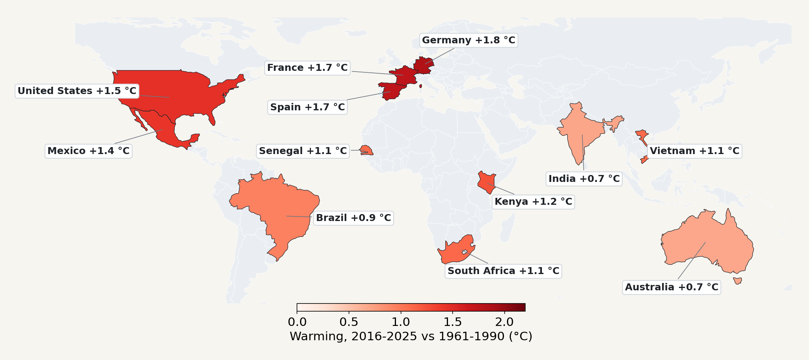

# Warming, rainfall and growth in 12 countries, 1940–2025

**Environmental Economics · ESSEC BSc AIDAMS · 2026–2027 · Track 1: temperature and precipitation records**
**Group:** Eliott Beghin · Pollux Gronier · Saty Viard Laroque · Augustin Vlandas · **Course:** Caterina Seghini

<p align="center"></p>

> We took 85 years of temperature and rainfall records for 12 countries, measured how far the climate has moved compared with ordinary year-to-year swings, and checked whether the unusual years were also unusual for the economy (GDP growth and harvests).

| Deliverable | Where |
|---|---|
| Paper (submitted 2 November) | [`paper/PAPER.pdf`](paper/PAPER.pdf), source [`paper/PAPER.md`](paper/PAPER.md) |
| Code that reproduces every number | [`scripts/`](scripts/), run 00 → 08 |
| Talk (9 November, 10 min + 3 min Q&A) | [`presentation/Track1_presentation.pptx`](presentation/Track1_presentation.pptx), [`presentation/SCRIPT.md`](presentation/SCRIPT.md), [`presentation/DEFENSE_NOTES.md`](presentation/DEFENSE_NOTES.md) |
| Assignment | [`docs/assignment_brief.pdf`](docs/assignment_brief.pdf) |

## The answer

| | Finding | Kind of claim |
|---|---|---|
| **+0.7 to +1.85 °C** | Warming 2016–2025 vs 1961–1990, from India and Australia to Germany. All 120 country-years since 2016 were warmer than their old normal. | description |
| **11 / 12** | Countries where the warming is beyond 2σ, twice the normal year-to-year swing. Mexico 5.2σ; Australia is the exception, at 1.7σ. | description |
| **0 / 12** | Countries where the rainfall change exceeds one ordinary year's swing. As a 10-year average it is still measurable in 4 (Brazil, India, Kenya, Senegal), and it does not follow the warming. | description |
| **2 / 12** | Countries where one season clearly warms faster: summer in France and Spain. | description |
| **+2.2 %** | Crop output in a year with 10 % more rain than normal. It is robust, and it lasts one year. Dry years: crop growth −7.6 points, GDP growth only −0.27. | correlation |
| **−0.04 pp per °C** | GDP per capita growth in a warmer year, in the preferred model (country and year effects + country trends). Interval [−0.76, +0.69]: no detectable effect, and losses above about 0.8 pp per °C are ruled out. | correlation, not causal |

**So:** for temperature, today's climate is no longer the one people planned for. Rainfall has changed far less. Harvests notice climate shocks, for a year and through water; GDP does not, as far as twelve countries can detect.

## Data

| Source | What | Files |
|---|---|---|
| **Copernicus Interactive Climate Atlas**, ERA5 (the source the brief recommends) | Monthly temperature (°C) and rainfall (mm/day), 1940–2025, **averaged over each country**: 288 series (12 countries × 2 variables × 12 months). France, Germany and Spain use the Atlas's country masks. The 9 others use the Atlas's user-defined regions with Natural Earth borders (USA = 48 contiguous states). Checked on France: the two routes agree to 0.004 °C. | `data/raw/atlas/` |
| **World Bank WDI**, release of 8 October 2026 | GDP per capita growth, crop production index, agriculture share of GDP | `data/raw/worldbank_wdi.csv` |
| Open-Meteo API at each capital (comparison only) | Our first version. One grid point is not a country: the rainfall change differs by 9 points on median, and Kenya even flips sign (+11 % vs −13 %) | `data/raw/openmeteo/` |

Sources, access dates and the manual Atlas click path are in [`data/README.md`](data/README.md).

## Method in five lines

1. **Anomaly** = each month minus the same month's **1961–1990** average: the WMO reference period, before most of the warming, and the start of the economic data. Rainfall is expressed in % of that average.
2. **Change Δ** = mean annual anomaly 2016–2025. **Noise σ** = standard deviation of the years around the country's trend line, 1961–2025. Δ/σ > 2 means the recent decade could not pass for an ordinary year.
3. **Seasons:** the same calculation by calendar season. **Hot season** = each country's three warmest months, which catches heatwaves that annual means hide.
4. **Economy:** a panel of 12 countries × 1961–2025 (756 country-years). We regress growth on the temperature and rainfall anomalies with country and year effects, plus country trends in the preferred model. Standard errors are clustered by country, with a wild cluster bootstrap because 12 clusters are few. All 8 variants are reported.
5. **1940–1960** is shown but not used to measure change: fewer observations stand behind ERA5 then.

How every number in the talk is computed, from the raw file to the slide: [`presentation/DEFENSE_NOTES.md`](presentation/DEFENSE_NOTES.md), part 2.

## Repository

```
├── paper/            PAPER.md, PAPER.pdf, tables/ (every table as .csv and .md)
├── scripts/          00 → 08, the full pipeline (below)
├── data/             raw/ (downloads, never modified) · processed/ (outputs of 02–04) · README.md (data sheet)
├── figures/          the paper's figures
├── presentation/     Track1_presentation.pptx · figures/ (slide charts) · SCRIPT.md · DEFENSE_NOTES.md
│                     · LEARN_slides_4-6.md
└── docs/             assignment_brief.pdf
```

| Script | Does | Writes |
|---|---|---|
| `00_download_atlas.py` | Downloads the 288 Atlas series (keeps every server answer, retries on errors) | `data/raw/atlas/` |
| `01_download_data.py` | Downloads the World Bank indicators and the API comparison points | `data/raw/` |
| `02_process_data.py` | Normals, anomalies, seasons, hot season, annual series, shock years; merge with the economy | `data/processed/` |
| `03_compare_sources.py` | Country average vs capital point, under identical definitions | Table A1 |
| `04_run_econometrics.py` | Tables 1–6: change and noise, seasons, regressions with bootstrap, shock years, robustness | `paper/tables/` |
| `05_generate_figures.py` | The paper's figures | `figures/` |
| `06_presentation.py` | The deck's charts | `presentation/figures/` |
| `07_build_paper_pdf.py` | `PAPER.md` → A4 PDF (needs Chrome or Edge) | `paper/PAPER.pdf` |
| `08_build_deck.py` | The talk as a PowerPoint, speaker notes taken from `SCRIPT.md` | `presentation/Track1_presentation.pptx` |

## Run it

All raw data are in the repository, so nothing needs to be downloaded again.

```bash
pip install -r requirements.txt
```

Then run the scripts in order, from `python scripts/00_download_atlas.py` to `python scripts/08_build_deck.py`. Steps 00–01 find the cached files. The rest takes about 3 minutes, and the results are identical every run (the bootstrap uses a fixed seed). To re-download a source, delete its file in `data/raw/`. A full Atlas download takes 1–2 hours.

## The talk (9 November)

The deck is [`presentation/Track1_presentation.pptx`](presentation/Track1_presentation.pptx): 15 slides, Cambria and Calibri fonts so it looks the same on any PC. Its speaker notes are [`SCRIPT.md`](presentation/SCRIPT.md): 1,264 words, 9 minutes at 140 words per minute.

| Slides | Who | Part |
|---|---|---|
| 1–3 | Saty | The question, the 12 countries, what "a country's climate" means |
| 4–6 | Pollux | The method, the full record, signal versus noise |
| 7–10 | Augustin | Seasons, the hottest summers, the regressions |
| 11–13 | Eliott | Where shocks bite, what we can claim, the answer |

Everyone answers questions: [`DEFENSE_NOTES.md`](presentation/DEFENSE_NOTES.md) has 22 likely questions and the computation behind every number.

## Use of AI and references

AI assistants were used as tools: for coding and debugging (including the automated Atlas download), for reviewing a first version against the brief, and for help with editing and slides. The paper's closing statement says which tools and for what. Every number comes from the scripts run on the raw data in this repository, and every methodological choice is ours.

**Main references** (full list in the paper):
- Dell, Jones & Olken (2012, 2014);
- Burke, Hsiang & Miguel (2015);
- Kahn et al. (2021);
- Hersbach et al. (2020) for ERA5;
- Ciais et al. (2005);
- Cameron, Gelbach & Miller (2008) and Webb (2023);
- IPCC AR5 WGII (2014) and AR6 WGI (2021).
