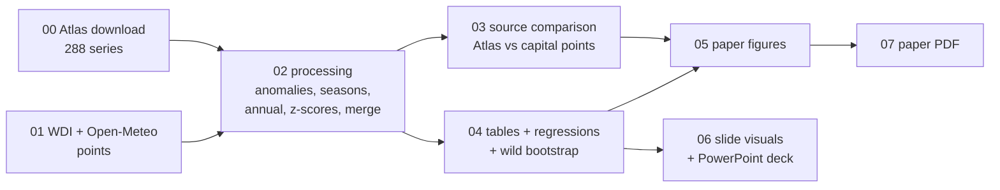

# Project report: data, process, explanations and insights

This is the long version of the project, written for the group so that everyone can explain every choice in the Q&A. The 10-page paper is `paper/PAPER.md` (PDF in `paper/PAPER.pdf`). The slides are `presentation/Track1_presentation.pptx`.

---

## 1. The project in one page

**Question (Track 1).** What do the observed temperature and precipitation records show for a set of countries? How much have they changed, how large is that change compared with year-to-year variation, where is it largest, and do the years that stand out in the climate also stand out in the economy?

**Sample.** 12 countries, three per continent:
- **Europe:** France, Germany, Spain.
- **Africa:** Kenya, Senegal, South Africa.
- **Asia-Pacific:** India, Vietnam, Australia.
- **Americas:** United States, Brazil, Mexico.

The climate record covers 1940–2025. The economic panel covers 1961–2025.

**Answers.**

| # | Finding | Evidence |
|---|---|---|
| 1 | Every country is warmer than in 1961–1990, by **+0.7 °C (India, Australia) to +1.85 °C (Germany)**. All 120 country-years of 2016–2025 were above their 1961–1990 normal. | Table 1, Fig. 1–2 |
| 2 | In **11 of 12** countries the warming is more than twice the normal year-to-year variation. Australia (1.7σ) is the exception: its climate is very variable. | Fig. 2 |
| 3 | **Rainfall change exceeds 2σ in none of the 12.** It does not happen where warming is largest (rank correlation 0.06). | Fig. 2, Table 1 |
| 4 | Warming is spread evenly over the year, except in **France and Spain**, where summer leads (+2.3/+2.4 °C vs +1.3/+1.4 °C in autumn). | Fig. 3, Table 2 |
| 5 | Warm years go with **slightly lower GDP growth**: −0.67 pp per °C, about −0.25 pp for a typical warm year. But the 95 % CI [−1.49, +0.16] includes zero, and the estimate disappears with country trends. | Table 3, Fig. 4–5 |
| 6 | **Crops react to water.** +10 % rainfall goes with +2.2 pp crop growth (p = 0.002). Dry years see crop growth 7.6 pp below normal, while GDP is only −0.27 pp below (not significant). | Table 3–4, Fig. 4 |
| 7 | **Data route matters for rainfall.** A single grid point at the capital (our first version) gives rainfall changes up to 28 pp away from the country average, and flips the sign in Kenya. | Fig. 6, Table A1 |

**Type of result.** Findings 1–4 are descriptions. Findings 5–6 are conditional correlations, which the design makes close to a natural experiment, but which are not causal claims at this sample size. Finding 7 is a data-quality result.

---

## 2. What changed compared with the first version

The first version (audited in `docs/AUDIT_first_version.md`) had good structure and reproducible code, but several problems that the brief's grading criteria would penalise.

| Problem in v1 | What we did |
|---|---|
| Used an API (Open-Meteo) instead of the Copernicus Atlas named in the brief. Its data were also **not ERA5**: no `models=` parameter was sent, so the API returned its default blend, essentially ERA5-Land. | Downloaded all data from the **Copernicus Interactive Climate Atlas** (ERA5). Kept the API data only as a comparison, with the model now explicit. |
| One grid cell at each capital stood in for a whole country. | **Country area averages**: Atlas masks for Europe, Atlas user-defined regions with real country borders elsewhere. |
| New Delhi "cooling" explained by aerosols and irrigation, with no source. | It was a data artefact. With country means India warms +0.7 °C. |
| Precipitation changes (±30–45 %) presented as signal. | Added precipitation signal-to-noise: none exceeds 2σ. |
| Seasonal claims contradicted the numbers ("Europe: summer > winter", false for Germany). | Country × season table with standard errors. Only France and Spain are significant. |
| "1976 / 2003 / 1984 caused crises", with untraceable figures (6 bn francs, €4 bn). | Replaced with a systematic table of each country's most extreme year, computed from our data, plus one peer-reviewed citation (Ciais et al., 2005). |
| Annual means hid summer heatwaves (France 2003 was not flagged). | Added a **hot-season** temperature (warmest 3 months): France 2003 = 3.4σ. |
| Shock-vs-normal comparison driven by COVID-2020 and by mixing fast- and slow-growing countries. | Within-country and within-year comparisons, with and without 2020–21, and cluster p-values. |
| Cited a bootstrap paper without using the method. | Implemented the **wild cluster bootstrap**, the right tool for 12 clusters. |
| Several numbers inconsistent between sections; causal wording. | Single pipeline, all text numbers read from the generated tables; descriptive and correlational wording. |

---

## 3. The data

### 3.1 Climate: Copernicus Interactive Climate Atlas

**What it is.** A web application of the EU's Copernicus Climate Change Service (C3S), run by ECMWF, that serves past and future climate data aggregated over regions. We use its **ERA5** dataset.
- **ERA5 is a reanalysis.** A weather forecast model is continuously corrected by every available observation (stations, balloons, aircraft, ships and, since 1979, satellites). The result is a gap-free, physically consistent record on a 0.25° grid (~28 km) from 1940.

**Variables.**

| Atlas code | Name | Unit | We use |
|---|---|---|---|
| `t` | mean of daily mean 2 m temperature | °C | monthly mean temperature |
| `pr` | mean of daily accumulated precipitation | mm/day | × days in month → monthly total (mm) |

**What we downloaded.**
- 12 countries × 2 variables × 12 calendar months = **288 series**, each covering 1940–2025.
- Accessed on 28 October 2026.
- Raw responses are in `data/raw/atlas/json/`; the tidy file is `data/raw/atlas/atlas_era5_monthly.csv`.

**How the Atlas defines a country.**
- **France, Germany, Spain:** the Atlas has a *European countries* region set. We used those masks (ids 2, 15 and 0).
- **The other nine countries:** the Atlas has **no country masks outside Europe**, only large IPCC regions such as "South Asia" or "Western Africa". Its *User defined* tool lets you draw or upload a region and returns the area average. We uploaded Natural Earth country borders (1:50 m, simplified to 0.05°). The United States is restricted to the 48 contiguous states.
- **Validation:** we ran France through the user-defined route as well. It matches the Atlas's own France mask to within 0.004 °C and 0.006 mm/day (correlation 0.99999). The nine user-defined countries are therefore on the same footing as the three European ones.

**How we downloaded it.** In the web interface the path is: dataset ERA5 → variable → month → region → *Regional information* → *Download data* → CSV. The browser builds that CSV from a JSON time series the Atlas server returns. `scripts/00_download_atlas.py` sends exactly those requests:
- `GET /temporal/serie?...&region=european-countries&ids=<id>` for the European masks.
- `POST /job/temporal/serie?...&aggFun=mean` with the country polygon, for user-defined regions. The Atlas runs a server-side job (30–90 s); the script polls until the status is `ok`.

We confirmed the equivalence in the browser's network log. Manual instructions for reproducing any series by hand are in `data/README.md`.

**Absolute values, not anomalies.** The Atlas returns absolute values, so the baseline is our choice: 1961–1990.

**Known limitations.**
- **Fewer observations early on.** Before ~1950, and before 1979 for precipitation in data-poor regions such as Africa, ERA5 is less constrained by observations. That is why the 1940s are faded in Figure 1 and why changes are measured from 1961.
- **Rainfall is modelled.** ERA5 rainfall comes from the model's physics, nudged by observations; it is not a gauge count. Convective (thunderstorm) rainfall is the weakest part.
- **National averages hide regional contrasts.** The US Northeast got wetter while the Southwest dried; Kenya's highlands are not its arid north.
- **Coastal mixing.** Coastal grid cells partly cover sea, so a few coastal cells mix land and ocean.

### 3.2 Comparison: Open-Meteo capital points (our first route)

Open-Meteo's Historical Weather API serves ECMWF reanalyses at a point. Our first version asked for the cell containing each capital and did not specify a model, so it received `best_match`. We checked on New Delhi that this blend coincides with **ERA5-Land** (0.1° resolution), not ERA5. We re-downloaded the same points with `models=era5` so that the comparison separates two effects:
- **point vs country:** ERA5 point vs Atlas;
- **product:** ERA5-Land blend vs ERA5.

**Results** (Table A1, Figure 6; common period 1961–2023, identical definitions):

| | Temperature | Precipitation |
|---|---|---|
| Correlation of annual anomalies, ERA5 capital point vs country | median 0.91 | median 0.73 (0.39 USA, 0.40 Australia, 0.43 Brazil) |
| Median absolute gap in the change, blend point vs country | 0.19 °C | 9.2 percentage points |
| Worst cases | India: −0.20 °C (point) vs +0.65 °C (country); Senegal: +0.24 vs +1.08 | USA: +32 % vs +4 %; Mexico: +28 % vs +1 %; Kenya: +11 % vs −13 % |

**Why rainfall is so sensitive.** Temperature anomalies are spatially smooth: a warm year is warm over hundreds of kilometres. Rain is patchy: one storm track, one mountain range or one city can change a single cell's total, and a capital is not a random location. Dakar sits on the Atlantic coast, Mexico City in a high valley, and Washington on the humid east coast of a continent whose interior is dry. **Lesson for the oral: check what a dataset actually measures before analysing it.** This is the brief's first instruction.

### 3.3 Economy: World Bank WDI

**Source.** Release of 8 October 2026, accessed through API v2 on 28 October 2026. The metadata, including the release date, are in `data/raw/worldbank_wdi_metadata.json`.

| Code | Variable | Unit | Coverage notes |
|---|---|---|---|
| `NY.GDP.PCAP.KD.ZG` | real GDP per capita growth | % | 1961–2025; Vietnam from 1985 → 756 observations |
| `AG.PRD.CROP.XD` | crop production index | 2014–16 = 100 | 1961–2023; growth = annual % change |
| `NV.AGR.TOTL.ZS` | agriculture, forestry, fishing value added | % of GDP | starts late: Germany 1991, Spain 1995, USA 1997, Australia 1990 |

**Merge.** Exact on (ISO3 code, year), so no climate year is lost.
- **Germany before 1991** is the World Bank's reconstruction of unified Germany.
- **Agricultural exposure differs widely.** Agriculture is 12–23 % of GDP in Kenya, Senegal, India and Vietnam, but under 3 % in France, Germany, Spain, the USA, Australia and South Africa.

---

## 4. The process



### 4.1 Definitions

- **Monthly anomaly.** For country *i*, month *m*, year *y*: the value minus the mean of the same calendar month over 1961–1990.
  - **Why:** the seasonal cycle is about 92 % of the variance of monthly temperature in France. Without removing it, a mild January looks colder than a cool July.
  - **Precipitation:** the anomaly is also expressed as a % of the baseline month, so dry and wet countries are comparable.
- **Annual values.** Temperature is the day-weighted mean of the 12 months; precipitation is the sum.
- **Seasons.** DJF, MAM, JJA, SON. December goes with the *following* January–February (the meteorological convention). These are calendar seasons: JJA is summer in the north, winter in South Africa, Australia and Brazil, and neither in Kenya.
- **Hot season.** For each country, the three consecutive months warmest in 1961–1990:
  - Jun–Aug: France, Germany, USA, Mexico;
  - Jul–Sep: Spain;
  - Apr–Jun: India, Senegal;
  - May–Jul: Vietnam;
  - Dec–Feb: South Africa, Australia;
  - Jan–Mar: Kenya;
  - Sep–Nov: Brazil.
  
  **Why:** a two-week heatwave barely moves an annual mean. France 2003 is only 1.2σ as a year but 3.4σ as a summer.
- **Change, Δ.** The mean anomaly over 2016–2025, i.e. the last 10 years compared with the 1961–1990 baseline.
- **Noise, σ.** The standard deviation of the annual anomaly around a linear trend over 1961–2025: how far a normal year strays.
- **Signal-to-noise, Δ/σ.** Above 2, the recent decade is clearly outside what ordinary variability produces.
- **Trend.** OLS slope per decade with Newey–West standard errors, which allow neighbouring years to be correlated.
- **Seasonal SE.** σ_season × √(1/10 + 1/30): the standard error of a difference between a 10-year and a 30-year mean.
- **Shock year.** A detrended z-score above 1.5 (hot) or below −1.5 (dry): roughly the most extreme 7 % of years for each country.

### 4.2 Econometrics, in plain words

We regress growth on the temperature and precipitation anomalies.
- **Country fixed effects** compare each country with itself: Vietnam always grows faster than Senegal, and that is not weather.
- **Year fixed effects** compare countries *within the same year*. They remove anything that hits everyone at once: oil shocks, the 2009 crisis, COVID, and the slow worldwide warming trend.

What is left is "this country was warmer than usual *relative to the others that year*". That is close to random from the economy's point of view, which is why this design is standard in the literature (Dell, Jones & Olken, 2012).

**Why year effects matter here.** Without them, a 1 °C warmer year goes with 0.75 pp lower growth (p = 0.01). But both temperature and growth trend over 1961–2025 (warming; post-1970s slowdown), and a regression without year effects partly picks up that coincidence. With year effects: −0.67 pp, p = 0.10. With country-specific trends as well: −0.04 pp, p = 0.92.

**Why the wild bootstrap.** Clustered standard errors assume many clusters, and we have 12 countries. The wild cluster bootstrap re-draws, many times, the country-level shocks with random signs, imposing "no effect", and asks how often a t-statistic as large as ours appears. It is reliable with few clusters. Our bootstrap p-values are close to the t(11) ones, which is reassuring.

**Reading a non-significant result.** p = 0.10 does **not** mean "no effect". The 95 % interval [−1.49, +0.16] pp per °C is compatible with zero *and* with a loss of 1.5 pp per °C. We cannot tell them apart with 12 countries: an *uninformative null*.

---

## 5. Insights, explained

1. **Warming is the robust signal; rainfall is noise at national scale.**
   - **Temperature:** the change since 1961–1990 is 1.7–5.2 times the normal year-to-year variation in 11 countries.
   - **Rainfall:** the change is at most 1.0σ anywhere. Three countries have significant drying *trends* (Kenya, Senegal, Spain), but the last decade is within the normal range.
   - **The Sahel:** the trend depends on the window. The very wet 1960s pull it down, and the 1970s–80s Sahel drought sits inside the baseline.
2. **Mexico is the clearest emergence case.** +1.4 °C is 5.2σ, because tropical and high-altitude temperatures barely vary from year to year. A moderate warming is then far outside anything people experienced in the 1970s. Germany warmed more (+1.85 °C), but its variable winters make that 2.9σ.
3. **Southern Europe's warming is a summer phenomenon.** France and Spain summers warmed about 1 °C more than autumns. It matters economically because heat lands when crop water demand, wildfire risk and cooling demand peak.
4. **Crops feel the climate; GDP barely does.**
   - In 9 of 12 countries' hottest seasons, crop growth was >5 pp below normal: France 2003 −21 pp, Germany 2003 −18, United States 1988 −14, Australia 2019 −11, South Africa 2016 −11.
   - GDP fell below normal in only 6 of the 12.
   - Rainfall is what moves crops systematically (+2.2 pp per +10 %).
   - This fits the IPCC's hazard → exposure → vulnerability chain covered in the course. Where agriculture is 1–3 % of GDP, a harvest shock is a small macroeconomic shock.
5. **The "climate penalty" in naive regressions is partly the passage of time.** A big, significant effect without year fixed effects shrinks in precision with them, and disappears with country trends. The same trap applied to the first version of this project.
6. **One grid point is not a country.** Using the capital's grid cell would have told us the US got 32 % wetter (country: +4 %) and India got cooler (country: +0.7 °C).

### Things we tried that are not in the paper

- **Splitting by agricultural exposure.** Temperature × "agriculture > 10 % of GDP" (Kenya, Senegal, India, Vietnam) gave a *positive* coefficient for that group (+1.17, p = 0.045) and −0.80 for the rest. With only 4 clusters in the first group, and a sign opposite to theory, we do not report it as a finding. It is a good example of why specifications should be fixed before looking at the results.
- **Hot-season temperature for GDP** gives p ≈ 0.04 (model 5). It is one of six GDP specifications, so we treat it as weakly suggestive only.

---

## 6. Limits, and what would make the economic result causal

- **Too few clusters.** 12 countries → wide intervals. Remedy: all countries in the Atlas/WDI (with user-defined regions), or sub-national units.
- **Exposure-blind weather.** Country-area averages weight deserts and cities alike. Remedy: weight the grid by cropland or population.
- **Forking paths.** Many specifications → one will look significant. Remedy: pre-specify the exposure channel.
- **Weather ≠ climate.** One unusual year allows neither adaptation nor accumulation of damage. Long-run effects need long-differences or the approach of Kahn et al. (2021), which looks at persistent deviations from historical norms.

---

## 7. Reproduce

```bash
pip install -r requirements.txt
```

```bash
python scripts/00_download_atlas.py
```

Then run, in order: `01_download_data.py`, `02_process_data.py`, `03_compare_sources.py`, `04_run_econometrics.py`, `05_generate_figures.py`, `06_presentation.py`, `07_build_paper_pdf.py`.

Steps 00–01 use the cached files in `data/raw/` and only download what is missing.

## 8. Glossary for the oral

- **Reanalysis (ERA5).** A weather model corrected by observations, which gives a complete gridded record.
- **Anomaly.** A value minus its 1961–1990 calendar-month average.
- **σ (noise).** How much a normal year deviates from the trend.
- **Signal-to-noise.** Change divided by σ.
- **Two-way fixed effects.** Compare a country with itself and with other countries in the same year.
- **Clustered SE.** Allow errors to be correlated within a country over time.
- **Wild cluster bootstrap.** Simulation-based p-values that work with few clusters.
- **Uninformative null.** Not significant, but the interval still includes large effects.
