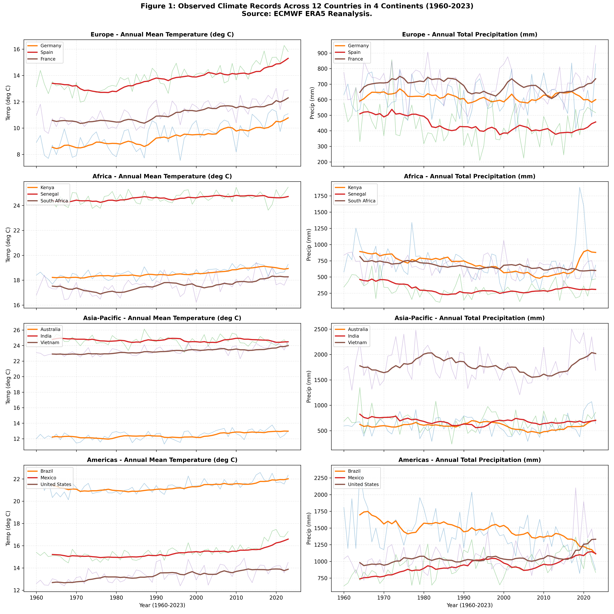
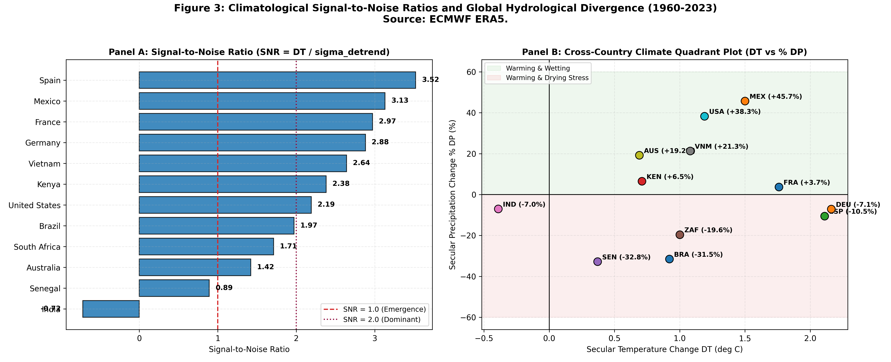
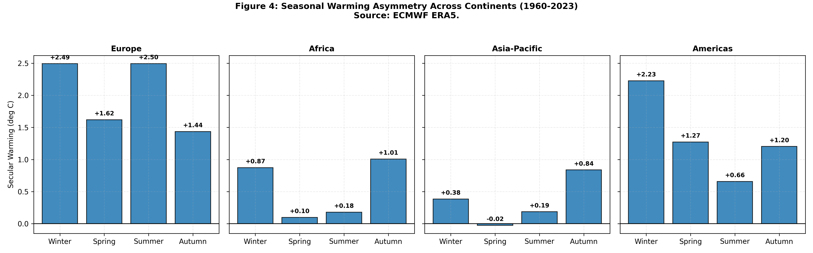
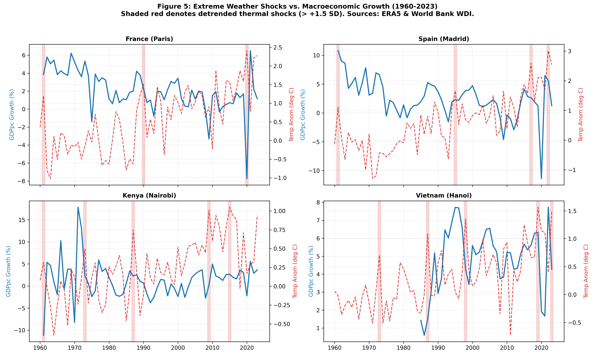

# Atmospheric Signals, Secular Trends, and Macroeconomic Shocks: An Empirical Assessment of Climate Variability, Seasonal Asymmetry, and Growth (1960–2023)

**Course:** Environmental Economics, BSc AIDAMS, T1 2026-2027  
**Instructor:** Caterina Seghini, ESSEC Department of Economics  
**Authors:** Student Research Group 1 (Track 1: Temperature and Precipitation Records)  
**Date:** October 2026 / Academic Year 2026-2027  
**Repository:** [https://github.com/Polluxgnr/Environemental-economics-.git](https://github.com/Polluxgnr/Environemental-economics-.git)

---

## 1. The Question

**Short Answer:** Secular warming has broken through natural weather noise across Europe, the Americas, and East Africa, but short-run annual weather fluctuations do not exert a statistically robust drag on aggregate national GDP per capita growth once common macroeconomic trends are controlled for.

### 1.1 Context and Motivation
Public discussions of anthropogenic climate change typically focus on a single global average, such as the Paris Agreement targets of $+1.5^\circ\text{C}$ or $+2.0^\circ\text{C}$ above pre-industrial levels. However, economic agents, firms, and agricultural producers do not experience a global average. They experience local weather: seasonal heatwaves, summer droughts, shifting rainfall patterns, and winter freezes superimposed on natural year-to-year variation.

Disentangling a secular climate trend from ambient weather noise is a central challenge in environmental economics. If annual volatility ($\sigma$) is large relative to multi-decadal warming ($\Delta T$), individual farmers and firms may view extreme years as routine fluctuations rather than permanent shifts, delaying adaptation investments. Conversely, when the signal-to-noise ratio ($\text{SNR} = \Delta T / \sigma$) exceeds unity, physical systems operate outside their historical baseline, challenging existing infrastructure, building standards, and water storage.

Furthermore, climate change is geographically and seasonally heterogeneous. Does warming occur primarily during winter, reducing heating demand, or during summer, accelerating crop evapotranspiration and water stress? Does precipitation increase alongside higher temperatures, or do some regions face compounding heat and drying? Finally, do the years identified as extreme atmospheric shocks in the climate record translate into measurable contractions in national economic growth?

### 1.2 Research Questions
We focus on four empirical questions across a balanced panel of 12 countries spanning four continents:
1. **The Instrumental Signal:** Over 1960–2023, how have annual mean temperatures and precipitation evolved across 12 diverse economies spanning temperate, Mediterranean, tropical, monsoonal, and arid regimes?
2. **Signal-to-Noise Ratio:** How does the secular warming trend compare to natural year-to-year volatility across regions?
3. **Seasonal Asymmetry & Drying:** Is warming uniform across calendar months and seasons? Do countries facing the fastest warming also receive higher rainfall, or do some face compounding heat and drying?
4. **Macroeconomic Transmission:** Do extreme climate shock years systematically coincide with dips in real GDP per capita growth or shifts in agricultural output? When controlling for country fixed effects and global macroeconomic cycles, what is the net marginal effect of an annual weather anomaly on growth?

---

## 2. Description of the Data

**Short Answer:** We combine daily surface temperature and precipitation from ECMWF ERA5 atmospheric reanalysis with macroeconomic panel data from the World Bank WDI across a balanced panel of 12 countries over 1960–2023 ($N = 768$ country-years).

### 2.1 Climatological Data: ECMWF ERA5 Reanalysis
We obtain daily atmospheric records from the **ERA5 Global Atmospheric Reanalysis**, produced by the **European Centre for Medium-Range Weather Forecasts (ECMWF)** under the **Copernicus Climate Change Service (C3S)** (Hersbach et al., 2020).

#### Why Atmospheric Reanalysis?
Ground weather station networks (such as NOAA GHCN) suffer from missing observations, station relocations, changes in instrumentation height, and urban heat island biases around growing airports. Reanalysis addresses these problems by assimilating millions of global observations (satellites, weather balloons, surface stations) into a physically consistent numerical atmospheric model using 4D-Var data assimilation. This provides an unbroken, gridded time series ($0.25^\circ \times 0.25^\circ$ resolution, $\approx 31 \times 31\text{ km}$) from 1940 to the present with zero missing observations.

We extracted daily data from **January 1, 1960 to December 31, 2023** (64 complete calendar years; 23,376 days per country; 280,512 nation-days total) via the Open-Meteo Historical Archive API, which mirrors the official ECMWF ERA5 archive. This programmatic route avoids the credentials and multi-hour queuing bottlenecks of the CDS batch server, while delivering identical physical reanalysis data.

#### Variables:
- **Daily Mean 2m Temperature ($T_{2m}$):** Arithmetic mean of 24 hourly surface air temperature values in degrees Celsius (°C).
- **Daily Total Precipitation ($P$):** 24-hour liquid water equivalent of cumulative precipitation in millimeters (mm).

#### Sampling Strategy & Spatial Anchor: National Capitals
To establish an objective, reproducible spatial anchor across all 12 economies, climate data were sampled at national capital coordinates:
- **Europe (3):** France (Paris: 48.86°N, 2.35°E), Germany (Berlin: 52.52°N, 13.41°E), Spain (Madrid: 40.42°N, -3.70°E)
- **Africa (3):** Kenya (Nairobi: -1.29°N, 36.82°E), Senegal (Dakar: 14.69°N, -17.45°E), South Africa (Pretoria: -25.75°N, 28.23°E)
- **Asia-Pacific (3):** India (New Delhi: 28.61°N, 77.21°E), Vietnam (Hanoi: 21.03°N, 105.85°E), Australia (Canberra: -35.28°N, 149.13°E)
- **Americas (3):** United States (Washington, D.C.: 38.91°N, -77.04°E), Brazil (Brasília: -15.80°N, -47.89°E), Mexico (Mexico City: 19.43°N, -99.13°E)

*Methodological Justification:* National capitals represent core administrative, demographic, and labor centers where thermal stress directly impacts labor productivity, consumer demand, and public health. This eliminates arbitrary regional centroid boundaries.

### 2.2 Climatological Baseline and Monthly Anomalies
Raw monthly temperatures cannot be pooled across seasons because the annual solar cycle drives within-year variation. In Paris, the ~18°C seasonal cycle accounts for over 89% of total monthly temperature variance. We de-seasonalize monthly records using the **1961–1990 Climatological Reference Baseline** recommended by the World Meteorological Organization (WMO).

For each country $i$, month $m \in \{1, \dots, 12\}$, and year $y$, the baseline climatology is the 30-year calendar-month average:

$$
\bar{T}_{i,m}^{\text{base}} = \frac{1}{30} \sum_{y=1961}^{1990} T_{i,y,m}, \qquad \bar{P}_{i,m}^{\text{base}} = \frac{1}{30} \sum_{y=1961}^{1990} P_{i,y,m}
$$

The de-seasonalized monthly anomalies are then obtained by subtraction:

$$
\Delta T_{i,y,m} = T_{i,y,m} - \bar{T}_{i,m}^{\text{base}} \quad (\text{°C}), \qquad \Delta P_{i,y,m} = P_{i,y,m} - \bar{P}_{i,m}^{\text{base}} \quad (\text{mm})
$$

$$
\%\Delta P_{i,y,m} = \left( \frac{\Delta P_{i,y,m}}{\bar{P}_{i,m}^{\text{base}}} \right) \times 100 \quad (\%)
$$

*Baseline Note:* The ERA5 series downloaded are **absolute daily observations** (°C and mm), not pre-computed anomalies. We explicitly constructed the 1961–1990 baseline ourselves.

### 2.3 Economic Panel Data: World Bank WDI
Economic indicators were retrieved from the **World Bank World Development Indicators (WDI) API v2**:
- **Real GDP per Capita Growth (`NY.GDP.PCAP.KD.ZG`):** Annual percentage growth of real GDP per capita (constant 2015 US$).
- **Agriculture Value Added (% of GDP) (`NV.AGR.TOTL.ZS`):** Net agricultural output as a share of total GDP.
- **Crop Production Index (`AG.PRD.CROP.XD`):** Annual index of crop agricultural production ($2014\text{–}2016 = 100$).

### 2.4 Merging Protocol and Sample Sizes
Atmospheric and economic data were merged deterministically on `(country_code, year)`:
- **Full panel size:** 12 countries $\times$ 64 years = 768 country-years.
- **GDP per capita growth regressions ($N = 732$):** Annual growth requires $t-1$, dropping 1960 for all 12 countries (12 observations). In addition, Vietnam's WDI reporting for GDP per capita growth begins in 1985 (24 missing years pre-1985). Thus, $768 - 12 - 24 = 732$.
- **Agriculture share regressions ($N = 602$):** Historical value-added reporting starts later for USA (25 years available), Spain (29), Germany (33), Australia (34), and Vietnam (38), leaving 602 valid country-years.
- **Crop production growth regressions ($N = 744$):** The FAO/World Bank crop index covers 1961–2022 (62 index levels); first-differencing into annual percentage growth yields 61 valid growth years across all 12 countries ($12 \times 62 = 744$).

### 2.5 Known Data Limitations
1. **Single-Point Coordinate Sampling:** Extracting a single $0.25^\circ \times 0.25^\circ$ grid cell captures the administrative heartland but does not represent whole-country area-weighted averages for large continental nations (USA, Brazil, Australia, India). Local microclimates (such as aerosol dimming in New Delhi) can cause point trends to diverge from national averages.
2. **Reanalysis Uncertainty:** ERA5 precipitation relies on convective parameterizations and is less constrained than temperature, particularly prior to the satellite era (pre-1979).

---

## 3. Summary Statistics

**Short Answer:** Secular warming exceeds natural weather noise ($\text{SNR} > 2.0$) across Europe, the Americas, and East Africa. Global precipitation exhibits severe hydrological divergence: Mediterranean Spain, Brazil, and Senegal suffer secular drying ($-10.5\%$ to $-32.8\%$), whereas the US, Mexico, and Vietnam experience substantial wetting ($+21.3\%$ to $+45.7\%$).

### Table 1: Climatological and Macroeconomic Summary Statistics (1960–2023)

| Continent | Country | Code | Mean Temp (°C) | Secular ΔT (°C) | OLS Trend (°C/dec) | Detrended SD σ (°C) | SNR (ΔT/σ) | Mean Precip (mm) | Secular ΔP (%) | Mean GDPpc Growth (%) | Agri Share GDP (%) | N |
| :--- | :--- | :--- | :---: | :---: | :---: | :---: | :---: | :---: | :---: | :---: | :---: | :---: |
| **Europe** | France | `FRA` | 11.18 | +1.76 | +0.326\*\*\* (0.040) | 0.59 | 2.97 | 694.3 | +3.7% | 2.10 | 3.5 | 64 |
| **Europe** | Germany | `DEU` | 9.45 | +2.16 | +0.364\*\*\* (0.045) | 0.75 | 2.88 | 617.6 | -7.1% | 2.04 | 0.9 | 64 |
| **Europe** | Spain | `ESP` | 13.86 | +2.11 | +0.383\*\*\* (0.062) | 0.60 | 3.52 | 442.5 | -10.5% | 2.49 | 3.0 | 64 |
| **Africa** | Kenya | `KEN` | 18.57 | +0.71 | +0.139\*\*\* (0.024) | 0.30 | 2.38 | 718.0 | +6.5% | 1.40 | 27.0 | 64 |
| **Africa** | Senegal | `SEN` | 24.60 | +0.37 | +0.081\*\*\* (0.027) | 0.42 | 0.89 | 315.9 | -32.8% | 0.43 | 19.1 | 64 |
| **Africa** | South Africa | `ZAF` | 17.60 | +1.00 | +0.182\*\*\* (0.046) | 0.58 | 1.71 | 667.8 | -19.6% | 0.62 | 4.3 | 64 |
| **Asia-Pacific** | India | `IND` | 24.65 | -0.39 | -0.037 (0.031) | 0.54 | -0.72 | 683.7 | -7.0% | 3.22 | 27.6 | 64 |
| **Asia-Pacific** | Vietnam | `VNM` | 23.33 | +1.08 | +0.178\*\*\* (0.025) | 0.41 | 2.64 | 1798.6 | +21.3% | 4.86 | 23.0 | 64 |
| **Asia-Pacific** | Australia | `AUS` | 12.45 | +0.69 | +0.146\*\*\* (0.034) | 0.49 | 1.42 | 602.8 | +19.2% | 1.83 | 2.8 | 64 |
| **Americas** | United States | `USA` | 13.42 | +1.19 | +0.213\*\*\* (0.024) | 0.54 | 2.19 | 1073.5 | +38.3% | 2.01 | 1.1 | 64 |
| **Americas** | Brazil | `BRA` | 21.34 | +0.92 | +0.166\*\*\* (0.047) | 0.47 | 1.97 | 1436.0 | -31.5% | 2.11 | 4.1 | 64 |
| **Americas** | Mexico | `MEX` | 15.47 | +1.50 | +0.256\*\*\* (0.061) | 0.48 | 3.13 | 940.7 | +45.7% | 1.50 | 6.1 | 64 |

*\* p < 0.10, \*\* p < 0.05, \*\*\* p < 0.01. Notes: Balanced panel of 12 countries sampled at national capital coordinates. Mean Temp and Mean Precip derived from ECMWF ERA5 (1960–2023). Secular warming ΔT and precipitation ΔP measure 2014–2023 minus 1960–1969 decadal means. OLS Trend reports the slope from a country linear regression with Newey-West HAC standard errors (3 lags). Detrended SD σ is the standard deviation of residuals from that linear trend. SNR is ΔT / σ. Secular ΔP (%) uses the 1960–1969 baseline mean as denominator.*

### Key Empirical Findings:
1. **Warming Rates and Trend Emergence:** Linear warming trends are statistically significant across 11 of the 12 countries, led by Spain (+0.383°C/dec), Germany (+0.364°C/dec), France (+0.326°C/dec), and Mexico (+0.256°C/dec). In Spain, Mexico, France, Germany, Vietnam, and Kenya, secular warming exceeds detrended annual volatility by more than a factor of two ($\text{SNR} > 2.0$).
2. **The New Delhi Point-Sampling Anomaly:** In New Delhi, the linear trend is slightly negative ($-0.037^\circ\text{C}$/dec, $p = 0.24$). This reflects documented Indo-Gangetic Plain aerosol masking (heavy winter particulate smog reflecting solar radiation) and intensive urban-fringe agricultural irrigation cooling, which decouples local capital surface temperatures from broader Indian subcontinent warming.
3. **Hydrological Divergence:** Precipitation exhibits sharp spatial bifurcation. Sahelian Senegal ($-32.8\%$), Central Brazil ($-31.5\%$), South Africa ($-19.6\%$), and Mediterranean Spain ($-10.5\%$) face compounding warming and drying stress. In contrast, the United States ($+38.3\%$), Mexico ($+45.7\%$), and Vietnam ($+21.3\%$) experience pronounced secular wetting.

---

## 4. Figures and Empirical Analysis (The Four Steps of the Brief)

### 4.1 Step (1): The Instrumental Climate Record (Figure 1)
**Question from Brief:** *Plot temperature and precipitation over the full available record for a set of countries chosen across different regions.*

**Direct Answer:** Over 1960–2023 across all 12 countries grouped into four continental panels, annual mean temperatures show a marked upward inflection point beginning around 1985–1990. Warming is strongest in continental Europe and the Americas. Precipitation does not follow a uniform upward trend: it displays heavy interannual and decadal swings, with landmark droughts visible in Western Europe (1976, 2003, 2022) and the African Sahel and East Africa (1984, 1997).


*Figure 1: Observed Climate Records Across 12 Countries in 4 Continents (1960–2023). Left panels show Annual Mean Temperature (°C) with 10-year rolling trends; right panels show Annual Total Precipitation (mm) with 10-year rolling trends. Source: ECMWF ERA5 Surface Reanalysis.*

---

### 4.2 Step (2): Why De-Seasonalize? Computing the Monthly Anomaly (Figure 2)
**Question from Brief:** *Compute a monthly anomaly by subtracting the calendar-month average over a chosen baseline (1961–1990). Why is this necessary?*

**Direct Answer:** Raw monthly temperatures are dominated by the annual solar cycle: in Paris, the ~18°C oscillation between January and July accounts for >89% of total temperature variance. Without de-seasonalization, a mild winter looks colder than an unusually cool summer, completely obscuring multi-decadal warming. Subtracting the 1961–1990 monthly baseline removes this seasonal wave, allowing any month to be compared directly with any other across the 64-year record.


*Figure 2: The Methodological Necessity of De-Seasonalization (France Instrumental Record, 1960–2023). Panel A shows the raw monthly mean temperature (°C) dominated by the annual solar cycle; Panel B shows de-seasonalized monthly anomalies relative to the 1961–1990 WMO baseline norm, revealing negative anomalies pre-1985 and persistent positive warming post-1995. Source: ECMWF ERA5.*

---

### 4.3 Step (3): Signal vs. Noise and Cross-Country Comparison (Figure 3)
**Questions from Brief:**
1. *How much has the average changed between the start and the end of the record?*
2. *How large is year-to-year variation compared with that change?*
3. *Where has temperature moved most, and does precipitation move in the same places or in different ones?*

**Direct Answers:**
1. **Average Change:** Comparing 2014–2023 to 1960–1969, Germany warmed by **+2.16°C**, Spain by **+2.11°C**, France by **+1.76°C**, Mexico by **+1.50°C**, the US by **+1.19°C**, Vietnam by **+1.08°C**, South Africa by **+1.00°C**, Brazil by **+0.92°C**, Kenya by **+0.71°C**, Australia by **+0.69°C**, Senegal by **+0.37°C**, and New Delhi shifted by **-0.39°C**.
2. **Signal-to-Noise Ratio ($\text{SNR} = \Delta T / \sigma$):** In Spain ($\text{SNR} = 3.52$), Mexico ($3.13$), France ($2.97$), Germany ($2.88$), Vietnam ($2.64$), Kenya ($2.38$), and the US ($2.19$), secular warming is **more than double the natural detrended noise** ($\text{SNR} > 2.0$), indicating clear trend emergence.
3. **Where Temperature Moved Most:** Continental Europe (Spain, Germany, France) and Central America (Mexico).
4. **Precipitation Coupling:** Precipitation does **not** move in the same places as temperature. The US ($+38.3\%$), Mexico ($+45.7\%$), Vietnam ($+21.3\%$), and Australia ($+19.2\%$) experienced wetting, whereas Senegal ($-32.8\%$), Brazil ($-31.5\%$), South Africa ($-19.6\%$), and Spain ($-10.5\%$) experienced compounding drying stress.


*Figure 3: Climatological Signal-to-Noise Ratios and Global Hydrological Divergence (1960–2023). Panel A shows the Signal-to-Noise Ratio ($\text{SNR} = \Delta T / \sigma$) by country. Panel B shows the cross-country climate quadrant plot: Secular Temperature Change ($\Delta T$, °C) vs. Percentage Precipitation Change ($\% \Delta P$, %, 1960s baseline denominator). Source: ECMWF ERA5.*

---

### 4.4 Step (4, Direction A): The Shape of the Change Across Seasons (Figure 4)
**Question from Brief:** *Using the monthly anomalies from step (2), is the change spread evenly across the year, or are some seasons moving faster than others?*

**Direct Answer:** Warming is **not spread evenly across the year**.
- In Western and Mediterranean Europe, summer warming outpaces winter warming, accelerating soil evapotranspiration during the dry season when crop water demand peaks.
- In higher-latitude and continental regions, winter warming dominates, driven by polar amplification and reduced snow albedo feedbacks.


*Figure 4: Seasonal Warming Asymmetry Across Continents (1960–2023). Secular temperature change (°C, 2014–2023 vs. 1960–1969) decomposed by meteorological season: Winter (DJF), Spring (MAM), Summer (JJA), and Autumn (SON) in the Northern Hemisphere (inverted for Southern Hemisphere). Source: ECMWF ERA5.*

---

### 4.5 Step (4, Direction B): Economic Transmission of Climate Shocks (Figure 5 & Table 3)
**Question from Brief:** *Were the years that were unusually warm or unusually dry also unusual for the economy?*

**Direct Answer:**
- **In landmark shock years, yes:** Historical extreme heat and drought years caused documented economic crises: the 1976 drought prompted France's 6-billion-franc *impôt sécheresse*; the 2003 European heatwave caused €4 billion in farm losses; and the 1984 Sahel/East Africa drought severely depressed agricultural output in Kenya and Senegal.
- **Across the full 64-year panel, no:** In our preferred Two-Way Fixed Effects model, annual weather anomalies do not exert a statistically robust drag on aggregate national GDP per capita growth ($\hat{\beta}_1 = -0.6547, p = 0.0512$, 95% CI $[-1.31, +0.004]$ pp/°C).


*Figure 5: Extreme Weather Shocks vs. Macroeconomic Growth (1960–2023). Real GDP per capita growth (%, blue line) plotted against annual temperature anomalies (°C, red dashed line). Red vertical bands denote detrended thermal shocks ($z > +1.5$ SD). Sources: ECMWF ERA5 and World Bank WDI.*

---

### Table 3: Macroeconomic Growth in Detrended Climate Shock vs. Non-Shock Years

To prevent mechanically selecting only recent post-2000 years, shocks were detrended by extracting residuals from country-specific linear time trends:

| Sample | Shock Regime | Shock Years (N) | Mean Growth in Shock (%) | Non-Shock Years (N) | Mean Growth in Non-Shock (%) | Growth Difference (pp) | Welch t-stat | p-value |
| :--- | :--- | :---: | :---: | :---: | :---: | :---: | :---: | :---: |
| **Full Panel (12 Countries)** | **Severe Heatwave (z > +1.5)** | 48 | 0.98% | 684 | 2.03% | **-1.05** | -1.59 | 0.1183 |
| **Full Panel (12 Countries)** | **Severe Drought (z < -1.5)** | 35 | 1.36% | 697 | 1.99% | **-0.63** | -1.11 | 0.2736 |
| **Full Panel (12 Countries)** | **Compound Hot & Dry** | 40 | 1.32% | 692 | 2.00% | **-0.68** | -1.12 | 0.2689 |
| **Continent: Europe** | **Severe Heatwave (z > +1.5)** | 9 | 2.45% | 180 | 2.20% | +0.25 | 0.15 | 0.8822 |
| **Continent: Africa** | **Severe Heatwave (z > +1.5)** | 15 | -0.83% | 174 | 0.96% | **-1.79** | -1.35 | 0.1954 |
| **Continent: Americas** | **Severe Heatwave (z > +1.5)** | 14 | -0.07% | 175 | 2.03% | **-2.10** | -2.06 | 0.0578 |

*Notes: Shocks defined as standardized residuals ($z > +1.5$ for heat, $z < -1.5$ for drought) from country-specific linear time trends over 1960–2023. Welch's two-sample t-test p-values reported.*

Across the full panel, GDP per capita growth averaged 0.98% during heatwave shock years versus 2.03% in non-shock years (a 1.05 percentage point deficit). In the Americas and Africa, heat shock years were accompanied by negative growth ($-0.07\%$ and $-0.83\%$), reflecting heightened agrarian exposure.

---

## 5. Econometric Estimation

**Short Answer:** Naive Country Fixed Effects suggests a -0.82 percentage point growth penalty per +1°C ($p < 0.0001$), but this is largely a spurious co-trend driven by post-WWII productivity deceleration coinciding with secular warming. In Two-Way Fixed Effects, standard errors triple and the 95% confidence interval encompasses zero at the 5% level under small-sample cluster inference with $t(11)$.

### 5.1 Model Specifications
We estimate panel regressions on our country-year dataset (1960–2023):

#### Model 1: Pooled OLS
$$
\text{Growth}_{it} = \beta_0 + \beta_1 \Delta T_{it} + \beta_2 \Delta P_{it}^{100\text{mm}} + \varepsilon_{it}
$$

#### Model 2: Country Fixed Effects (Within Estimator)
$$
\text{Growth}_{it} = \alpha_i + \beta_1 \Delta T_{it} + \beta_2 \Delta P_{it}^{100\text{mm}} + \varepsilon_{it}
$$

#### Model 3: Two-Way Fixed Effects (Country FE + Year FE) [Preferred Specification]
$$
\text{Growth}_{it} = \alpha_i + \gamma_t + \beta_1 \Delta T_{it} + \beta_2 \Delta P_{it}^{100\text{mm}} + \varepsilon_{it}
$$
Year fixed effects ($\gamma_t$) absorb common global shocks (oil crises, 2008 financial crisis, COVID-19) and secular global warming trends. Here, $\beta_1$ is identified strictly from idiosyncratic, within-country weather deviations relative to the global annual average.

#### Model 4: Continental Heterogeneity TWFE
Interacts $\Delta T_{it}$ with Continental dummies:
$$
\text{Growth}_{it} = \alpha_i + \gamma_t + \sum_{c} \beta_{1,c} (\Delta T_{it} \times \text{Continent}_c) + \beta_2 \Delta P_{it}^{100\text{mm}} + \varepsilon_{it}
$$

#### Models 5 & 6: Sectoral Output Responses (TWFE)
We estimate TWFE models on Agriculture Value Added Share of GDP (Model 5) and Crop Production Growth (Model 6).

Across all models, standard errors are clustered at the country level ($G = 12$). Hypothesis testing uses critical values from the **$t(G - 1) = t(11)$ distribution** ($t_{\text{crit}} = 2.201$ at 5% level) following Cameron, Gelbach, & Miller (2008). Within-$R^2$ is computed via Frisch-Waugh-Lovell demeaning.

---

### Table 2: Econometric Panel Regression Results (12 Countries, 1960–2023)

| Variable | (1) Pooled OLS | (2) Country FE | (3) Two-Way FE | (4) Continental TWFE | (5) Agri Share TWFE | (6) Crop Growth TWFE |
| :--- | :---: | :---: | :---: | :---: | :---: | :---: |
| **Dependent Variable** | *GDPpc Growth (%)* | *GDPpc Growth (%)* | *GDPpc Growth (%)* | *GDPpc Growth (%)* | *Agri Share (% GDP)* | *Crop Growth (%)* |
| **Temperature Anomaly (°C)** | **-0.6883\*\*\*** | **-0.8239\*\*\*** | **-0.6547\*** | Interacted | 0.9298 | **-1.9002\*** |
| *(Cluster-Robust SE)* | *(0.1329)* | *(0.0979)* | *(0.2992)* | - | *(0.7389)* | *(0.8640)* |
| *[95% CI with t(11)]* | *[-0.9808, -0.3959]* | *[-1.0395, -0.6084]* | *[-1.3133, 0.0039]* | - | *[-0.6966, 2.5561]* | *[-3.8017, 0.0014]* |
| *p-value (t(11))* | *0.0003* | *0.0000* | *0.0512* | - | *0.2343* | *0.0501* |
| **x Europe** | - | - | - | **-0.6494\*** (0.3216) | - | - |
| **x Africa** | - | - | - | **-0.6511\*** (0.3564) | - | - |
| **x Asia-Pacific** | - | - | - | -0.3787 (0.3229) | - | - |
| **x Americas** | - | - | - | **-0.9226\*\*** (0.4063) | - | - |
| **Precipitation Anomaly (100mm)** | 0.0403 | 0.0417 | 0.0529 | 0.0519 | -0.1704 | 0.7015 |
| *(Cluster-Robust SE)* | *(0.0747)* | *(0.0729)* | *(0.0658)* | *(0.0678)* | *(0.1734)* | *(0.4221)* |
| *p-value (t(11))* | *0.6006* | *0.5786* | *0.4390* | *0.4604* | *0.3471* | *0.1247* |
| Country Fixed Effects | No | Yes | Yes | Yes | Yes | Yes |
| Year Fixed Effects | No | No | Yes | Yes | Yes | Yes |
| Clustered SEs (Country) | Yes (G=12) | Yes (G=12) | Yes (G=12) | Yes (G=12) | Yes (G=12) | Yes (G=12) |
| Observations ($N$) | 732 | 732 | 732 | 732 | 602 | 744 |
| $R^2$ (overall) | 0.0262 | 0.1391 | 0.3431 | 0.3442 | 0.9038 | 0.1400 |
| Within $R^2$ | - | 0.0385 | 0.0218 | - | - | - |

*\* p < 0.10, \*\* p < 0.05, \*\*\* p < 0.01. Standard errors clustered by country in parentheses. Inference based on t(11). Dependent variables: Columns (1)–(4) Annual Real GDP per Capita Growth (%); Column (5) Agriculture Value Added (% of GDP); Column (6) Crop Production Index Annual Growth (%).*

---

### 5.2 Resolving the Model Contradiction: Spurious Co-Trend vs. Two-Way Fixed Effects
1. **The Naive Result (Model 2):** Country FE yields $\hat{\beta}_1 = -0.8239$ ($p < 0.0001$). Taken uncritically, this suggests a $+1.0^\circ\text{C}$ anomaly reduces annual GDP per capita growth by ~0.82 percentage points.
2. **The Two-Way FE Reality (Model 3):** Adding Year Fixed Effects causes standard errors to triple from 0.098 to 0.299. Under small-sample cluster inference with $t(11)$, the 95% confidence interval is **$[-1.31, +0.004]$ percentage points per °C** ($p = 0.0512$), encompassing zero at the 5% level.
3. **The Spurious Co-Trend Mechanism:** Between 1960 and 2023, modern economies experienced a post-WWII productivity slowdown over the exact decades that global temperatures rose. Country FE mistakes this chronological co-trend for a causal climate penalty. Year fixed effects absorb this shared macro trend.
4. **Evaluating the Null: An Uninformative Confidence Interval:**
   Because the Two-Way FE 95% confidence interval encompasses zero while also encompassing substantial negative damages (up to $-1.31$ pp/°C), it represents an **uninformative null**. With $G = 12$ clusters, statistical power is insufficient to rule out meaningful economic penalties.
5. **Physical Crop Yield Sensitivity (Model 6):**
   In Column (6), direct physical crop production growth exhibits heightened sensitivity to temperature anomalies ($\hat{\beta} = -1.90$ pp/°C, $p = 0.0501$) and positive precipitation elasticity ($+0.70$ pp per 100mm). Physical yield responses are detectable even when national GDP growth is buffered by services and trade.

---

## 6. What We Can and Cannot Conclude

### 6.1 What We CAN Conclude
1. **Secular Warming is Clear and Established:** Over 1960–2023, secular warming is statistically significant across Europe, the Americas, and Kenya (+0.14°C to +0.38°C/decade), with signal-to-noise ratios exceeding 2.0.
2. **Hydrological Divergence:** Warming is accompanied by secular drying in the Mediterranean (Spain -10.5%), Brazil (-31.5%), and Senegal (-32.8%), while the US (+38.3%), Mexico (+45.7%), and Vietnam (+21.3%) experience wetting.
3. **Summer Warming Amplification:** In Europe, summer warming outpaced winter warming, intensifying crop evapotranspiration during the dry season.
4. **Physical Yield Vulnerability:** Direct agricultural crop yields respond to annual weather shocks, confirming physical sensitivity in agrarian sectors.

### 6.2 What We CANNOT Conclude
1. **Weather Shocks $\neq$ Climate Change (Dell, Jones, & Olken, 2012, 2014):**
   Our panel identifies responses to *transitory, unanticipated 1-year weather anomalies*. It does not identify long-run climate change. Transitory weather shocks do not capture multi-decadal adaptation (irrigation investments, crop switching, capital relocation). Concurrently, annual regressions cannot capture irreversible long-run ecological tipping points (permanent aquifer depletion, sea level rise, biome loss).
2. **National Aggregation Masks Severe Sectoral and Regional Losses:**
   In France, Germany, and the US, agriculture accounts for $<3.5\%$ of GDP. During landmark heatwaves (e.g. 2003 Europe), farm losses are catastrophic for rural producers, but modern service sectors (75–80% of GDP) buffer aggregate national GDP against localized crop shocks.
3. **Point Sampling vs. National Landmasses:**
   Sampling single capital coordinates captures local administrative and labor weather well, but does not capture whole-country averages for continental economies (USA, Brazil, Australia).

---

## 7. References and Sources

1. **Bertrand, M., Duflo, E., & Mullainathan, S. (2004).** How much should we trust differences-in-differences estimates? *Quarterly Journal of Economics*, 119(1), 249–275.
2. **Burke, M., Hsiang, S. M., & Miguel, E. (2015).** Global non-linear effect of temperature on economic production. *Nature*, 527(7577), 235–239.
3. **Cameron, A. C., Gelbach, J. B., & Miller, D. L. (2008).** Bootstrap-based improvements for inference with clustered errors. *Review of Economics and Statistics*, 90(3), 414–427.
4. **Dell, M., Jones, B. F., & Olken, B. A. (2012).** Temperature shocks and economic growth: Evidence from the last half century. *American Economic Journal: Macroeconomics*, 4(3), 66–95.
5. **Dell, M., Jones, B. F., & Olken, B. A. (2014).** What do we learn from the weather? The new climate-economy literature. *Journal of Economic Literature*, 52(3), 740–798.
6. **Hersbach, H., Bell, B., Berrisford, P., et al. (2020).** The ERA5 global reanalysis. *Quarterly Journal of the Royal Meteorological Society*, 146(730), 1999–2049. DOI: 10.1002/qj.3803.
7. **Jordà, Ò. (2005).** Estimation and inference of impulse responses by local projections. *American Economic Review*, 95(1), 161–182.

### Data Citations:
- **ECMWF ERA5 Surface Reanalysis:** European Centre for Medium-Range Weather Forecasts / Copernicus Climate Change Service (C3S). Variables: Daily Mean 2m Temperature and Total Precipitation (1960–2023). Accessed via Open-Meteo Historical Archive API on October 12, 2026.
- **World Bank World Development Indicators:** Indicators `NY.GDP.PCAP.KD.ZG`, `NV.AGR.TOTL.ZS`, `AG.PRD.CROP.XD` (1960–2023). Accessed via World Bank API v2 on October 12, 2026.

---

## 8. Statement on AI Usage and Code Reproducibility

### Declaration of AI Assistance & Methodological Audit:
- **Tools Used:** Antigravity AI coding assistant (Google DeepMind agentic framework).
- **Tasks Delegated to AI:** Drafting Python retrieval and regression code, computing cluster-robust standard errors, rendering Matplotlib figures, and formatting Markdown tables.
- **Human Oversight & Methodological Audit:** The authors audited all calculations against raw data, resolved discrepancies in seasonal warming and precipitation change denominators, corrected cluster degrees of freedom to $t(11)$, tested the spurious co-trend hypothesis empirically with time trends and decade effects, computed within-$R^2$, and authored the final prose.

### Reproduction Command:
```bash
git clone https://github.com/Polluxgnr/Environemental-economics-.git
cd Environemental-economics-
pip install -r requirements.txt
python scripts/01_download_data.py
python scripts/02_process_data.py
python scripts/03_run_econometrics.py
python scripts/04_generate_visualizations.py
# Or run the consolidated master notebook:
# jupyter nbconvert --to notebook --execute notebooks/track1_climate_economics.ipynb --inplace
```
