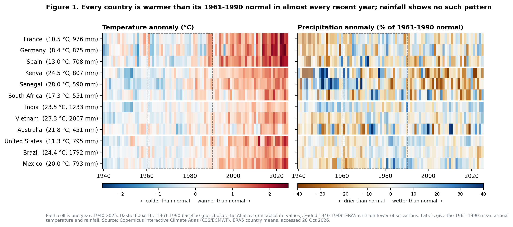
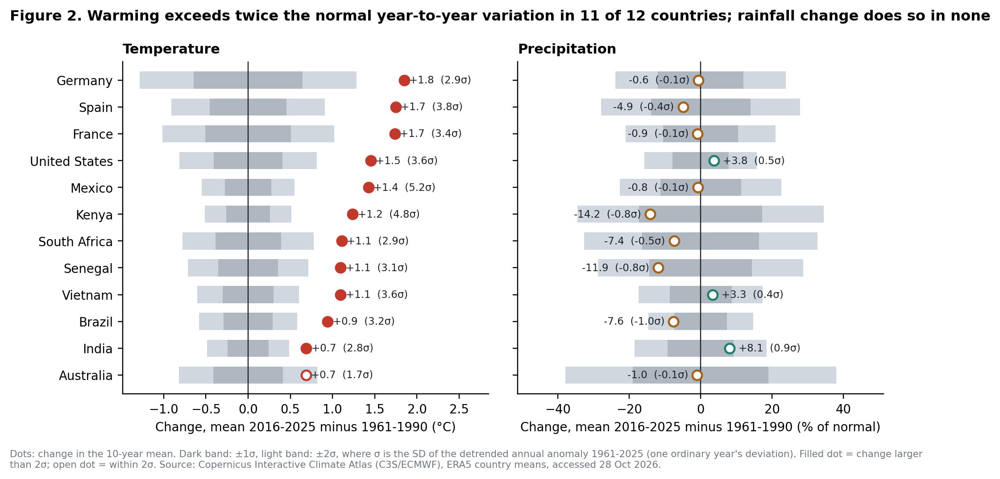
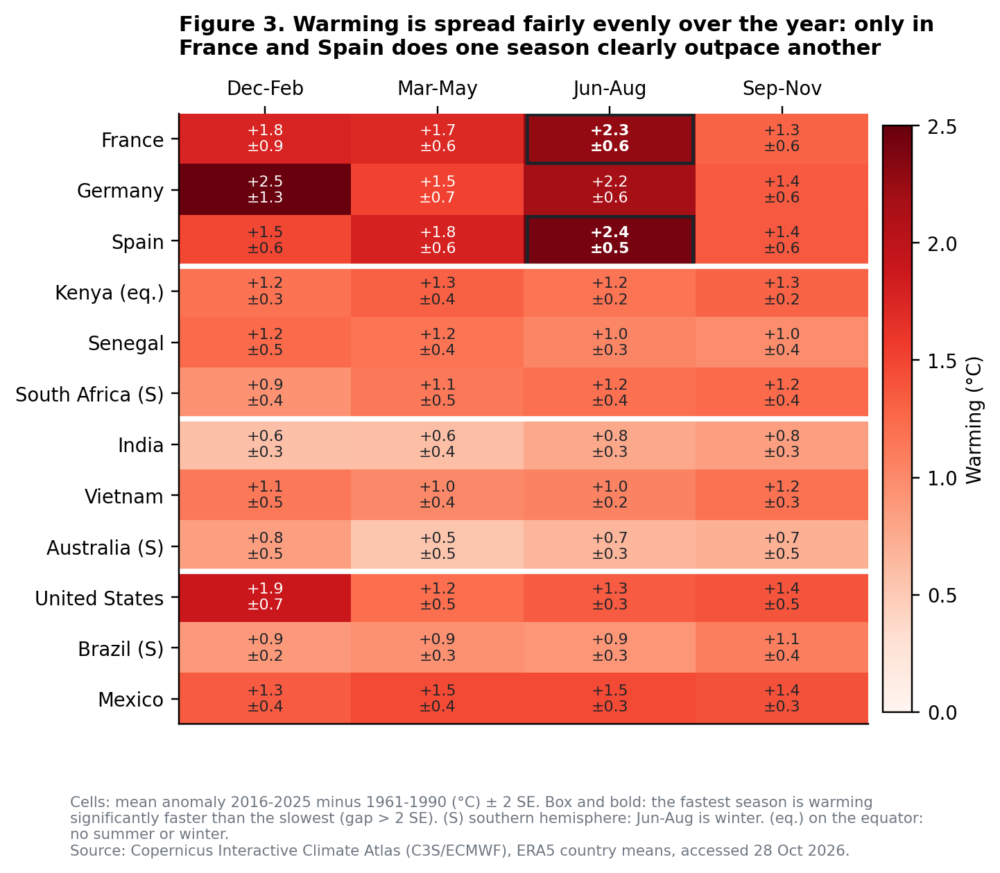
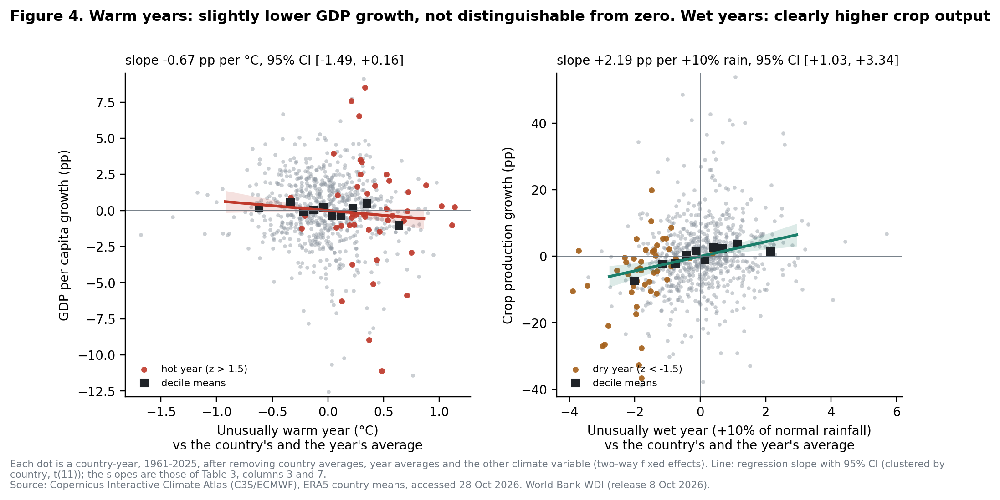
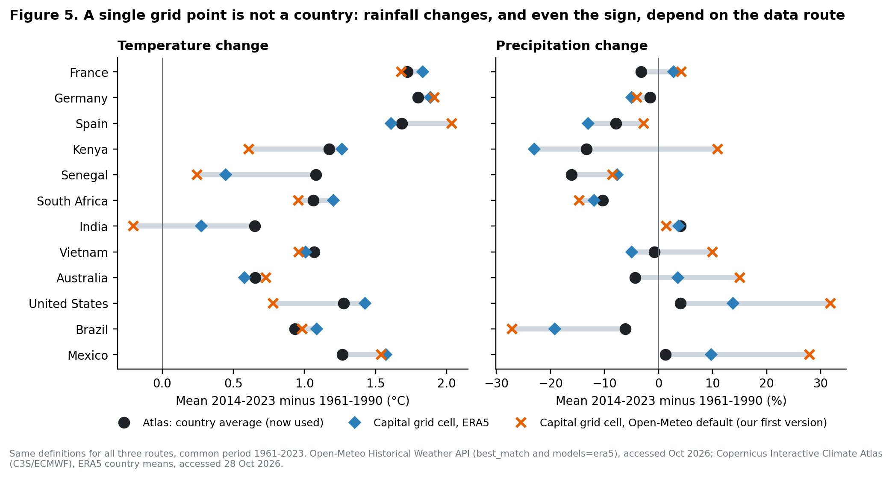

# Warming, rainfall and growth in twelve countries, 1940–2025

**Environmental Economics, BSc AIDAMS, ESSEC, T1 2026–2027 · Track 1: Temperature and precipitation records**

**Authors:** Eliott Beghin, Pollux Gronier, Saty Viard Laroque, Augustin Vlandas · **Instructor:** Caterina Seghini · **Submitted:** 2 November 2026

---

## 1. The question

The Paris targets are written as one global number, but no farmer, firm or finance ministry lives in the global average. What each of them faces is the climate of its own country: how much warmer and wetter or drier it has become, and how that change compares with the ordinary swings from one year to the next. Those swings are what people already plan around. A shift smaller than the usual year-to-year noise is hard to perceive and easy to dismiss. A shift several times larger means the "normal" year of the 1970s no longer exists.

We ask four questions for twelve countries, three in each of four regions (Europe, Africa, Asia-Pacific, the Americas), chosen to span temperate, Mediterranean, semi-arid, tropical and monsoon climates and very different economies:

1. **Change.** How much have annual temperature and precipitation changed between the 1961–1990 baseline and the last decade, 2016–2025?
2. **Noise.** How large is that change compared with normal year-to-year variation?
3. **Where and when.** Where has temperature moved most? Does precipitation move in the same places? Is the warming spread evenly across the seasons?
4. **The economy.** Were the years that stand out in the climate record, unusually hot or unusually dry, also unusual for GDP per capita growth and for crop output?

An answer to (1)–(3) is a set of numbers, each with a measure of noise, which tells a reader whether a change is distinguishable from an ordinary year. An answer to (4) is a comparison of growth in climate-shock years with growth in other years, net of each country's average and of shocks common to all countries. The audience is anyone who has to read local climate statistics: a ministry setting adaptation priorities, an insurer, or a bank stress-testing physical risk.

## 2. Data

**Climate: Copernicus Interactive Climate Atlas (C3S/ECMWF).**
- **Dataset and variables.** We use the Atlas's ERA5 dataset: *mean of daily mean 2 m temperature* (°C) and *mean of daily accumulated precipitation* (mm/day), downloaded as monthly series for each calendar month, 1940–2025.
- **ERA5 itself.** It is a reanalysis: a weather model continuously corrected by observations from stations, balloons, ships and, since 1979, satellites (Hersbach et al., 2020).
- **Regions.** The Atlas averages ERA5 over a region. For France, Germany and Spain we used its predefined *European countries* masks. Outside Europe the Atlas has no country masks, only large IPCC regions, so for the other nine countries we used its *user-defined region* tool with Natural Earth 1:50 m borders. The United States is the 48 contiguous states.
- **Check on the user-defined route.** We ran France both ways: the user-defined polygon reproduces the Atlas's own France mask to within 0.004 °C and 0.006 mm/day (correlation 0.99999).
- **Units.** Monthly precipitation in mm is the Atlas value × days in the month; annual temperature is the day-weighted mean of the 12 months; annual precipitation is their sum.

**The series are absolute values, not anomalies.** We chose the baseline ourselves: 1961–1990, the WMO reference period, which is also the first 30 years for which our economic data exist.
- **Anomalies.** For each country and calendar month we subtract that month's 1961–1990 mean. Without this step the seasonal cycle dominates: in France it accounts for 92 % of the variance of monthly temperature. Precipitation anomalies are also expressed in % of the baseline month.
- **Seasons.** DJF, MAM, JJA and SON, with December counted in the following year's DJF.
- **Hot season.** For each country, the three *consecutive* calendar months that were warmest in 1961–1990 (e.g. Jun–Aug in France, Dec–Feb in South Africa).

**Economy: World Bank World Development Indicators** (release of 8 October 2026). We use:
- real GDP per capita growth (`NY.GDP.PCAP.KD.ZG`, %);
- the crop production index (`AG.PRD.CROP.XD`, 2014–2016 = 100), from which we compute annual crop growth;
- agriculture's share of value added (`NV.AGR.TOTL.ZS`, % of GDP).

The two sources are matched on ISO country code and calendar year, and the match is exact: no climate year is lost. The losses are on the WDI side:
- Vietnam's growth series starts in 1985, giving 756 growth observations (1961–2025) rather than 780.
- The crop index runs to 2024, so crop growth covers 1962–2024 (also 756 observations, by coincidence).
- The agriculture share starts in 1991–1997 for Germany, Spain and the United States.
- Germany before 1991 is the World Bank's reconstruction of unified Germany.

**Missing values and limits.** The Atlas series have no gaps. The limits that matter are these:
- **Early record.** ERA5 is less constrained by observations before 1950, and for precipitation in Africa before satellites. We show 1940–2025 but measure change from 1961.
- **Reanalysis rainfall.** ERA5 precipitation is a model output nudged by observations, not a rain-gauge count.
- **National averages.** A country mean hides regional contrasts, for example the US Southwest against the Northeast.

**How much the data route matters.** Our first version used the Open-Meteo API at one grid point per capital, and it did not specify the model, so it silently received a blend that is essentially ERA5-Land. Putting all three routes through identical definitions (Figure 5, Table A1 in the repository) gives a clear result:
- **Temperature** is robust. Annual anomalies at the capital point correlate with the country mean at 0.91 (ERA5 point) and 0.85 (our first version's blend), with a median gap in the change of 0.19 °C. Two places differ a lot: Dakar, on the Atlantic coast, warmed much less than Senegal, and New Delhi showed no warming at all in the blend.
- **Precipitation** is not. The median gap in the change is 9 percentage points. Kenya's change flips sign: −13 % for the country, +11 % at the Nairobi point. The US capital point shows +32 % where the country shows +4 %.

Rainfall at one 10–30 km cell is not a country's rainfall. Everything below uses the Atlas country means.

## 3. Summary statistics

**Table 1. Change and noise by country** (Atlas ERA5 country means, 1961–2025).

| Country | T 1961–90 (°C) | Trend (°C/dec) | ΔT 2016–25 (°C) | σT (°C) | ΔT/σT | P 1961–90 (mm) | Trend (%/dec) | ΔP 2016–25 (%) | σP (%) | ΔP/σP |
|---|---|---|---|---|---|---|---|---|---|---|
| France | 10.5 | +0.34 (0.04) | +1.74 | 0.51 | 3.4 | 976 | −0.4 (0.7) | −0.9 | 10.5 | −0.1 |
| Germany | 8.4 | +0.35 (0.04) | +1.85 | 0.64 | 2.9 | 875 | +0.2 (0.8) | −0.6 | 12.0 | −0.1 |
| Spain | 13.0 | +0.37 (0.04) | +1.75 | 0.46 | 3.8 | 708 | −1.8 (0.8)** | −4.9 | 13.9 | −0.4 |
| Kenya | 24.5 | +0.27 (0.01) | +1.24 | 0.26 | 4.8 | 807 | −3.4 (1.1)*** | −14.2 | 17.3 | −0.8 |
| Senegal | 28.0 | +0.26 (0.03) | +1.10 | 0.36 | 3.1 | 590 | −4.1 (1.1)*** | −11.9 | 14.4 | −0.8 |
| South Africa | 17.3 | +0.21 (0.03) | +1.11 | 0.39 | 2.9 | 551 | −1.1 (1.3) | −7.4 | 16.4 | −0.5 |
| India | 23.5 | +0.14 (0.02) | +0.69 | 0.24 | 2.8 | 1233 | +0.9 (0.7) | +8.1 | 9.3 | 0.9 |
| Vietnam | 23.3 | +0.22 (0.02) | +1.09 | 0.30 | 3.6 | 2067 | +0.5 (0.7) | +3.3 | 8.7 | 0.4 |
| Australia | 21.8 | +0.13 (0.03) | +0.69 | 0.41 | 1.7 | 451 | +0.7 (1.5) | −1.0 | 19.0 | −0.1 |
| United States | 11.3 | +0.29 (0.02) | +1.45 | 0.41 | 3.6 | 795 | +0.8 (0.7) | +3.8 | 7.9 | 0.5 |
| Brazil | 24.4 | +0.20 (0.03) | +0.94 | 0.29 | 3.2 | 1792 | −0.6 (0.8) | −7.6 | 7.4 | −1.0 |
| Mexico | 20.0 | +0.29 (0.02) | +1.43 | 0.27 | 5.2 | 793 | +1.5 (1.1) | −0.8 | 11.3 | −0.1 |

*Notes.*
- **Trend:** OLS slope of the annual anomaly, per decade, 1961–2025, with Newey–West SE (3 lags) in parentheses. Every temperature trend is significant at 1 %; for precipitation, ** p < 0.05, *** p < 0.01.
- **Δ:** mean anomaly 2016–2025 relative to 1961–1990.
- **σ:** SD of the detrended annual anomaly, i.e. how far an ordinary year strays from the trend.
- **N:** 65 years per country. The range of each series is shown in full in Figure 1.

**Table 1b. The economic variables by country** (World Bank WDI, 1961–2025).

| Country | GDP pc growth: mean (%) | SD | Min | Max | N | Crop growth: mean (%) | SD | N | Agriculture, % of GDP (2016–25) |
|---|---|---|---|---|---|---|---|---|---|
| France | 2.06 | 2.27 | −7.7 | 6.5 | 65 | 0.8 | 8.6 | 63 | 1.5 |
| Germany | 1.97 | 2.22 | −5.3 | 6.6 | 65 | 0.6 | 8.4 | 63 | 0.8 |
| Spain | 2.48 | 3.31 | −11.4 | 10.8 | 65 | 2.2 | 13.2 | 63 | 2.7 |
| Kenya | 1.44 | 4.12 | −11.2 | 17.8 | 65 | 4.2 | 8.9 | 63 | 21.4 |
| Senegal | 0.55 | 3.33 | −9.3 | 6.1 | 65 | 5.4 | 26.4 | 63 | 15.7 |
| South Africa | 0.58 | 2.56 | −7.7 | 4.7 | 65 | 2.8 | 13.8 | 63 | 2.5 |
| India | 3.32 | 3.31 | −7.4 | 8.8 | 65 | 2.8 | 4.6 | 63 | 17.1 |
| Vietnam | 4.96 | 1.81 | 0.6 | 7.7 | 41 | 3.4 | 4.0 | 63 | 12.4 |
| Australia | 1.76 | 1.71 | −3.6 | 5.1 | 65 | 4.8 | 18.6 | 63 | 2.4 |
| United States | 2.00 | 2.01 | −3.4 | 6.3 | 65 | 2.0 | 9.3 | 63 | 0.9 |
| Brazil | 2.12 | 3.67 | −6.5 | 11.2 | 65 | 3.4 | 6.0 | 63 | 5.4 |
| Mexico | 1.46 | 3.43 | −9.1 | 8.3 | 65 | 2.7 | 4.6 | 63 | 3.6 |

Agriculture weighs 12–23 % of GDP in Kenya, Senegal, India and Vietnam but under 3 % in six of the twelve countries, and crop output is more volatile than GDP everywhere: its SD is 1.3 (Mexico) to 11 (Australia) times larger. That contrast is what Section 5 tests.

## 4. Figures

**Figure 1** shows the full record of both variables, as anomalies so that all countries share one scale.
- **Temperature:** every one of the 120 country-years from 2016 to 2025 was warmer than its 1961–1990 normal.
- **Rainfall:** it alternates between wet and dry years with no comparable drift.
- **Levels:** the 1961–1990 levels are in the row labels, and Figure A1 of the repository plots the levels in full.

*In simple words:* each thin stripe is one year. On the left, blue means colder than the normal of 1961–1990 and red means warmer: every row turns red on the right, so every country now has warm years almost all the time. On the right, brown means a drier year and blue a wetter one. The colours keep switching without a direction, so rainfall goes up and down with no clear trend.

**Figure 2** compares the change with the ordinary year-to-year variation.
- **Temperature.** Warming since 1961–1990 ranges from +0.7 °C (India, Australia) to +1.85 °C (Germany), in line with the IPCC's assessment that land has warmed faster than the global average (IPCC, 2021).
  - In 11 of 12 countries the change is more than twice the swing of an ordinary year (σ).
  - Mexico's +1.4 °C is 5.2σ, because its temperature barely varies from year to year.
  - Australia, at 1.7σ, is the exception: its climate is so variable that +0.7 °C stays within the range of ordinary years.
- **Rainfall.** The change is smaller than one ordinary year's swing in every country, so nobody would perceive it as a new climate. But a ten-year average is much more precise than a single year (its standard error is about 0.37σ).
  - **Detectable change:** on that basis, the change in average rainfall is statistically detectable in four countries (Table 6 in the repository): Brazil (−7.6 %), Kenya (−14 %), Senegal (−12 %) and India (+8 %).
  - **Caveat:** this rough test ignores autocorrelation. For the Sahel it also depends on the window, since the wet 1960s sit inside the baseline.
  - **Trends agree:** linear trends show significant drying in Kenya, Senegal and Spain (Table 1).

*In simple words:* think of each year's weather as a dice roll. The grey bands show how far an ordinary roll can land, and the dot shows where the last ten years landed. For temperature the dot is far outside the bands almost everywhere: the dice themselves have changed. For rain the dot stays inside the band of a single roll. In a few countries, though, the ten-year average has moved enough to be measured: rain has changed a little, not enough to feel like a new climate.

**Does rainfall change where temperature changes?** We find no detectable relationship. If anything it goes the other way: the countries that warmed most have the *smallest* rainfall changes (rank correlation between warming and the size of the rainfall change −0.42; with 12 countries the 95 % interval is about ±0.6). Germany, Spain and France warmed most and show almost no rainfall change. The largest rainfall changes are in Kenya and Senegal, which warmed less.

**Figure 3** shows whether the warming is spread evenly across the year. Broadly it is:
- **France and Spain:** the only countries where the fastest season is significantly ahead of the slowest. Summer has warmed by +2.3 and +2.4 °C against +1.3 to +1.4 °C in autumn.
- **Germany (+2.5 °C) and the United States (+1.9 °C):** both warmed most in winter. But winters there are so variable that neither gap is distinguishable from zero.
- **The tropics:** the gaps are below 0.3 °C.

Comparing the fastest with the slowest of four seasons leans towards finding a difference, and the SE assumes independent years, so we read only the clearest cases. The France–Spain summer result is also the pattern reported for southern Europe in the literature. It matters economically because it falls when crop water demand and cooling demand peak.

*In simple words:* we asked whether the warming happens more in summer or in winter. In most countries every season warmed by about the same amount. Only in France and Spain do summers clearly warm faster, and summer is exactly when heat hurts crops and people most.

**Figure 4** asks whether unusual climate years were unusual for the economy. Each country-year is plotted after removing the country's average and the year's average, so that 2009 or 2020, bad everywhere, does not count against the climate.
- **GDP:** the slope is slightly negative, but its band includes zero, and Section 5 shows it disappears once country-specific trends are removed.
- **Crops:** what stands out is rainfall. A year 10 % wetter than normal goes with crop output about 2.2 % higher that year, and the driest years sit at the bottom left.

*In simple words:* each dot is one country in one year, compared with what is normal for that country and for that year. On the left, hotter years show no clear pattern for GDP. On the right, rainier years clearly have better harvests.

**Figure 5** compares the country average (used in this paper) with one grid point at the capital (our first version), as discussed in Section 2. Temperature changes agree closely. Rainfall changes differ by 9 pp on median, and for Kenya even the sign flips.

*In simple words:* measuring a whole country's rain at its capital is like judging a whole class by one pupil. For temperature, that pupil is fairly typical. For rain, it can tell the opposite story.

**The most extreme years** (Table 5 in the repository) point the same way, because the worst harvest years were **compound heat-and-drought events**:
- **France 2003** (a 3.4σ summer, also a dry year): crop growth 21 pp below what the country and year would predict, GDP growth 1.5 pp below (Ciais et al., 2005, document the Europe-wide drop in plant productivity).
- **Germany 2003 and Australia 2019:** each country's hottest season *and* driest year on record. Crops −18 and −11 pp.
- **United States 1988** (hot and dry): crops −14 pp, GDP +1.1.
- **Senegal 1983**, its driest year: crops −35 pp.

Across all hot-season shocks, crops show no effect on average (−0.04 pp, p = 0.99), while dry years show −7.6 pp (p = 0.045; Table 4 in the repository). Water, not heat alone, is what moves harvests at this scale.

## 5. Econometrics

We estimate panel regressions by OLS with fixed effects:

$$g_{it} = \alpha_i + \gamma_t + \beta\, T_{it} + \delta\, P_{it} + \varepsilon_{it}$$

- $g_{it}$ is real GDP per capita growth (%) of country $i$ in year $t$, or crop production growth (%).
- $T_{it}$ is the annual temperature anomaly (°C relative to 1961–1990), or in variants the hot-season anomaly (Section 2).
- $P_{it}$ is the annual precipitation anomaly in units of 10 % of normal.
- $\alpha_i$ (country fixed effects) absorbs each country's average growth.
- $\gamma_t$ (year fixed effects) absorbs everything common to a year: oil shocks, the 2009 crisis, COVID, and the global warming trend itself.
- Model 4 adds one linear trend per country. It removes country-specific drifts in both growth and temperature that year effects cannot.
- **Standard errors** are clustered by country. With only 12 clusters we use t(11) critical values, and also report wild cluster bootstrap-t p-values (Webb weights, 9,999 draws), the standard fix for few clusters (Cameron, Gelbach & Miller, 2008; Webb, 2023).

**Table 3. Growth on climate anomalies, 12 countries** (cluster SE in parentheses).

| Model | Temp. β (pp/°C) | 95 % CI | p t(11) | p boot. | 1-SD warm yr | Precip. (+10 %) | N | Years |
|---|---|---|---|---|---|---|---|---|
| (1) Pooled OLS | −0.60 (0.25) | [−1.15,&nbsp;−0.05] | 0.034 | 0.068 | −0.23 | +0.03 (0.10) | 756 | 1961–2025 |
| (2) Country FE | −0.75 (0.24) | [−1.28,&nbsp;−0.21] | 0.011 | 0.031 | −0.28 | −0.06 (0.11) | 756 | 1961–2025 |
| (3) Two-way FE | −0.67 (0.37) | [−1.49,&nbsp;+0.16] | 0.103 | 0.118 | −0.25 | −0.03 (0.11) | 756 | 1961–2025 |
| **(4) Two-way FE + trends (preferred)** | **−0.04 (0.33)** | **[−0.76,&nbsp;+0.69]** | **0.917** | **0.924** | **−0.01** | +0.08 (0.08) | 756 | 1961–2025 |
| (5) Two-way FE, hot-season T | −0.43 (0.20) | [−0.87,&nbsp;−0.00] | 0.049 | 0.037 | −0.24 | −0.02 (0.10) | 756 | 1961–2025 |
| (6) Two-way FE, excl. 2020–21 | −0.71 (0.42) | [−1.63,&nbsp;+0.21] | 0.116 | 0.132 | −0.27 | −0.05 (0.12) | 732 | 1961–2025 |
| (7) Crops, two-way FE | −0.35 (0.88) | [−2.29,&nbsp;+1.59] | 0.698 | 0.721 | −0.13 | **+2.19 (0.52)** | 756 | 1962–2024 |
| (8) Crops, hot-season T | +0.81 (1.12) | [−1.67,&nbsp;+3.28] | 0.488 | 0.522 | +0.45 | **+2.33 (0.63)** | 756 | 1962–2024 |

*Notes.*
- **Samples:** GDP models use Vietnam from 1985 only.
- **1-SD warm year** = β × the average within-country SD of the detrended anomaly: 0.38 °C annual, 0.56 °C hot season.
- **Within R²** is at most 0.025 for GDP and 0.06 for crops.
- **Rain coefficients** in models 7–8: p = 0.002 and 0.004.
- **Robustness checks** are in Table 6 of the repository.

**Interpretation.**
- **Without year effects (models 1–2),** a 1 °C warmer year goes with 0.6–0.75 pp lower growth and looks significant. Both temperature and growth trend over time: the world warmed while growth slowed after the 1960s.
- **Year effects (model 3) only remove the trend that all countries share.** But the countries that warmed fastest also slowed most: across the 12 countries the correlation between the warming trend and the trend in GDP growth is −0.57. Europe warmed by 0.34–0.37 °C per decade while its growth fell, and India, one of the two slowest warmers (+0.14 °C per decade), saw its growth rise. Dropping India alone moves β from −0.67 to −0.38. Model 3 therefore still mixes weather with diverging country trends.
- **Our preferred model is model 4**, with country-specific trends, because only it isolates year-to-year weather. Its estimate is −0.04 pp per °C. The hot-season effect of model 5 also vanishes with country trends (−0.02, SE 0.15).
- **That null is fairly informative.** The 95 % interval [−0.76, +0.69] rules out losses larger than about 0.8 pp of growth per °C in this sample. That excludes effects of the size Dell, Jones & Olken (2012) estimate for poor countries (more than 1 pp per °C). Pooling rich and poor countries can hide such heterogeneity, and with 12 countries we cannot test it without choosing the split after seeing the data.
- **Crops respond to water, not temperature.** A year 10 % wetter than normal goes with crop growth 2.2 pp higher (p = 0.002).
  - **Robust:** the estimate is 1.9–2.4 when any one country is dropped, and 2.4 with country trends.
  - **A one-year effect:** the crop index is in levels, so its growth falls back the next year. With last year's rain added, this year's rain gives +2.7 and last year's −2.4. In words: crop *output* is about 2–3 % higher in a year 10 % wetter than normal, and returns to normal afterwards.
  - **Dry years:** crop growth is 7.6 pp below normal (p = 0.045), while GDP growth is only 0.27 pp lower (p = 0.50).

## 6. What we can and cannot conclude

**Method and type of result.**
- **Sections 3–4 are descriptions.** They use the Atlas country means with standard errors for trends and seasonal differences.
  - Every country has warmed, by +0.7 to +1.85 °C since 1961–1990, and in 11 of 12 that is more than twice the normal year-to-year swing.
  - The change concentrates in summer in France and Spain.
  - Rainfall has changed much less: always less than one ordinary year's swing, detectably so in four countries, and not where warming is largest.
- **Section 5 is a conditional correlation.** Dry years go with clearly lower crop output that year. We find *no* robust association between unusually warm years and GDP growth once country-specific trends are removed; the apparent penalty in simpler models comes from countries' diverging trends.

Year-to-year weather is plausibly unrelated to what the economy would have done anyway, which makes the fixed-effects design close to a natural experiment. Even so, we do not claim causal effects:
- **The panel is small.** Twelve countries give 12 clusters, and inference stays fragile however it is corrected. The GDP null is informative about large effects, but not about small ones.
- **National aggregates dilute local shocks.** National averages of both climate and GDP blur regional heatwaves and regional economies: Kenya's crop zones are not its arid north.
- **Heterogeneity.** Rich and poor economies are pooled, which can mask effects confined to poorer, more agricultural countries.

What the results would need in order to be causal and general: many more countries or sub-national units, so that standard errors shrink and heterogeneity can be tested; weather measured where economic activity takes place, for example cropland- or population-weighted; and an exposure channel fixed in advance, such as agriculture's share, rather than chosen after looking at the data.

**Weather is not climate change.** Our design measures the response to one unusual year, relative to a fixed 1961–1990 baseline. A permanent shift allows adaptation (irrigation, crop choice, air conditioning) but also accumulates damage (soil, water tables, capital).
- **Burke, Hsiang & Miguel (2015)** find a non-linear effect of temperature levels.
- **Kahn et al. (2021)** find that persistent deviations of temperature from its moving historical norm lower long-run growth. That is a different object from our year-to-year anomalies, and our results say nothing against it.

In the IPCC's language of hazard, exposure and vulnerability (IPCC, 2014), our climate series measure the hazard. A hazard becomes an economic loss only through exposure, and agriculture is a small share of GDP in most of our countries. That is consistent with our clearest economic finding: shocks show up in harvests, through water, long before they show up in GDP.

**Our position.** The warming in these records is unambiguous and large relative to what people have experienced as normal. Rainfall has changed less, and how much depends on how it is measured. A single year's heat leaves no robust trace in national GDP in our sample, while drought leaves a large but temporary one in harvests. For policy, the relevant exposure is sectoral and regional, not national.

---

## References

- Burke, M., Hsiang, S. M., & Miguel, E. (2015). Global non-linear effect of temperature on economic production. *Nature*, 527(7577), 235–239.
- Cameron, A. C., Gelbach, J. B., & Miller, D. L. (2008). Bootstrap-based improvements for inference with clustered errors. *Review of Economics and Statistics*, 90(3), 414–427.
- Ciais, P., et al. (2005). Europe-wide reduction in primary productivity caused by the heat and drought in 2003. *Nature*, 437(7058), 529–533.
- Dell, M., Jones, B. F., & Olken, B. A. (2012). Temperature shocks and economic growth: Evidence from the last half century. *American Economic Journal: Macroeconomics*, 4(3), 66–95.
- Dell, M., Jones, B. F., & Olken, B. A. (2014). What do we learn from the weather? The new climate–economy literature. *Journal of Economic Literature*, 52(3), 740–798.
- Hersbach, H., et al. (2020). The ERA5 global reanalysis. *Quarterly Journal of the Royal Meteorological Society*, 146(730), 1999–2049.
- IPCC (2014). *Climate Change 2014: Impacts, Adaptation, and Vulnerability. Summary for Policymakers*. Cambridge University Press.
- IPCC (2021). *Climate Change 2021: The Physical Science Basis. Summary for Policymakers*. Cambridge University Press.
- Kahn, M. E., Mohaddes, K., Ng, R. N. C., Pesaran, M. H., Raissi, M., & Yang, J.-C. (2021). Long-term macroeconomic effects of climate change: A cross-country analysis. *Energy Economics*, 104, 105624.
- Webb, M. D. (2023). Reworking wild bootstrap-based inference for clustered errors. *Canadian Journal of Economics*, 56(3), 839–858.

**Data.**
- Copernicus Climate Change Service (C3S)/ECMWF, *Copernicus Interactive Climate Atlas*, dataset ERA5, variables `t` and `pr`, monthly 1940–2025, https://atlas.climate.copernicus.eu, accessed 28 October 2026.
- World Bank, *World Development Indicators*, release of 8 October 2026, API v2, accessed 28 October 2026.
- Open-Meteo, *Historical Weather API* (default `best_match` model and `models=era5`), capital grid points, accessed 12 and 27 October 2026 (comparison only).
- Natural Earth, *Admin 0 – Countries*, 1:50 m and 1:110 m, v5.

## Use of AI and reproducibility

**AI use.** We used AI assistants as tools, in the way one would use a tutor or a code reviewer, and kept the analysis under our control.
- **Coding and debugging.** Antigravity (Google) and Claude (Anthropic, via Claude Code) helped write and debug the Python scripts. This includes the automated download of the Copernicus Atlas series that replaced our first, API-based data route.
- **Review.** Claude was used to check a first version of the project against the brief. That review is why we changed data source and corrected several statements.
- **Writing and slides.** Claude helped draft and edit parts of the text and lay out the presentation slides.

**Good practice.**
- Every number comes from code in the repository run on the raw data, never from an AI answer.
- We re-ran the full pipeline and checked the paper's tables against the generated output.
- Every data source is documented with its producer, version and access date.
- We discussed the methodological choices (sample, baseline, model, interpretation) and can justify each of them.

**Reproducibility.** Running `pip install -r requirements.txt` then `scripts/00_…` to `scripts/07_…` in order rebuilds every table, figure and this PDF. The raw downloads are included in `data/raw/`, and `data/README.md` gives every source, access date and the manual Atlas click-path.
