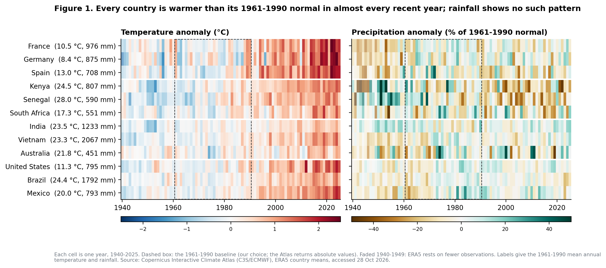
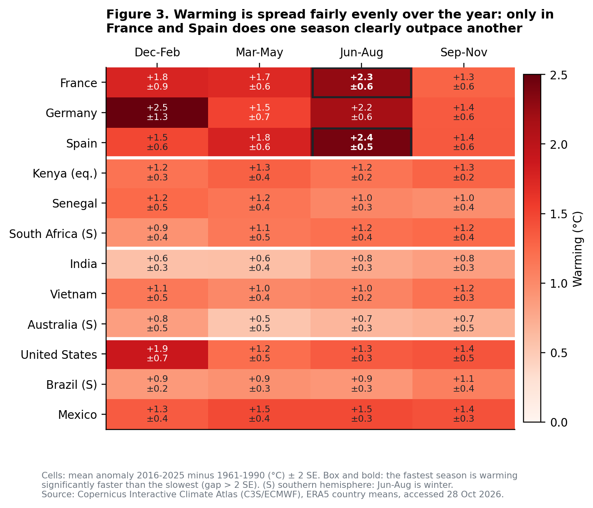
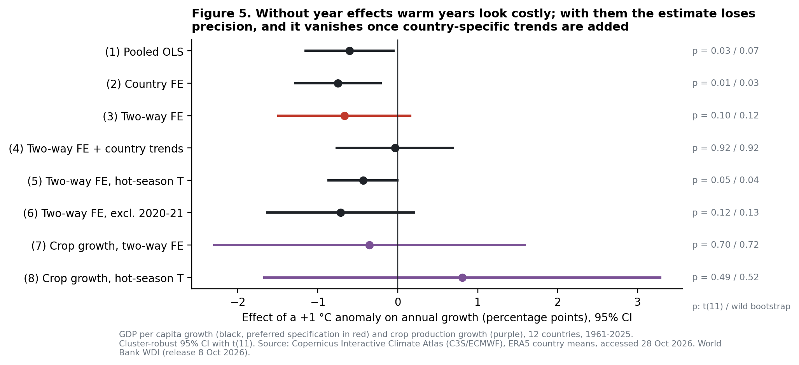

# Warming, rainfall and growth in twelve countries, 1940–2025

**Environmental Economics, BSc AIDAMS, ESSEC, T1 2026–2027 · Track 1: Temperature and precipitation records**

**Authors:** [names of the five group members] · **Instructor:** Caterina Seghini · **Submitted:** 2 November 2026

**Code and data:** https://github.com/Polluxgnr/Environemental-economics-

---

## 1. The question

The Paris targets are written as one global number, but no farmer, firm or finance ministry lives in the global average. What each of them faces is the climate of its own country: how much warmer and wetter or drier it has become, and how that change compares with the ordinary swings from one year to the next. Those swings are what people already plan around. A shift smaller than the usual year-to-year noise is hard to perceive and easy to dismiss. A shift several times larger means the "normal" year of the 1970s no longer exists.

We ask four questions for twelve countries, three per continent, chosen to span temperate, Mediterranean, semi-arid, tropical and monsoon climates and very different economies:

1. **Change.** How much have annual temperature and precipitation changed between the 1961–1990 baseline and the last decade, 2016–2025?
2. **Noise.** How large is that change compared with normal year-to-year variation?
3. **Where and when.** Where has temperature moved most? Does precipitation move in the same places? Is the warming spread evenly across the seasons?
4. **The economy.** Were the years that stand out in the climate record, unusually hot or unusually dry, also unusual for GDP per capita growth and for crop output?

An answer to (1)–(3) is a set of numbers, each with a measure of noise, which tells a reader whether a change is distinguishable from an ordinary year. An answer to (4) is a comparison of growth in climate-shock years with growth in other years, net of each country's average and of shocks common to all countries. The audience is anyone who has to read local climate statistics: a ministry setting adaptation priorities, an insurer, or a bank stress-testing physical risk.

## 2. Data

**Climate: Copernicus Interactive Climate Atlas (C3S/ECMWF).**
- **Dataset and variables.** We use the Atlas's ERA5 dataset: *mean of daily mean 2 m temperature* (°C) and *mean of daily accumulated precipitation* (mm/day), downloaded as monthly series for each calendar month, 1940–2025 (accessed 28 October 2026).
- **ERA5 itself.** It is a reanalysis: a weather model continuously corrected by observations from stations, balloons, ships and, since 1979, satellites (Hersbach et al., 2020).
- **Regions.** The Atlas averages ERA5 over a region. For France, Germany and Spain we used its predefined *European countries* masks. Outside Europe the Atlas has no country masks, only large IPCC regions, so for the other nine countries we used its *user-defined region* tool with Natural Earth 1:50 m borders. The United States is the 48 contiguous states.
- **Check on the user-defined route.** We ran France both ways: the user-defined polygon reproduces the Atlas's own France mask to within 0.004 °C and 0.006 mm/day (correlation 0.99999).
- **Units.** Monthly precipitation in mm is the Atlas value × days in the month; annual temperature is the day-weighted mean of the 12 months; annual precipitation is their sum.

**The series are absolute values, not anomalies.** We chose the baseline ourselves: 1961–1990, the WMO reference period, which is also the first 30 years for which our economic data exist. For each country and calendar month we subtract that month's 1961–1990 mean. Without this step the seasonal cycle dominates: in France it accounts for 92 % of the variance of monthly temperature. Precipitation anomalies are also expressed in % of the baseline month. Seasons are DJF, MAM, JJA and SON, with December counted in the following year's DJF.

**Economy: World Bank World Development Indicators** (release of 8 October 2026, accessed 28 October 2026). We use:
- real GDP per capita growth (`NY.GDP.PCAP.KD.ZG`, %);
- the crop production index (`AG.PRD.CROP.XD`, 2014–2016 = 100), from which we compute annual crop growth;
- agriculture's share of value added (`NV.AGR.TOTL.ZS`, % of GDP).

The two sources are matched on ISO country code and calendar year, and the match is exact: no climate year is lost. The losses are on the WDI side:
- Vietnam's growth series starts in 1985, giving 756 growth observations rather than 780.
- The crop index ends in 2023.
- The agriculture share starts in 1991–1997 for Germany, Spain and the United States.
- Germany before 1991 is the World Bank's reconstruction of unified Germany.

**Missing values and limits.** The Atlas series have no gaps. The limits that matter are these:
- **Early record.** ERA5 is less constrained by observations before 1950, and for precipitation in Africa before satellites. We show 1940–2025 but measure change from 1961.
- **Reanalysis rainfall.** ERA5 precipitation is a model output nudged by observations, not a rain-gauge count.
- **National averages.** A country mean hides regional contrasts, for example the US Southwest against the Northeast.

**How much the data route matters.** Our first version used the Open-Meteo API at one grid point per capital, and it did not specify the model, so it silently received a blend that is essentially ERA5-Land. Putting all three routes through identical definitions (Figure 6, Table A1 in the repository) gives a clear result:
- **Temperature** is robust. The capital point and the country mean correlate at 0.91 (median), and the change in the mean differs by 0.19 °C (median). Two places differ a lot: Dakar is cooled by the ocean, and New Delhi showed no warming at all in the blend.
- **Precipitation** is not. The median gap in the change is 9 percentage points. Kenya's change flips sign: −13 % for the country, +11 % at the Nairobi point. The US capital point shows +32 % where the country shows +4 %.

Rainfall at one 10–30 km cell is not a country's rainfall. Everything below uses the Atlas country means.

## 3. Summary statistics

**Table 1. Change and noise by country** (Atlas ERA5 country means, 1961–2025).

| Country | T 1961–90 (°C) | Trend (°C/dec) | ΔT 2016–25 (°C) | σT (°C) | ΔT/σT | P 1961–90 (mm) | Trend (%/dec) | ΔP 2016–25 (%) | σP (%) | ΔP/σP |
|---|---|---|---|---|---|---|---|---|---|---|
| France | 10.5 | +0.34 (0.04) | +1.74 | 0.51 | 3.4 | 976 | −0.4 (0.7) | −0.9 | 10.5 | −0.1 |
| Germany | 8.4 | +0.35 (0.04) | +1.85 | 0.64 | 2.9 | 875 | +0.2 (0.8) | −0.6 | 12.0 | −0.1 |
| Spain | 13.0 | +0.37 (0.04) | +1.75 | 0.46 | 3.8 | 708 | −1.8 (0.8)** | −4.9 | 13.9 | −0.4 |
| Kenya | 24.5 | +0.27 (0.01) | +1.24 | 0.26 | 4.8 | 807 | −3.4 (1.1)*** | −14.2 | 17.3 | −0.8 |
| Senegal | 28.0 | +0.26 (0.03) | +1.10 | 0.36 | 3.1 | 590 | −4.1 (1.1)*** | −11.9 | 14.4 | −0.8 |
| South Africa | 17.3 | +0.21 (0.03) | +1.11 | 0.39 | 2.9 | 551 | −1.1 (1.3) | −7.4 | 16.4 | −0.5 |
| India | 23.5 | +0.14 (0.02) | +0.69 | 0.24 | 2.8 | 1233 | +0.9 (0.7) | +8.1 | 9.3 | 0.9 |
| Vietnam | 23.3 | +0.22 (0.02) | +1.09 | 0.30 | 3.6 | 2067 | +0.5 (0.7) | +3.3 | 8.7 | 0.4 |
| Australia | 21.8 | +0.13 (0.03) | +0.69 | 0.41 | 1.7 | 451 | +0.7 (1.5) | −1.0 | 19.0 | −0.1 |
| United States | 11.3 | +0.29 (0.02) | +1.45 | 0.41 | 3.6 | 795 | +0.8 (0.7) | +3.8 | 7.9 | 0.5 |
| Brazil | 24.4 | +0.20 (0.03) | +0.94 | 0.29 | 3.2 | 1792 | −0.6 (0.8) | −7.6 | 7.4 | −1.0 |
| Mexico | 20.0 | +0.29 (0.02) | +1.43 | 0.27 | 5.2 | 793 | +1.5 (1.1) | −0.8 | 11.3 | −0.1 |

*Notes.*
- **Trend:** OLS slope of the annual anomaly, per decade, 1961–2025, with Newey–West SE (3 lags) in parentheses. Every temperature trend is significant at 1 %; for precipitation, ** p < 0.05, *** p < 0.01.
- **Δ:** mean anomaly 2016–2025 relative to 1961–1990.
- **σ:** SD of the detrended annual anomaly, i.e. how far an ordinary year strays from the trend.
- **N:** 65 years per country.
- Growth and crop statistics by country (means, SD, range, N) are in Table 1b of the repository.

Across countries, real GDP per capita grew 0.6–5.0 % a year on average, with an SD of 1.7–4.1 pp. Agriculture weighs 12–23 % of GDP in Kenya, Senegal, India and Vietnam (2016–2025), but under 3 % in France, Germany, Spain, Australia, the United States and South Africa.

## 4. Figures

**Figure 1** shows the full record, the brief's step 1, as anomalies so that all countries share one scale. Every one of the 120 country-years from 2016 to 2025 was warmer than its 1961–1990 normal. Rainfall alternates between wet and dry years with no comparable drift. The levels behind these anomalies are in the row labels and in Figure A1 of the repository.

**Figure 2** answers steps 3a and 3b. Warming since 1961–1990 ranges from +0.7 °C (India, Australia) to +1.85 °C (Germany). In 11 of 12 countries it is more than twice the year-to-year noise. Mexico's +1.4 °C is 5.2σ, because its temperature barely varies from year to year. Australia, at 1.7σ, is the one exception: its climate is so variable that +0.7 °C remains within the range of ordinary years. **Rainfall change exceeds 2σ in none of the 12 countries.** Linear trends say the same thing more weakly: three countries show significant drying (Kenya −3.4 %/decade, Senegal −4.1 %, Spain −1.8 %). Even there, the last decade lies within one σ of normal, so the answer depends on which years are compared. For the Sahel, the wet 1960s sit inside the baseline.

**Does rainfall move where temperature moves?** No. Across the 12 countries, the rank correlation between warming and rainfall change is 0.04. The fastest warmers, Germany, Spain and France, show almost no rainfall change. The largest rainfall changes are in Kenya (−14 %) and Senegal (−12 %), which warmed less.

**Figure 3** is step 4, direction B: the shape of the change. Warming is broadly even across the year:
- **France and Spain:** the only countries where the fastest season is significantly ahead of the slowest. Summer has warmed by +2.3 and +2.4 °C against +1.3 to +1.4 °C in autumn.
- **Germany (+2.5 °C) and the United States (+1.9 °C):** both warmed most in winter. But winters there are so variable that neither gap is distinguishable from zero.
- **The tropics:** the gaps are below 0.3 °C.

A summer-heavy warming in southern Europe matters economically: it falls when crop water demand and cooling demand peak.

**Figure 4** is step 4, direction A: were unusual climate years unusual for the economy? Each country-year is plotted after removing the country's average and the year's average, so 2009 or 2020, bad everywhere, does not count against the climate.
- **GDP:** a 1 °C warmer-than-usual year goes with growth 0.67 pp lower, but the confidence band includes zero.
- **Crops:** what stands out is rainfall. A year 10 % wetter than normal goes with crop output 2.2 pp higher (95 % CI 1.0–3.3), and the driest years sit at the bottom left.

**Figure 5** shows how much the GDP answer depends on what is controlled for. Section 5 explains it.

**Figure 6** shows why we use country means (Section 2).

**The most extreme years** (Table 5 in the repository) make the same point concretely:
- **France's hottest summer, 2003** (3.5σ for the season, but only 1.2σ as an annual mean): crop growth was 21 pp below what the country and year would predict, GDP growth 1.5 pp below (Ciais et al., 2005, document the 2003 harvest collapse).
- **Germany 2003:** −18 pp crops, −2.2 pp GDP.
- **United States 1988:** −14 pp crops, +1.1 pp GDP.
- **Senegal's driest year, 1983:** −35 pp crops, −5.2 pp GDP.

In 9 of the 12 hottest seasons on record, crop growth was more than 5 pp below normal, while GDP fell below normal in only half of them. India 2010 and Mexico 1980 are counter-examples where both rose.

## 5. Econometrics

We estimate panel regressions by OLS with fixed effects:

$$g_{it} = \alpha_i + \gamma_t + \beta\, T_{it} + \delta\, P_{it} + \varepsilon_{it}$$

- $g_{it}$ is real GDP per capita growth (%) of country $i$ in year $t$, or crop production growth (%).
- $T_{it}$ is the annual temperature anomaly (°C relative to 1961–1990). In variants it is the hot-season anomaly: the mean of the three calendar months that were warmest in 1961–1990, e.g. Jun–Aug in France and Dec–Feb in South Africa.
- $P_{it}$ is the annual precipitation anomaly in units of 10 % of normal.
- $\alpha_i$ (country fixed effects) absorbs each country's average growth.
- $\gamma_t$ (year fixed effects) absorbs everything common to a year: oil shocks, the 2009 crisis, COVID, and the global warming trend itself.
- $\beta$ is identified from a country being warmer than usual relative to the other countries in the same year. That deviation is weather, close to random from the economy's point of view (Dell, Jones & Olken, 2012, 2014).
- **Standard errors** are clustered by country. With only 12 clusters we use t(11) critical values, and also report wild cluster bootstrap-t p-values (Webb weights, 9,999 draws), the standard fix for few clusters (Cameron, Gelbach & Miller, 2008; Webb, 2023).
- **Sample:** 756 country-years, 1961–2025.

**Table 3. Growth on climate anomalies, 12 countries, 1961–2025** (cluster SE in parentheses).

| Model | Temperature β (pp per °C) | 95 % CI | p, t(11) | p, wild bootstrap | 1-SD warm year (pp) | Precip. (+10 %) |
|---|---|---|---|---|---|---|
| (1) Pooled OLS | −0.60 (0.25) | [−1.15, −0.05] | 0.034 | 0.068 | −0.23 | +0.03 (0.10) |
| (2) Country FE | −0.75 (0.24) | [−1.28, −0.21] | 0.011 | 0.031 | −0.28 | −0.06 (0.11) |
| **(3) Two-way FE (preferred)** | **−0.67 (0.37)** | **[−1.49, +0.16]** | **0.103** | **0.118** | **−0.25** | −0.03 (0.11) |
| (4) Two-way FE + country trends | −0.04 (0.33) | [−0.76, +0.69] | 0.917 | 0.924 | −0.01 | +0.08 (0.08) |
| (5) Two-way FE, hot-season T | −0.43 (0.20) | [−0.87, −0.00] | 0.049 | 0.037 | −0.24 | −0.02 (0.10) |
| (6) Two-way FE, excl. 2020–21 | −0.71 (0.42) | [−1.63, +0.21] | 0.116 | 0.132 | −0.27 | −0.05 (0.12) |
| (7) Crop growth, two-way FE | −0.35 (0.88) | [−2.29, +1.59] | 0.698 | 0.721 | −0.13 | **+2.19 (0.52)**, p = 0.002 |
| (8) Crop growth, hot-season T | +0.81 (1.12) | [−1.67, +3.28] | 0.488 | 0.522 | +0.45 | **+2.33 (0.63)**, p = 0.004 |

*Notes.*
- **1-SD warm year** = β × the average within-country SD of the detrended anomaly: 0.38 °C for the annual measure, 0.56 °C for the hot season.
- **Within R²** (the share of the variation left after fixed effects that climate explains) is at most 0.01 for GDP and 0.06 for crops.

**Interpretation.**
- **Without year effects (models 1–2),** a 1 °C warmer year goes with 0.6–0.75 pp lower growth, and that looks significant. But both temperature and growth trend over 1961–2025: the world warmed while growth slowed after the 1960s. A regression without year effects partly picks up that coincidence.
- **With year effects (model 3),** the estimate stays close (−0.67 pp/°C) but its SE rises by half. The 95 % interval runs from −1.49 to +0.16, and the bootstrap p-value is 0.12.
- **In units of the problem:** a typical warm year, one SD or 0.38 °C, would cost about 0.25 pp of growth, against average growth of about 2 %. Small, if real.
- **Country-specific trends (model 4)** remove the estimate entirely. The effect is not robust.
- **The hot-season measure (model 5)** is borderline (p ≈ 0.04–0.05). It is one of six GDP specifications, so we read it as consistent with a small effect, not as proof of one.
- **Crops respond to water, not temperature, at this level of aggregation.** Each +10 % of normal rainfall goes with 2.2 pp higher crop growth (p = 0.002). Dry years (z < −1.5) see crop growth 7.6 pp below normal (p = 0.045, Table 4 in the repository), while GDP is only 0.27 pp lower (p = 0.50).

## 6. What we can and cannot conclude

**Method and type of result.**
- **Sections 3–4 are descriptions.** They use the Atlas country means with standard errors for trends and seasonal differences, and they are solid. Every country has warmed, by +0.7 to +1.85 °C since 1961–1990. In 11 of 12 that is more than twice the normal year-to-year variation. The change concentrates in summer in France and Spain. Rainfall change is mostly within the noise and does not occur where warming is largest.
- **Section 5 is a conditional correlation.** Unusually warm years go with slightly lower GDP growth, and unusually dry years with clearly lower crop output.

Year-to-year weather is plausibly unrelated to what the economy would have done anyway, which makes the two-way fixed-effects design close to a natural experiment. Even so, we do not claim a causal effect on GDP:
- **The estimate is imprecise and fragile.** The interval includes both zero and a loss of 1.5 pp per °C, and the estimate vanishes with country trends. A non-significant result here is an uninformative null, not evidence of no effect.
- **The panel is small.** Twelve countries give 12 clusters; inference is fragile however it is corrected.
- **National aggregates dilute local shocks.** National averages of both climate and GDP blur regional heatwaves and regional economies: Kenya's crop zones are not its arid north.

What the results would need in order to be causal: many more countries or sub-national units (regions, districts), so that standard errors shrink; weather measured where economic activity takes place, for example cropland- or population-weighted; and an exposure channel fixed in advance, such as agriculture's share or heat-sensitive labour, rather than chosen after looking at the data.

**Weather is not climate change.** Our design measures the response to one unusual year. A permanent shift allows adaptation (irrigation, crop choice, air conditioning) but also accumulates damage (soil, water tables, capital). The literature disagrees on which dominates: Burke, Hsiang & Miguel (2015) find a non-linear effect of temperature levels; Kahn et al. (2021) find that persistent *deviations from historical norms*, which is what our anomalies measure, lower long-run growth. In the IPCC's language of hazard, exposure and vulnerability (IPCC, 2014), our climate series measure the hazard. They become economic losses only through exposure, and agriculture is a small share of GDP in most of our countries. That is consistent with our clearest economic finding: shocks show up in crops long before they show up in GDP.

**Our position.** The warming in these records is unambiguous and large relative to what people have experienced as normal. The rainfall signal is weak, and it is fragile to how rainfall is measured. A single year's heat leaves little trace in national GDP, while drought leaves a large one in harvests. For policy, the relevant exposure is sectoral and regional, not national.

---

## References

- Burke, M., Hsiang, S. M., & Miguel, E. (2015). Global non-linear effect of temperature on economic production. *Nature*, 527(7577), 235–239.
- Cameron, A. C., Gelbach, J. B., & Miller, D. L. (2008). Bootstrap-based improvements for inference with clustered errors. *Review of Economics and Statistics*, 90(3), 414–427.
- Ciais, P., et al. (2005). Europe-wide reduction in primary productivity caused by the heat and drought in 2003. *Nature*, 437(7058), 529–533.
- Dell, M., Jones, B. F., & Olken, B. A. (2012). Temperature shocks and economic growth: Evidence from the last half century. *American Economic Journal: Macroeconomics*, 4(3), 66–95.
- Dell, M., Jones, B. F., & Olken, B. A. (2014). What do we learn from the weather? The new climate–economy literature. *Journal of Economic Literature*, 52(3), 740–798.
- Hersbach, H., et al. (2020). The ERA5 global reanalysis. *Quarterly Journal of the Royal Meteorological Society*, 146(730), 1999–2049.
- IPCC (2014). *Climate Change 2014: Impacts, Adaptation, and Vulnerability. Summary for Policymakers*. Cambridge University Press.
- IPCC (2021). *Climate Change 2021: The Physical Science Basis. Summary for Policymakers*. Cambridge University Press.
- Kahn, M. E., Mohaddes, K., Ng, R. N. C., Pesaran, M. H., Raissi, M., & Yang, J.-C. (2021). Long-term macroeconomic effects of climate change: A cross-country analysis. *Energy Economics*, 104, 105624.
- Webb, M. D. (2023). Reworking wild bootstrap-based inference for clustered errors. *Canadian Journal of Economics*, 56(3), 839–858.

**Data.**
- Copernicus Climate Change Service (C3S)/ECMWF, *Copernicus Interactive Climate Atlas*, dataset ERA5, variables `t` and `pr`, monthly 1940–2025, https://atlas.climate.copernicus.eu, accessed 28 October 2026.
- World Bank, *World Development Indicators*, release of 8 October 2026, API v2, accessed 28 October 2026.
- Open-Meteo, *Historical Weather API* (default `best_match` model and `models=era5`), capital grid points, accessed 12 and 27 October 2026 (comparison only).
- Natural Earth, *Admin 0 – Countries*, 1:50 m and 1:110 m, v5.

## Use of AI and reproducibility

**AI use.** [To be completed by the group, naming every tool. For example: AI coding assistants (name them) were used to write and debug the download and analysis scripts, to reverse-engineer the Atlas download requests, to draft figure code and parts of the text, and to audit the first version of the project. All numbers were produced by the code in the repository from the raw data; the authors checked them and can explain each one.]

**Reproducibility.** Running `pip install -r requirements.txt` then `scripts/00_…` to `scripts/06_…` in order rebuilds every table and figure. The raw downloads are included in `data/raw/`, and `data/README.md` gives every source, access date and the manual Atlas click-path.
