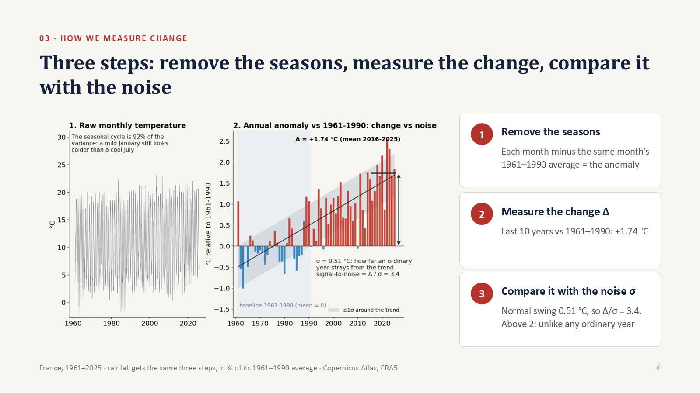
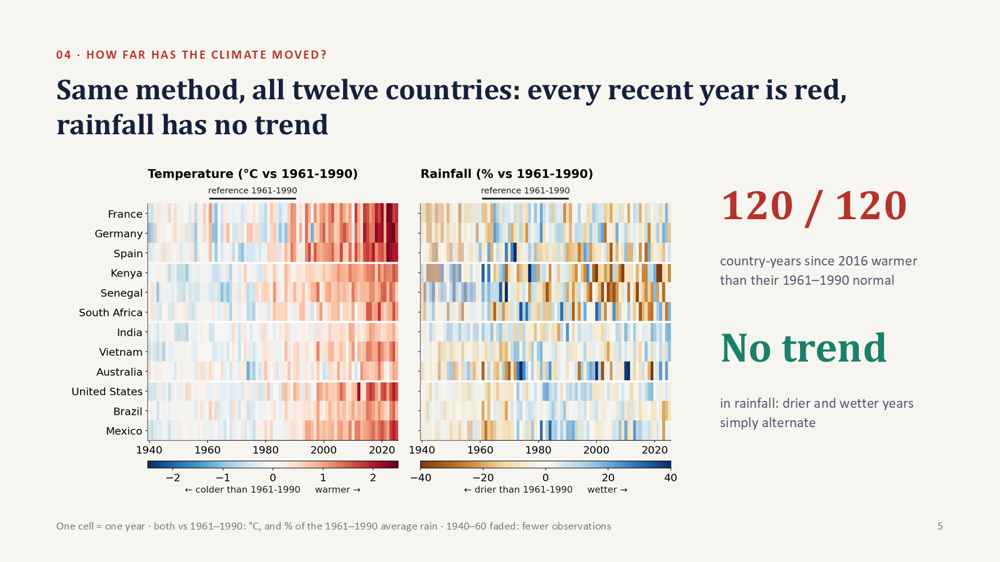
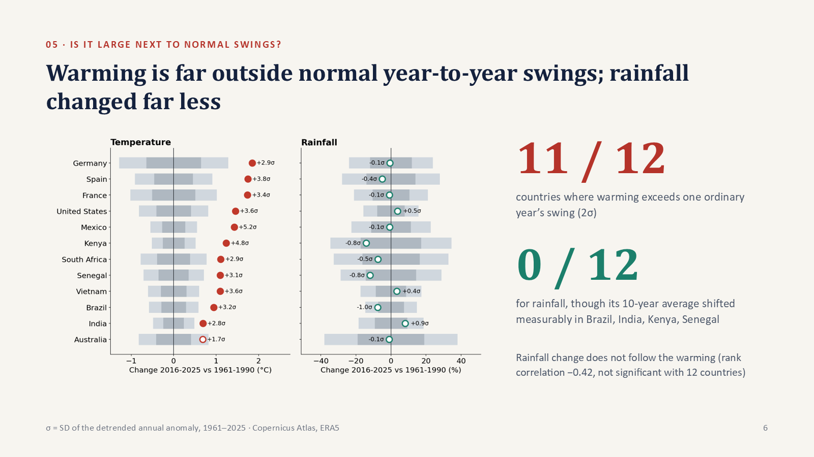

# Prep, Pollux: slides 4–6

2:35–5:20 · about 370 spoken words · between Saty (slides 1–3) and Augustin (slides 7–9).

## Your part in one breath

Saty asks three questions:

1. How far has the climate moved?
2. Is that large next to normal ups and downs?
3. Were the unusual years also unusual for the economy?

**You answer the first two.** Slide 4 gives the tool, slide 5 answers Q1, slide 6 answers Q2.

- **Cue in** (Saty): *"The next question is how to measure change."*
- **Your first words:** *"How do we measure change? In three steps…"*
- **Your last words:** *"But when in the year does the warming happen?"* Augustin then says *"Mostly, evenly across the year."*

### The one picture to keep in mind: the tide and the waves

Think of the sea at a harbour:
- **The waves** are the weather. Every year is a bit warmer or cooler than expected. **σ** measures how big the waves are.
- **The tide** is the climate: the level the waves move around. **Δ** measures how much the tide has risen since 1961–1990.
- **Δ / σ** asks whether the tide has risen by more than a big wave. If it has (ratio above 2), even a cool year today is warmer than a typical year used to be. That is what "the climate has moved" means.

---

## Slide 4: How we measure change (2:35–3:40)

### What you say

> How do we measure change? In three steps, shown here on France. Step one: remove the seasons. On the left is raw monthly temperature, and the seasons are 92 percent of what you see: a mild January still looks colder than a cool July. So we compare each month with the same month in 1961 to 1990, the WMO's reference period. What is left is the anomaly; on the right, it is averaged by year. Step two: the change, delta, the last ten years against the reference: +1.74 degrees. Step three: compare it with the noise, sigma, how far an ordinary year strays from the trend: 0.51 degrees. The ratio is 3.4. Above two, the last decade could not pass for an ordinary year. Rainfall gets the same three steps, in percent of its 1961–1990 average.

**Skeleton:** three steps, France → ① seasons = 92 % → same month 1961–1990 → anomaly → ② Δ = +1.74 → ③ σ = 0.51 → 3.4 > 2 → rain: same, in %

**Point at:** card 1 + left chart → card 2 + black arrow → card 3 + grey band.

### How the chart is built (read it like a map)

**Left chart: raw monthly temperature, France, 1961–2025.** One point per month (780 months), straight from the Copernicus file, in °C. The zig-zag is summer–winter–summer: about 3 °C in January, 18.6 °C in July (1961–1990 averages).

**Right chart: the same data after step 1, one bar per year.**

| Element | What it is |
|---|---|
| **Bars** | The annual anomaly: how much warmer (red) or cooler (blue) that year was than the 1961–1990 normal |
| **Shaded block, 1961–1990** | The reference period itself. By construction its bars average exactly zero (we checked: 0.0004) |
| **Black sloping line** | The trend: the straight line that best fits the 65 bars (least squares). It rises 0.34 °C per decade |
| **Grey band around the line** | ±1σ: the line plus or minus 0.51 °C. About two years in three fall inside it (France: 44 of 65) |
| **Short black line on the right** | The average of the last ten bars (2016–2025): +1.74 °C |
| **Double arrow** | Δ: the distance from 0 (the old normal) up to that average |

**Is the grey band "2" or "0.51"?** It is **0.51**. The band is the trend ± 1σ, so it is 0.51 °C above and 0.51 °C below the line (1.02 °C wide). The number **2** is not drawn on this chart. It is the threshold for the *ratio* Δ/σ. It only appears as a band on slide 6, where the light grey band is ±2σ.

**What is on the left of the right chart?** The years 1961–1990, which *are* the reference: the bars there are measured against their own average, so they go up and down around zero. There is no 1940–1960 on this chart (it starts in 1961). On slide 5, where 1940–1960 does appear, those years are also measured against 1961–1990. There is only one reference period in the whole project.

**The blank gaps between bars** (1991, 1996, 2010) are not missing data. Those years were a hair below the normal (−0.02, −0.08, −0.07 °C), so their blue bar is too small to see.

### How each number is computed: France, step by step

**Step 1: the anomaly (removes the seasons).**
1. The **normal** for each calendar month is the average of that month over the 30 years 1961–1990. For France, July's normal is 18.56 °C.
2. The **monthly anomaly** is the month minus its normal. July 2022 was 21.92 °C, so its anomaly is 21.92 − 18.56 = **+3.35 °C**.
3. The **annual anomaly** is the average of the 12 monthly anomalies, weighted by the number of days. For 2022: +0.47, +2.54, +2.34, +1.38, +3.66, +3.52, +3.35, +4.00, +0.75, +4.13, +2.70, +1.59, giving **+2.54 °C**, the tallest bar on the chart.
4. **Where 92 % comes from.** The variance of the raw monthly series is 34.1; after subtracting the normals it is 2.6. So the seasons were 1 − 2.6/34.1 = **92 %** of all the movement.

**Step 2: the change Δ.** Average the annual anomalies of the last ten years:
- 2016–2025: +1.08, +1.31, +1.94, +1.67, +2.15, +0.87, +2.54, +2.31, +1.68, +1.84
- Mean: **Δ = +1.74 °C**. The reference averages zero, so Δ is the warming since 1961–1990.

**Step 3: the noise σ.**
1. Fit the trend line through the 65 annual anomalies (1961–2025). It goes from −0.49 °C in 1961 to +1.69 °C in 2025.
2. For each year, take the gap between the bar and the line. For example, 2022: 2.54 − 1.59 = +0.95 (a hot year even for its time); 2021: 0.87 − 1.55 = −0.68 (a cool one).
3. σ is the standard deviation of these 65 gaps: **σ = 0.51 °C**.
4. **Ratio:** Δ/σ = 1.74 / 0.51 = **3.4**.

**Why measure the gaps from the trend line and not from zero?** If we measured from zero, the warming itself would count as "noise". The plain standard deviation of France's anomalies is 0.82 °C. That mixes the cool 1960s and the warm 2020s, and would make the change look smaller than it is. The waves have to be measured around the tide, not around where the tide used to be.

**Why does Δ start from zero but σ from the trend?** They answer different questions:
- **Δ:** how far has the normal moved? That is a distance between two climates, old and recent.
- **σ:** how much does a single year wobble around its own climate? That is the size of the waves, wherever the tide is.

### Why a ratio, and why compare it with 2?

**Why a ratio?** A degree does not mean the same thing everywhere. Mexico's years barely vary (σ = 0.27 °C), so +1.4 °C there is something nobody has ever seen. Germany's years vary a lot (σ = 0.64 °C, mild or freezing winters), so +1.85 °C there is less unusual compared with what people are used to. Dividing by σ puts every country on the same scale: "how many normal swings has the climate moved?" It has no unit, so it also works for rainfall in %.

**Why 2?**
1. Year-to-year gaps are roughly bell-shaped, and in a bell shape about 95 % of values fall within ±2σ. **We checked this on our data:** across all 780 country-years, 4.4 % fall outside ±2σ of their trend (2.2 % on the warm side). That is almost exactly the 5 % a bell shape predicts.
2. So "Δ above 2σ" means the recent average is warmer than about 97–98 % of ordinary years would ever be in the old climate. In plain words, **it could not pass for an ordinary year.**
3. It is a reading rule, not a formal test, and the result does not depend on it. With a stricter bar of 3σ, **8 of 12** countries still pass.
4. The most concrete version: **in all 12 countries, not one single year of 1961–1990 was as warm as the 2016–2025 average.** France's warmest old year was 1989 (+1.17 °C), below the recent average of +1.74.

**Why this is conservative.** We compare a *ten-year average* with the swing of a *single* year. An average of ten years wobbles much less than one year: about σ/√10 = 0.16 °C for France. So a purely statistical test would flag even smaller changes. We chose the stricter question on purpose: would people *feel* a different climate?

---

## Slide 5: How far has the climate moved? (3:40–4:25)

### What you say

> Now the same method on all twelve countries, every year since 1940: one row per country, one cell per year, both measured against the same reference, marked on top. Temperature, on the left: mostly blue before the 1980s, red after, and all hundred and twenty country-years since 2016 are warmer than their old normal. Rainfall, on the right: brown is a drier year, blue a wetter one, and they simply alternate, with no trend. The years before 1961 are faded because fewer observations stand behind them. So for temperature, the climate has clearly moved. But is that large next to normal ups and downs?

**Skeleton:** same method, 12 countries, since 1940 → reference bar on top → blue → red, all 120 since 2016 warmer → rain alternates, no trend → before 1961 faded → *"But is that large next to normal ups and downs?"*

**Point at:** "reference 1961–1990" bar → dark-red right edge of the temperature panel → the rainfall panel.

### How the chart is built

- **One cell = one country × one year.** Each cell is exactly the annual anomaly from step 1 on slide 4, so France's row is slide 4's bars turned into colours.
- **Temperature colours:** °C above (red) or below (blue) the country's own 1961–1990 normal. The scale runs from −2.5 to +2.5 °C, and anything beyond is the darkest shade.
- **Rainfall colours:** the year's total rain compared with the 1961–1990 average total, in %, from −40 % (dark brown) to +40 % (dark blue).
- **Rows:** grouped by continent (Europe, Africa, Asia-Pacific, Americas), separated by the white lines. Those lines are not gaps in the data.
- **The black bar on top** marks 1961–1990, the reference. It is the same for every row and both panels.
- **1940–1960 faded:** a light veil over those years.

**Some cells to make it concrete:**
- **France 2022:** +2.54 °C, the darkest red in its row, and rain −13 %.
- **Germany 1940:** −1.83 °C, a dark blue cell at the far left (a very cold wartime winter).
- **Kenya 2022:** rain −46 %, a dark brown cell (the East African drought).

### The faded years (1940–1960): what are they compared with?

They are compared with **the same 1961–1990 reference**, like every other cell. There is no separate 1940–1960 baseline. On average they were about 0.2 °C below the 1961–1990 normal, which is why the left side is mostly pale blue.

We fade them because ERA5 is a weather model corrected by observations, and before about 1950 there were far fewer observations (no satellites until 1979, few stations in Africa). So we show them for context, but **every number we quote starts in 1961.**

### What we can say about this chart

- **Temperature:** the change is everywhere and in the same direction. Every row turns red, and all 120 cells since 2016 are above zero. The lowest is Australia 2022, at +0.07 °C.
- **Rainfall:** there is no colour drift. Dry and wet years alternate in every row, so whatever changed is small next to the year-to-year swings.
- **What we cannot say from this chart alone:** *how* large the change is compared with normal swings. That is slide 6.

---

## Slide 6: Is it large next to normal swings? (4:25–5:20)

### What you say

> This chart answers it. Each dot is a country's change; the grey bands are one and two sigma, that country's normal swing. Temperature is beyond two sigma in 11 of 12 countries. Mexico is the clearest case: +1.4 degrees is 5.2 sigma, because its temperature barely varies. Germany warmed more, but its winters swing so much that it is 2.9 sigma. Australia is the only exception, at 1.7. Rainfall: everywhere, the change is smaller than one ordinary year's swing, so nobody would feel a new rainfall climate. Still, its ten-year average shifted measurably in four countries: Brazil, India, Kenya and Senegal. So temperature has clearly moved, rainfall much less. But when in the year does the warming happen?

**Skeleton:** this chart answers it → dot = Δ, bands = 1σ and 2σ → 11/12 → Mexico 5.2σ (barely varies) → Germany 2.9σ (winters swing) → Australia 1.7 → rain: inside everywhere → but average shifted in 4 → temperature moved, rainfall much less → *"But when in the year…?"*

**Point at:** Mexico, Germany, Australia (the hollow red dot) → Kenya and Senegal on the right.

### How the chart is built

Each row is one country, and both panels use the same rows.

| Element | What it is |
|---|---|
| **Dot** | Δ for that country, in °C (left) or % (right): its 2016–2025 average minus 1961–1990. The same number as slide 4's arrow; for France, +1.74 |
| **Dark grey band** | ±1σ around **zero** (the old normal), using that country's own σ |
| **Light grey band** | ±2σ around zero |
| **Label next to the dot** | The ratio Δ/σ, e.g. "+3.4σ" for France |
| **Filled dot** | Δ is outside the light band (ratio above 2). **Hollow dot:** inside |
| **Row order** | Sorted by warming in °C, biggest at the top. The rainfall panel keeps the same rows so you can read a country across |

**Why are the bands centred on zero here, but on the trend in slide 4?** Here we ask: if the climate were still the 1961–1990 one, would a year this far from zero be ordinary? So the bands show the normal range of an ordinary year around the old normal. Their width is σ, measured around the trend so the warming is not counted as noise.

**Why are the bands different widths?** Each country has its own σ. Germany's band is wide (σ 0.64), Mexico's narrow (σ 0.27).

### Why is Germany above Spain if its ratio is lower?

Because **the rows are sorted by the warming in degrees, not by the ratio.**

| | Δ (°C) | σ (°C) | Δ/σ |
|---|---|---|---|
| Germany | **+1.85** (largest of all) | **0.64** (largest of all) | 2.9 |
| Spain | +1.75 | 0.46 | 3.8 |
| France | +1.74 | 0.51 | 3.4 |

Germany warmed the most in degrees, so it is at the top. But its σ is the *highest* of the 12 countries, not the lowest: German years swing a lot (a mild winter or a freezing one changes the whole year). So its ratio is the lowest of the three European countries. The order is deliberate. It shows the main point of the chart: **the biggest warming in degrees is not the most unusual one.** Mexico is fifth by degrees (+1.43) but first by ratio (5.2σ).

### What we can say about this chart

**Temperature: 11 of 12 dots are outside the light band.** In every country except Australia, the recent decade is outside the range of ordinary years. Australia (+0.69 °C, σ 0.41, ratio 1.7) warmed the least (tied with India) and has big natural swings: El Niño and La Niña push whole years up or down.

**Rainfall: every dot is inside the bands.** But "0 of 12" and "measurable in 4" answer two different questions:

| Question | Compared with | Kenya | Result |
|---|---|---|---|
| Would people **feel** a new rainfall climate? | the swing of **one** ordinary year (2σ = ±34.5 %) | −14.2 % is well inside | 0 of 12 |
| Has the **average** rainfall really shifted? | the precision of a 10-year average against a 30-year one: σ × √(1/10 + 1/30) = 6.3 % | −14.2 / 6.3 = −2.2, beyond 2 | 4 of 12 |

The other three: Senegal −11.9 % (−2.3), India +8.1 % (+2.4), Brazil −7.6 % (−2.8). So rainfall did shift in four countries, but by less than the normal difference between a dry year and a wet one.

**Rainfall does not follow the warming.** The countries that warmed most do not have the biggest rainfall changes (rank correlation −0.42; with 12 countries, anything within about ±0.6 could be chance). So "warmer" does not automatically mean "drier" or "wetter" here.

---

## Questions you may get, with answers

**How exactly do you compute Δ?** The average of the ten annual anomalies 2016–2025. Each annual anomaly is the day-weighted average of the 12 monthly anomalies, and each monthly anomaly is that month minus its 1961–1990 average. France: +1.74 °C.

**And σ?** Fit a straight line through the 65 annual anomalies 1961–2025, take each year's gap from the line, and compute the standard deviation of the gaps. France: 0.51 °C.

**Why 2 and not 1 or 3?** About 95 % of ordinary years fall within ±2σ, and on our 780 country-years it is 95.6 %. At 3σ, 8 of 12 countries still pass, and not one year of 1961–1990 in any country was as warm as the recent average. The conclusion does not hinge on the 2.

**Isn't comparing a decade average with one year's swing unfair?** It is deliberately strict. A ten-year average wobbles about three times less than one year (σ/√10). A purely statistical test would pass even more easily. Our question is whether people would feel the difference.

**Why the last 10 years and not just 2025?** One year is mostly weather. France was +2.54 °C in 2022 but +0.87 in 2021. Ten years average that out.

**Why not the newer 1991–2020 normal?** It already contains much of the warming. Δ would be smaller, because part of the warming would count as "normal". The trend and σ would not change.

**Is the grey band on slide 4 the same as on slide 6?** No. Slide 4: ±1σ around the *trend line* (how much years wobble). Slide 6: ±1σ and ±2σ around *zero* (the range of an ordinary year in the old climate). Same σ, different centre.

**Do the faded years 1940–1960 use another baseline?** No. Every cell, from 1940 to 2025, is measured against 1961–1990. They are faded only because the data behind them are thinner.

**Why is Germany at the top of slide 6?** The rows are sorted by warming in °C, and Germany warmed most (+1.85). Its ratio is lower because its σ is the highest (0.64).

**Where does 92 % come from?** France's monthly variance is 34.1 before removing the monthly normals and 2.6 after: 1 − 2.6/34.1 = 0.92.

**Some rainfall trends are significant in the paper (Kenya, Senegal, Spain). Why say rainfall changed little?** A trend uses all 65 years, so it is precise. Those trends are real, but small next to one year's swing. That is exactly slide 6's point.

**Is ERA5 rainfall reliable?** Less than temperature. Temperature is well constrained by observations; rainfall comes partly from the model's physics. That is one more reason we only say rainfall "changed far less", not that it did not change.

---

## Self-test (cover the answers)

1. Cue in and last line? 

answer
In: "The next question is how to measure change." Out: "But when in the year does the warming happen?"

2. Compute France's July 2022 anomaly. 

answer
21.92 − 18.56 = +3.35 °C

3. How is Δ computed, and France's value? 

answer
Mean of the 2016–2025 annual anomalies; +1.74 °C

4. How is σ computed, and why around the trend? 

answer
SD of the gaps between each year and the 1961–2025 trend line; 0.51 °C. Otherwise the warming would count as noise (0.82 instead)

5. Grey band on slide 4: 2 or 0.51? 

answer
±0.51 °C (±1σ) around the trend. The 2 is the threshold for Δ/σ

6. Why 2? 

answer
~95 % of ordinary years fall within ±2σ (95.6 % in our data); at 3σ still 8/12; no 1961–1990 year was as warm as the recent average

7. What are the 1940–1960 cells compared with? 

answer
1961–1990, like every cell; faded only because of fewer observations

8. Why is Germany above Spain on slide 6? 

answer
Rows sorted by warming in °C (Germany +1.85 > Spain +1.75); Germany's σ is the highest (0.64), so its ratio is lower (2.9 vs 3.8)

9. Bands on slide 6 are centred on what? 

answer
Zero, the old normal: the range of an ordinary year in the 1961–1990 climate

10. Rainfall: 0 of 12 and 4 of 12, explain. 

answer
0/12 beyond one year's swing (would people feel it?); 4/12 where the 10-year average shifted measurably (Kenya −14 %, z = −2.2)

## Rehearsal plan

1. Read the three texts aloud twice with the deck open in presenter view (the notes are the same text).
2. Explain the tide-and-waves picture to someone in 20 seconds. If you can, you understand Δ, σ and the ratio.
3. Give each slide from its skeleton only. The words may change; the order and the numbers must not.
4. Time yourself: **2:45** for the three slides. If you run long, shorten the explanations, never the handover lines.
5. Rehearse both handovers out loud with Saty and Augustin.
