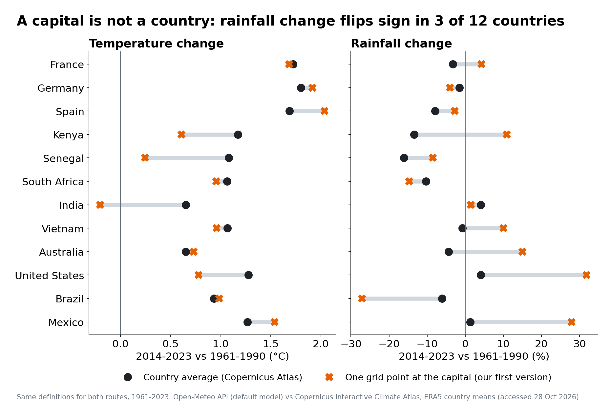
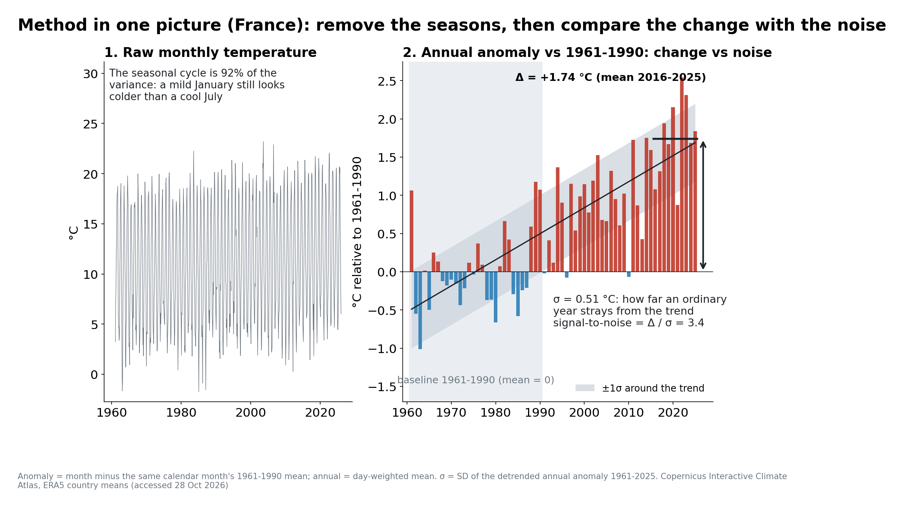
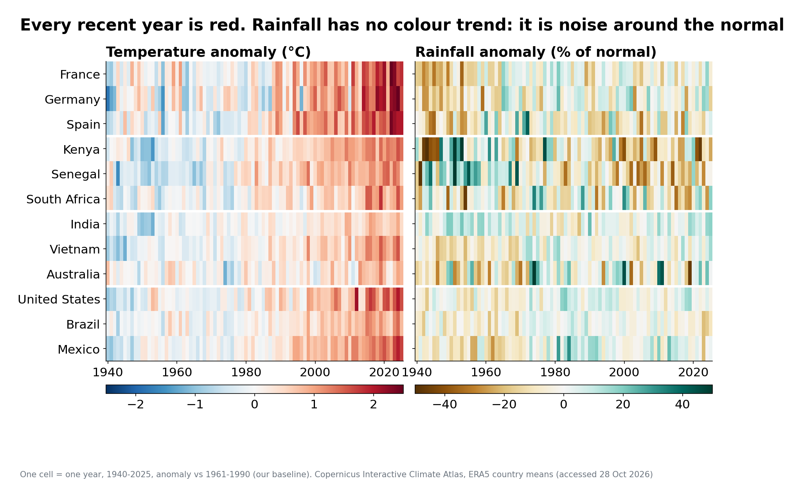
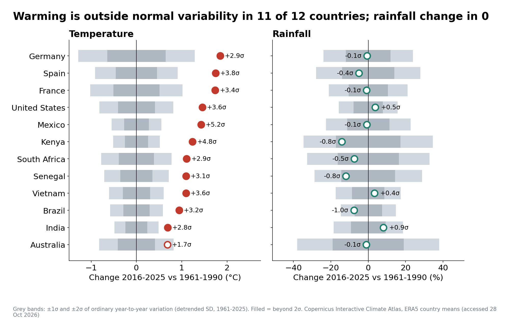
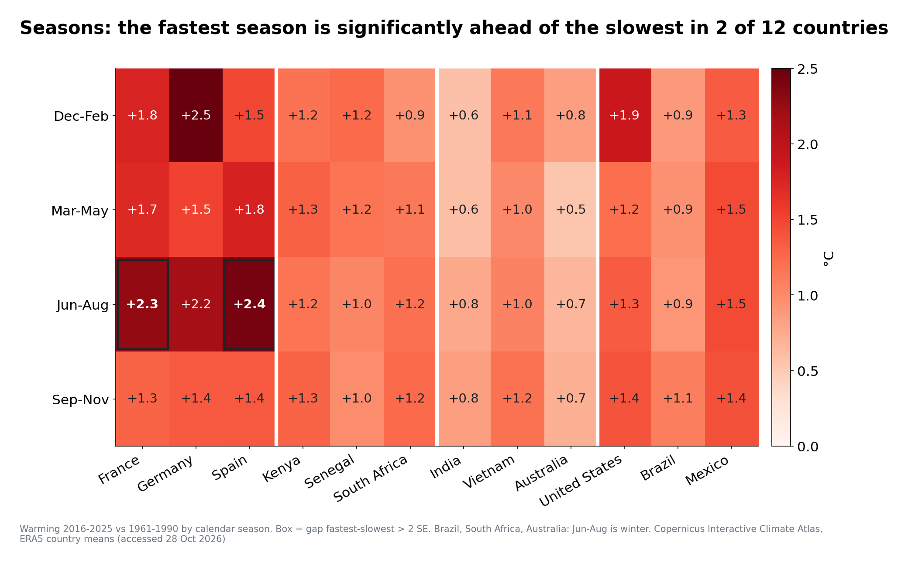
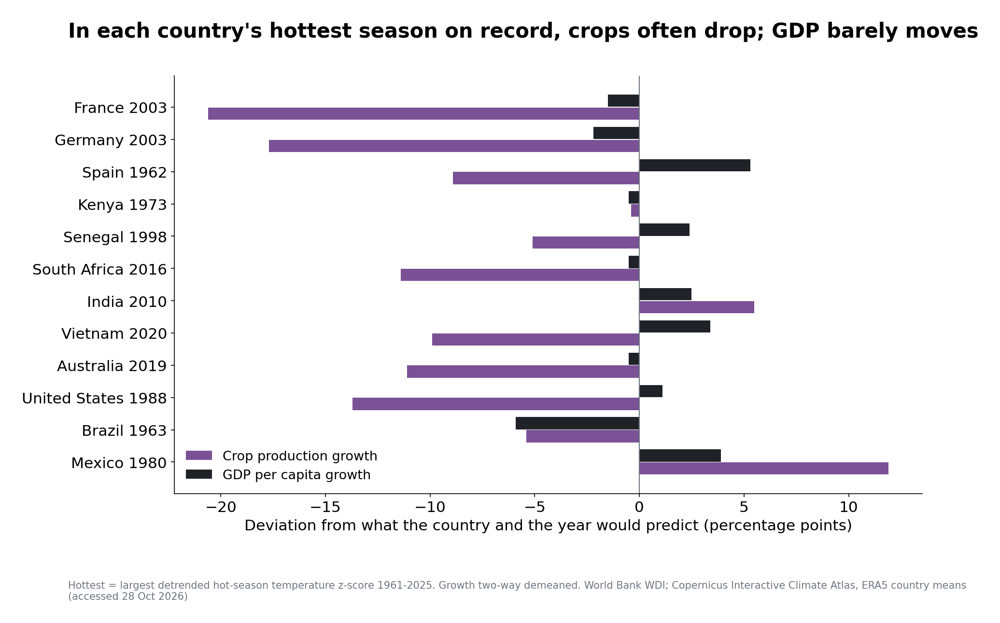
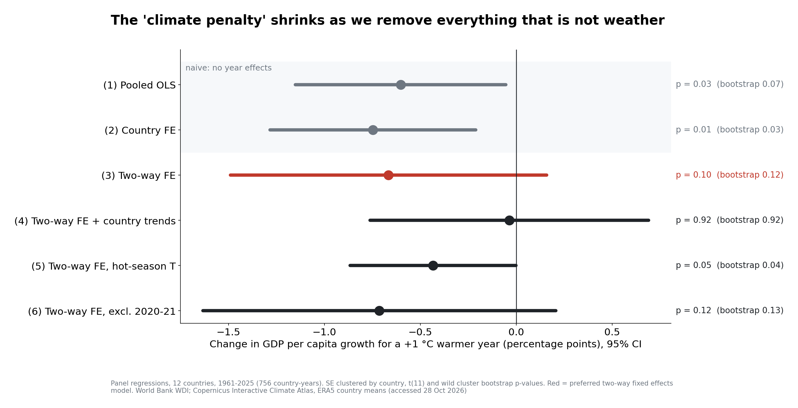
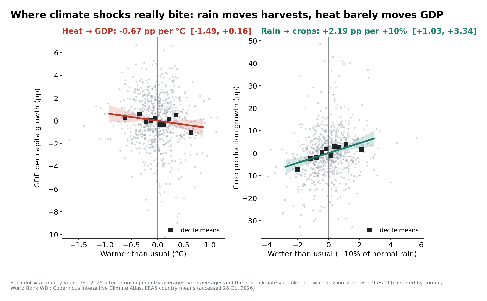

# Talk script: 10 minutes + 3 minutes Q&A (9 November 2026)

*Generated by `scripts/06_presentation.py` from the same text as the speaker notes in `Track1_presentation.pptx`; every number is read from `paper/tables/`. Edit the script there, not here, so slides, notes and paper never diverge.*

## The thread

Each slide answers the question the previous one raises:

1. **Question.** Is today's climate still the one people plan around? And does the economy notice when it is not?
2. **What is a country's climate?** A capital's grid point is not the country, so we rebuilt everything from Copernicus Atlas country averages. *Raises: how do we measure change?*
3. **Method.** Monthly anomalies against 1961-1990, then change compared with noise (σ). *Raises: what does it show?*
4. **Results.** Warming beyond normal variability almost everywhere; rainfall within the noise; summer leads only in France and Spain. *Raises: does it matter for the economy?*
5. **Economy.** The hottest summers hit crops, not GDP. Regressions confirm it: heat → GDP is small and imprecise; rain → crops is clear. *Raises: what kind of claim is that?*
6. **Claims.** Description, correlation or causation, and what would make the result causal.

**Length.** About 1148 spoken words, about 8 minutes at 140 words per minute. Rehearse with a timer.

**Roles.**
- Speaker 1 (climate): slides 1-7.
- Speaker 2 (economy): slides 8-12.
- The other three members: the Q&A (see `DEFENSE_NOTES.md`).

**Delivery.**
- One number per slide: say it, then point at it.
- Name the type of each result out loud (*description*, *correlation*).
- The handover at slide 8 is the sentence ending slide 7, not a pause.

---

### 1. Is today's climate still the one we planned for?  ·  Speaker 1  ·  0:00-0:35

> Every plan we make, a harvest, a dam, a heating system, assumes that a normal year looks like the normal years we remember. Our question is whether that is still true. We read 85 years of temperature and rainfall records for twelve countries, measured how far they have moved, compared that with ordinary year-to-year swings, and then asked whether the unusual years were also unusual for the economy.

### 2. Twelve countries, one answer  ·  Speaker 1  ·  0:35-1:15

> Three countries per continent, chosen to cover temperate Europe, the Mediterranean, the Sahel, East Africa, the monsoon and the Americas, and economies where agriculture is anywhere from one to twenty-three percent of GDP. The headline is already on this map: every one of them is warmer than in 1961 to 1990, from +0.7 degrees in Australia and India to +1.85 in Germany. The rest of the talk asks whether that is large, when in the year it happens, and whether it matters. But first, a question we had to answer before anything else: what is the climate of a country?

### 3. What does our data measure?  ·  Speaker 1  ·  1:15-2:15

> Our first version used a weather API and one grid point at each capital. When we rebuilt the data from the Copernicus Climate Atlas, which averages the ERA5 reanalysis over the whole country, temperature barely moved: the typical gap is 0.2 degrees. Rainfall did not survive: the typical gap is 9 percentage points, the United States goes from +32 percent at Washington to +4 for the country, and Kenya flips from +11 to -13. A warm year is warm over hundreds of kilometres; rain is local. So everything from now on is a country average. For France, Germany and Spain the Atlas has country masks; for the others we uploaded the borders into the Atlas's own user-defined region tool, and checked on France that both routes agree to four thousandths of a degree.

### 4. Method  ·  Speaker 1  ·  2:15-3:10

> Here is the whole method on one country. On the left, raw monthly temperature: the seasons are 92% of the variation, so a January cannot be compared with a July. For each calendar month we subtract its average over our baseline, 1961 to 1990. The Atlas gives absolute values, so the baseline is our choice: the WMO reference period, before most of the warming. On the right, the annual result, with two numbers. The change, the last ten years against the baseline: +1.74 degrees. And the noise, sigma, how far an ordinary year strays from the trend: 0.51. Their ratio, 3.4, tells us whether the change could pass for a normal year. Above two, it could not.

### 5. The full record  ·  Speaker 1  ·  3:10-3:50

> Now all twelve countries, every year since 1940. On the left, temperature: blue before the 1980s, red after, and every country-year since 2016 is above its normal. On the right, rainfall, built the same way: it flickers between wet and dry, with no colour trend. The 1940s are faded because the reanalysis rests on fewer observations then, which is why we measure change from 1961. The next slide puts numbers on this contrast.

### 6. Signal versus noise  ·  Speaker 1  ·  3:50-4:50

> Each dot is the change; the grey bands are one and two sigmas of ordinary variation. Temperature is outside two sigma in 11 of 12 countries. Mexico is the clearest case: +1.4 degrees is 5.2 sigma, because its temperature barely varies from year to year. Germany warmed more, but its winters are so variable that it is 2.9 sigma. Australia is the exception, at 1.7. Rainfall: zero of twelve. Kenya and Senegal do show significant drying trends, but the last decade is still within a normal range. And rainfall does not change where warming is largest: the rank correlation across countries is 0.06.

### 7. When in the year  ·  Speaker 1  ·  4:50-5:35

> Is the warming spread evenly across the year? Mostly, yes. Only in France and Spain is one season clearly ahead: there, summer warmed by about +2.3 degrees against +1.3 in autumn. Germany's winter warmed even more, +2.5, but German winters vary so much that we cannot call it faster. Summer-heavy warming matters because it lands exactly when crops need water and cities need cooling, which brings us to the economy.

### 8. The hottest summers  ·  Speaker 2  ·  5:35-6:35

> So, the last part of the question: were the unusual climate years unusual for the economy? One measurement point first. An annual mean dilutes a heatwave: France's 2003 is only 1.2 sigma as a year, but 3.4 sigma as a summer. So we use each country's hot season, its three warmest months. Here is every country's hottest one on record, and how growth compared with what the country and the year would predict. Purple is crops, black is GDP. France 2003: crops -21 points, GDP -1.5. In 9 of 12 cases crops fell by more than five points; GDP fell in only 6. These are anecdotes, but they form a pattern, so let us test it.

### 9. Testing it  ·  Speaker 2  ·  6:35-7:50

> We regress growth on the temperature and rainfall anomalies over all 756 country-years. The grey lines are the naive versions. Comparing each country only with itself, a warmer year costs 0.75 points, and it looks significant. But that is partly timing: the world warmed while growth slowed after the 1960s. Year effects remove that, because they compare countries within the same year and absorb oil shocks, 2009 and COVID. That is our preferred model, in red: -0.67 points per degree, with an interval from -1.5 to +0.16. With only twelve countries we check it with a wild bootstrap: p = 0.12. Add country trends and it falls to -0.04. In words: a typical warm year might cost about 0.25 points of growth, and we cannot tell that apart from zero.

### 10. Where shocks bite  ·  Speaker 2  ·  7:50-8:35

> So where do climate shocks bite? In harvests rather than GDP, and through water rather than heat. On the right, a year ten percent wetter than normal goes with crop growth 2.2 points higher, and that estimate is precise. In dry years crop growth is 7.6 points below normal, while GDP growth is only 0.27 below. The likely reason is exposure: in most of our countries agriculture is one to three percent of GDP. This is the IPCC chain from the course: a hazard becomes a loss only through exposure and vulnerability.

### 11. What we can and cannot conclude  ·  Speaker 2  ·  8:35-9:30

- Description (solid): every country has warmed; 11/12 beyond normal variability; rainfall change within the noise.
- Correlation: dry years go with lower harvests (clear); warm years with slightly lower GDP growth (not distinguishable from zero).
- Not causal, and not climate change: one unusual year allows no adaptation; 12 countries are too few; national averages hide local losses.
- To make it causal: many more units (all countries, regions), exposure-weighted weather, a channel fixed in advance.

> Let us be precise about what kind of claims these are. The climate results are descriptions, and they are solid. The economic results are correlations. Year-to-year weather is close to random, so our design is close to an experiment, but twelve countries give intervals too wide to claim a causal effect on GDP. And a hot year is not climate change: one unusual year allows no adaptation and no build-up of damage. To go further we would need many more units, weather weighted by where crops and people are, and a channel chosen before looking at the data.

### 12. Three takeaways  ·  Speaker 2  ·  9:30-10:00

- Warming is unmistakable: +0.7 to +1.85 °C since 1961-1990, far outside normal variability.
- Rainfall is local and noisy, and it depends on how you measure it.
- Climate shocks reach harvests long before they reach GDP.

> To close: the warming in these records is unmistakable. Rainfall is a different, local story, and one that depends on how carefully you measure it. And when the climate misbehaves, the first place it shows is the harvest, not GDP. Thank you; we are happy to take questions.

### 13. Backup: data and definitions  ·  Backup  ·  Q&A

- Climate: Copernicus Interactive Climate Atlas (C3S/ECMWF), ERA5, monthly 1940-2025, 288 series. FRA/DEU/ESP: Atlas country masks; 9 others: Atlas user-defined regions with Natural Earth borders (USA = 48 states). Validated on France to 0.004 °C.
- Anomaly = month minus its 1961-1990 calendar-month mean; precipitation = mm/day × days; Δ = mean 2016-2025; σ = SD of the detrended annual anomaly.
- Economy: World Bank WDI, release 8 Oct 2026: GDP per capita growth, crop production index, agriculture share.
- Regressions: two-way fixed effects, SE clustered by country, t(11) + wild cluster bootstrap (Webb weights, 9,999 draws).

> Use in Q&A only.

### 14. Backup: likely questions  ·  Backup  ·  Q&A

- Why not the API? One grid point is not a country, above all for rainfall.
- Why does the naive model give a big effect? Warming and the growth slowdown both trend over time.
- Is p ≈ 0.1 'no effect'? No: the interval also includes a loss of 1.5 pp per °C.
- Why the hot season? France 2003: 1.2σ as a year, 3.4σ as a summer.
- Why 1961-1990? WMO reference, before most of the warming, and the start of the WDI data.

> Use in Q&A only.
